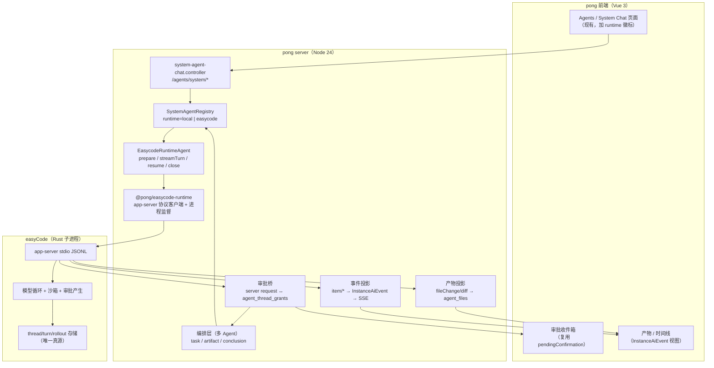

# ADR-001：easyCode 深度集成、多 Agent 协议与桌面交付

- 状态：Accepted（经四份调研 + 红队评审 + 作者第二轮反驳）
- 日期：2026-11-12
- 决策人：Lead（架构评审：easycode-analyst / studio-architect / protocol-designer / desktop-engineer / red-teamer）
- 输入：
  - `research/easycode-analysis.md`
  - `research/studio-integration-analysis.md`
  - `research/multi-agent-protocol-analysis.md`
  - `research/desktop-runtime-analysis.md`
  - `research/red-team-review.md`
  - 第二轮反驳记录（见 `research/round2-rebuttals.md`）

> 本文面向项目作者，使用中文。仓库内代码注释与提交信息仍按 `pong-studio/AGENTS.md` 的约定使用英文。

---

## 1. 背景与目标

### 1.1 背景

`pong-studio` 是 n8n 2.48 的本地化二开：pnpm monorepo、Node 后卫、Vue 3 前端、SQLite/Postgres、工作流引擎、MCP 客户端，且已内置 `@pong/agents` 与 `@pong/instance-ai` 两套 agent 基座。

`easyCode` 是 Codex 的改名 fork：Rust 单二进制（`easycode.exe`），提供 `app-server --listen stdio://` 交互协议，包含模型循环、沙箱、审批、thread/turn、MCP、skills、多 agent 原语（agent-message-board / agent-roles / agent-graph-store）。

### 1.2 目标

1. 把 easyCode 作为**编码型 agent 内核**深度接入 pong：单机、可审批、可中断、可恢复、可回放。
2. 提供多 Agent 协作能力，用**结构化语义 + 内容寻址产物**替代 agent 间自然语言互话。
3. 交付 Windows 桌面端：一键启动、无需注册登录、本地数据、不依赖云服务（模型 API 除外）。
4. **不硬编码提示词、不限制模型**：模型能力优先，宿主提供环境与工具，不提供"人格"和"套路"。

### 1.3 不变量（任何实现不得违反）

| # | 不变量 | 判据 |
|---|---|---|
| I1 | 内核提示词归 easyCode 所有；pong 只注入**事实**（项目约束、工具契约、产物 schema），不注入"人设/步骤模板/固定计划" | pong 侧无超过 200 行的静态 prompt 常量；所有注入有来源与哈希 |
| I2 | 模型可自由推理；协议只约束**交付物**，不约束思考过程 | 无 `"think step by step"` 类硬编码；schema 只作用于 conclusion/artifact |
| I3 | 唯一真源：agent 过程以 easyCode rollout 为准；pong 只做投影与编排 | 任何事件可回溯到 `threadId/turnId/itemId` |
| I4 | 审批的应答责任在宿主进程；宿主崩溃 = 该 turn 作废，不静默重放 | 审批超时/断连有明确终态 |
| I5 | 一切外部依赖（模型、二进制）版本锁定 + 可校验 | `runtime.lock.json` 含版本与 sha256 |
| I6 | 桌面端默认离线；只开模型 API 出站与 loopback 入站 | 网络面清单可审计 |
| I7 | 一次成型：M0 验证真实链路后才进入产品化，不做"先木屋再石屋" | M0 退出标准全部通过才允许 M1 |

### 1.4 非目标

- 不做多人协作/团队权限（单用户本地）。
- 不替代 n8n 原生 AI Agent 节点（workflow 内模型步骤保留）。
- 不在本期移除 `@pong/agents` 现有能力；easyCode 作为它的新 runtime。

---

## 2. 结论摘要

| 决策 | 结论 | 依据 |
|---|---|---|
| D1 easyCode 通道 | **只用 `app-server --listen stdio://`**；不用 `exec --json`，不用 TS SDK | exec 拒绝全部交互（`exec/src/lib.rs:2086-2204`）；TS SDK 只是 exec 包装 |
| D2 集成落点 | **复用 `/agents/system` 的 provider 接口**，新增 2 个文件，不新建 cli module / HTTP 面 / 前端 feature | `system-agent-chat.controller.ts:51`、`system-agent.types.ts:239`、`system-agent-execution.service.ts:1095`、`SystemAgentRegistry.register` |
| D3 宿主读循环 | 独立读线程/微任务，**永不 await 阻塞**；有界内存队列；审批超时 + interrupt 兜底 | stdio 写通道满时是**阻塞**而非断连（`transport/stdio.rs:53,61`），阻塞会 head-of-line 卡死审批 |
| D4 数据真源 | rollout JSONL 为真源；SQLite 是镜像；pong 以 `threadId` 做投影；默认共享 `EASYCODE_HOME`，强隔离时每 agent 一 home | `state/src/lib.rs:1-8`、WAL + busy retry（`sqlite/busy_retry.rs:23`）、维护锁（`reclamation.rs:124`） |
| D5 多 Agent 协议 | v0.1 **6 种语义消息** + 内容寻址 artifact + 单调 `log_seq`（写者回填）；不做双向版本协商与 13 种消息 | 红队 §2(b)：8/13 可映射现有 RPC/实体；作者接受 5 语义槽不可替代 |
| D6 桌面交付 | **C-first**：M1 交付浏览器 + 启动器 + `compiled/` 生产布局；M3 再上 Tauri 2 薄壳（复用同一 Rust 监督器） | 红队 §2(c)；作者有条件接受 |
| D7 发布二进制 | M0 出口必须拿到 easyCode fork 的 **release** 产物；拿不到则显式二选一：接受 dev-small（包 500–650 MB）或改走 C 方案 | 本机仅 dev-small 344.2 MB（`dist/.../README.txt`） |
| D8 提示词 | base prompt 留在内核；pong 注入 developerInstructions（来源=仓库事实/AGENTS.md/工具契约）+ 工具描述；**预算与来源可审计** | `protocol/src/prompts/base_instructions/default.md`、`core/src/session/mod.rs:801-836` |
| D9 清理 | 删除后端 license 残余与 `buildLicenseHints` 提示词污染 | 82 处生产 `feat:` gate（34 文件）；`instance-ai.adapter.service.ts:1059-1077` |

---

## 3. 系统上下文



### 3.1 进程与职责

| 进程 | 职责 | 生命周期 |
|---|---|---|
| 桌面壳（M3，Tauri 2） | 窗口、托盘、单实例、进程看护、更新；**零业务 IPC** | 用户会话 |
| pong server（Node 24 sidecar） | REST/SSE、持久化、审批归属、投影、编排 | 随壳启动；健康检查；崩溃重启 |
| easyCode app-server（每 thread 树一个） | 模型循环、工具执行、沙箱、审批产生 | 按需拉起；空闲回收看 thread 状态，不看事件活跃度 |
| 沙箱 helper | easyCode 侧命令/文件隔离 | 随 app-server |

### 3.2 关键数据流（一次 turn）

1. 前端 `POST /agents/system/.../messages` → pong 创建 `agent_turn`，选中 `runtime=easycode`。
2. pong 确保对应 app-server 进程存在 → `thread/start`（或 `thread/resume`）→ `turn/start`。
3. easyCode 流式发出 `item/*` 通知；pong 的**读线程只做入队**，另一消费者写 SQLite 投影并推 SSE。
4. 审批请求到达：pong 记录 pending（带超时计时器），映射到 `agent_thread_grants`/checkpoint，推前端；用户决策 → 同连接应答；超时 → `decline`。
5. `turn/completed` → 投影终态；`turn/failed` → 错误映射；`turnAborted` 延迟到达时按"已结束"处理。
6. 产物：`fileChange` → 保存 diff 摘要与 manifest；pong 侧 `agent_files` 引用 rollout 坐标。

---

## 4. 决策记录

### ADR-01：easyCode 只经 app-server stdio 接入

- 决策：pong 以子进程方式启动 `easycode app-server --listen stdio://`，使用其自定义 JSON-RPC（非 JSON-RPC 2.0）信封。
- 备选：
  - `easycode exec --json`：拒绝审批/用户输入/dynamic tool/MCP elicitation（`exec/src/lib.rs:2086-2204`）→ 否决。
  - TS SDK：只是 exec 的 spawn 包装（`sdk/typescript/src/exec.ts:94-206`）→ 否决。
  - 直接 import Rust crate：与 Node 宿主不兼容、升级耦合 → 否决。
- 后果：需要自研约 1.5k–3k 行 TS 协议客户端（含 748 个生成类型中的白名单子集），维护成本真实存在；用版本锁 + CI schema diff 控制。

### ADR-02：宿主读循环契约（红队 A1/A2/A3 修正后）

- 事实修正：stdio 出站队列满时走 `send().await` **阻塞**（`app-server-transport/src/transport/stdio.rs:53,61`；`app-server/src/lib.rs:981` 唯一出站路由），不是断连丢弃。断连只发生在 ws/remote-control。
- 决策：
  1. pong 读循环**不做任何 await 阻塞**：解析 → 入有界内存队列 → 立即继续读；写库/SSE 由独立消费者完成。
  2. 审批请求记录 `(threadId, turnId, itemId, approvalId)`；默认 120s 超时，超时应答 `decline` 并记审计；无配置可调，故契约在宿主侧实现。
  3. `turn/interrupt` 返回 `invalid_request("no active turn")` 时视为**已结束**，不触发进程重建。
  4. 审批应答责任在宿主进程：前端断线仅影响展示；宿主重启 → 该 turn 标记作废，需用户重新发起。
  5. 关窗顺序：`turn/interrupt`（或 shutdown）→ 等终态 → 关 stdin → 5s → 杀进程树。
- 备选：改用 easyCode 的 ws/daemon 传输（有断连语义）→ 推迟到 M0 对照实验，不进入关键路径。

### ADR-03：集成落点复用 `/agents/system`，不新增模块/HTTP/前端

- 决策：新增 `system-agents/easycode/easycode-agent.provider.ts` 与 `easycode-runtime-agent.ts`，实现现有 `RuntimeAgent` 接口（`system-agent.types.ts:125,239`），在 `SystemAgentRegistry.register` 注册；协议客户端独立为 `packages/@pong/easycode-runtime`。
- 理由：
  - `system-agent-chat.controller.ts:51` 已提供 chat/resume/threads/queue 路由。
  - `system-agent-execution.service.ts:1095` 已有 `execute({agentInstance, prepare})` 边界，`streamTurn` 天然适配。
  - `agent_thread`/`agent_message`/`agent_execution`/`agent_plan`/`agent_checkpoints`/`agent_thread_grants`/`agent_file_grants` 已存在（`agents.module.ts:264-358`），无需新表，只加 `runtime_kind`。
- 否决：新 cli module + 新 HTTP 面 + 新前端 feature → 第 5 套会话模型，双维护。

### ADR-04：数据真源与并发

- 决策：rollout JSONL 是 agent 过程真源；easyCode SQLite 为镜像；pong 只存投影与编排实体（task/artifact/conclusion/审批记录）。
- 并发：默认所有 agent 共享 `EASYCODE_HOME`（WAL + busy retry + 迁移容忍并行，`sqlite/busy_retry.rs:23`、`migrations.rs:14-19`）；当需要严格隔离或跨版本实验时，每 agent 独立 home（配置项，默认关）。
- 恢复：`thread/resume` 前做 workspace 一致性检查（`git status`/`git diff`），UI 标注"可能半改"；默认不自动重放有副作用 turn。

### ADR-05：多 Agent 协议 v0.1（最小语义）

- 决策：只保留 6 种 kind，其余用现有 RPC/实体表达：
  1. `task_assigned`
  2. `artifact_published`
  3. `conclusion_proposed`
  4. `conclusion_challenged`
  5. `approval_requested`
  6. `approval_decided`
- Envelope 必填：`protocol`（`pong.agent/0.x`）、`kind`、`id`（ULID）、`sent_at`、`from`、`to`、`task_id`、`idempotency_key`、`payload`；可选：`parent_id`、`log_seq`（仅黑板写者回填）、`notes`。
- Artifact：`artifact://sha256/<64hex>` + `{ media_type, bytes, summary ≤400 字, parents[] }`；禁止内联大上下文。
- 用户输入合并进审批：`approval_requested.request_kind="input"`，回答走 `approval_decided.answer`（≤2KB）或 `answer_artifact`。
- 状态机：`awaiting_approval | awaiting_input` 合并为 `awaiting_decision`。
- 编排：pong 编排层拥有黑板（append-only，单调 `log_seq`）；点对点消息为优化，必须回写黑板对账；仲裁只处理不可自动判定的冲突，且必须写 `basis[]`。
- 不做的（防过度设计）：协议版本协商（放 pong 层）、lease、进度消息（映射 `turn/*`）、ack/重试消息（DB 幂等）、hello（启动自检）。

### ADR-06：能力优先的提示词策略

- 决策：
  1. base/developer 提示词不整体替换；pong 只注入 `developerInstructions`，内容=**仓库事实**（AGENTS.md、项目结构、命令）、**工具契约**（dynamicTools 的 schema 与副作用说明）、**交付物 schema**。
  2. 不写"你是一个…"人设、不写固定步骤、不写"必须/禁止"清单式套路；约束放在工具与验收器里，而不是 prompt 里。
  3. 每次注入记录来源、哈希、token 预算（上限可配，默认 8k）；可回放。
  4. 模型能力优先：工具即能力（workspace、tests、git、MCP、pong 域工具）；验收即约束（可执行命令 > 语言规则）。
- 反例判定：任何新增 >200 行静态 prompt 常量、任何"先思考再…"模板、任何把业务规则翻译成 prompt 的实现，评审直接拒绝。

### ADR-07：桌面交付 C-first → Tauri 2

- 决策：
  - M1 交付 C 方案：浏览器打开本地 `http://127.0.0.1:<port>` + 小启动器（单实例、托盘/快捷方式、进程监督）+ 复用 `scripts/build-pong.mjs` 的 `compiled/` 生产布局。
  - M3 交付 Tauri 2 薄壳：只做窗口/看护/更新，页面仍加载同一 URL；**复用 M1 的 Rust 监督器模块**（Job Object、shutdown 顺序），避免返工。
- 否决：Electron（体积、Node 复用伪收益）；纯原生启动器直接上（无应用身份、审批阻塞问题——但 M1 用浏览器已证明审批是页面内交互）。
- 门禁：M0 出口必须确认 easyCode release 产物或显式选择 dev-small；未签名大二进制分发的杀软风险列入 M3 风险。

### ADR-08：版本锁定与适配层演进

- 决策：`runtime.lock.json` 锁定 easyCode 版本、`easycode.exe` sha256、pong 协议客户端版本；CI 对 `generate-ts`/`generate-json-schema` 产物做 diff，变更必须显式更新锁与契约测试。
- 契约测试（8 个最小集）：initialize/initialized、thread/start、turn/start、审批 request/response、dynamic tool call、turn/interrupt、turnAborted、thread/resume。
- 备选：跟随 upstream master → 否决；上游有大量未合并的 Codex 变更，行为会漂移。

### ADR-09：清理 license 残余与提示词污染

- 决策：M1 前完成：
  1. 删除 `packages/cli/src/license/`（controller/service/renewal task）、`license-metrics`、相关错误类，以及 82 处生产 `feat:` gate（保留测试中的引用直到测试迁移完成）。
  2. 删除 `buildLicenseHints` 及其注入路径（`instance-ai.adapter.service.ts:1059-1077`），避免"Pro plan"语义污染模型上下文。
  3. 移除前端 `license`/`hideUsagePage` 字段与 `enterprise` 中与套餐相关的键（保留功能 flag 若仍有代码引用，需逐个迁移）。
- 理由：离线首启已证明不依赖 license，但提示词污染会改变模型行为，违背 I1/I2。

---

## 5. easyCode 集成契约（实现依据）

### 5.1 启动与握手

```
spawn easycode app-server --listen stdio://   （cwd = 工作区根）
→ initialize { clientInfo, capabilities: { experimentalApi: true } }
→ 服务端返回 { userAgent, easycodeHome, platformFamily, platformOs }
→ notify "initialized"
→ thread/start { cwd, model, approvalPolicy: "on-request" | "user", sandbox,
                 baseInstructions?, developerInstructions?, dynamicTools[], outputSchema? }
```

- 审批策略默认 `user`（不走内核 auto-review，红队 A4）。
- `sandbox` 单用户桌面默认 `workspace-write` + 用户审批；`danger-full-access` 仅显式开启。
- `dynamicTools` 记录 `toolset_hash`；resume 时 hash 不匹配 → fork 新 thread（红队 A6）。

### 5.2 事件与审批

| easyCode 事件 | pong 处理 |
|---|---|
| `turn/started`、`item/*`、`item/agentMessage/delta` 等 | 入队 → 投影 `InstanceAiEvent` → SSE |
| `item/commandExecution/requestApproval` / `fileChange/requestApproval` / `permissions/requestApproval` | 建 pending（120s 超时）→ UI 审批卡 → 同连接应答 |
| `item/tool/requestUserInput` | 归并为 `approval_requested.request_kind="input"` |
| `item/tool/call` | pong 执行 dynamic tool；副作用走 `AgentToolApprovalService` + `agent_thread_grants`；审计独立于 easyCode 审批 |
| `turn/completed` / `turn/failed` | 终态投影 + 用量记录 |
| `turn/interrupt` 响应 `invalid_request("no active turn")` | 视为已结束，不重建进程 |
| `turnAborted`（可延迟） | 覆盖为最终态；延迟窗口内不再判定卡死 |

### 5.3 取消 / 恢复 / 退出

- 取消：`turn/interrupt` → 等 `turnAborted` 或 5s → 仍无则重建进程（仅当有 active turn）。
- 恢复：`thread/resume` 前 workspace 检查；不自动重放有副作用 turn。
- 退出：`turn/interrupt` → 等终态 ≤5s → 关 stdin → 5s → 杀进程树（Job Object，KILL_ON_JOB_CLOSE）。
### 5.4 M0 真机实测后的契约修正（2026-11-12）

`docs/poc/m0-results.md` 记录的真实链路（1,398 事件、5 次审批、dynamic tool、30 turns/30 min、0 失败）修正了两条假设：

1. **重复 `turn/interrupt` 无响应**：对已结束 turn 再次发送 interrupt，服务端在 30 s（专项测试 90 s）内**静默无响应**，不是 `invalid_request("no active turn")`。宿主必须自设 5 s 超时并视为已结束，禁止据此重建进程。
2. **`thread/resume` 前置条件**：thread 必须已有落盘 rollout；新 thread 直接 resume 返回 `no rollout found`。宿主在 resume 前检查 rollout 存在性，否则 fork 新 thread。

上述两条已在 `@pong/easycode-runtime` supervisor 中实现兜底并有单测覆盖。

---

## 6. 多 Agent 协议 v0.1（冻结结构）

```json
{
  "protocol": "pong.agent/0.1",
  "kind": "task_assigned | artifact_published | conclusion_proposed | conclusion_challenged | approval_requested | approval_decided",
  "id": "01J...ULID",
  "sent_at": "2026-11-12T15:00:00Z",
  "from": { "agent_id": "...", "role": "planner|coder|reviewer|arbiter" },
  "to": { "agent_id": "..." },
  "task_id": "01J...ULID",
  "idempotency_key": "sha256:...",
  "parent_id": "01J...ULID?",
  "log_seq": 42,
  "payload": { "...kind-specific...": null },
  "notes": "≤400 字可读摘要（可选逃生舱）"
}
```

- Artifact 引用：`artifact://sha256/<64hex>`；`artifact_published.payload = { uri, media_type, bytes, summary, parents[] }`。
- `conclusion_proposed`：`{ claim, evidence[], artifacts[], confidence, falsifiers[] }`。
- `conclusion_challenged`：`{ target_id, reason, counter_evidence[], requested_action }`。
- 仲裁（M2）：`arbiter` 只读黑板与验证器结果，写 `verdict`（并入 `conclusion_proposed` 的 `resolved_by`），不新增 kind。
- 存储：pong `agent_task`、`agent_message`、`agent_artifact_manifest`、`agent_conclusion`；黑板 append-only，`log_seq` 单调。

---

## 7. 风险登记册

| # | 风险 | 级别 | 缓解 | 验收 |
|---|---|---|---|---|
| R1 | stdio 出站阻塞导致审批卡死 | blocker | ADR-02 读循环契约 + 120s 审批超时 + interrupt 兜底 | 故障注入测试：读循环暂停 30s，审批仍可回复 |
| R2 | easyCode release 产物不存在 | blocker | M0 门禁；显式 dev-small 或 C 方案 | M0 出口记录 |
| R3 | interrupt 竞态误判 | blocker | `invalid_request` 视为已结束；重建仅限 active turn | 竞态测试 |
| R4 | 数据真源冲突 / 多进程 SQLite | major | rollout 真源 + pong 投影；共享 home 可配置 | 4 并发 agent 压测无迁移/锁失败 |
| R5 | 协议过度设计 | major | 6 kind 最小集；A/B 验证后再扩 | token/时延 A/B 报告 |
| R6 | dynamic tool 审批与 easyCode 审批分裂 | major | 分开呈现、统一审计；工具副作用走 pong 审批 | 审计记录可关联 turnId |
| R7 | 进程治理（Job Object、端口、孤儿） | major | Rust 监督器单实现；shutdown 顺序写死 | Windows 专项测试 |
| R8 | 未签名大二进制分发 | major | M3 前评估；签名/白名单/文档 | 发布检查表 |
| R9 | 版本耦合（无协议协商） | major | runtime.lock + schema diff + 8 契约测试 | CI 门禁 |
| R10 | 提示词污染（license hints 等） | major | ADR-09 清理 + 注入审计 | prompt 来源/哈希可查 |
| R11 | 首启慢（DB 迁移 + 节点加载） | minor | 预热 + 启动页 + 后台建索引 | 首启 ≤60s（冷） |

---

## 8. 被否决的方案

| 方案 | 否决理由 |
|---|---|
| `easycode exec --json` 作为主通道 | 拒绝全部交互能力（审批、user input、dynamic tool） |
| TS SDK 直接嵌入 | 只是 exec 包装，无审批/工具回调 |
| 走 pong sandbox provider | 抽象只含 FS/命令，丢失 steer/resume/审批；双重沙箱 |
| 新 cli module + 新 HTTP 面 + 新前端 feature | 与现有 `/agents/system` 重叠，产生第 5 套会话模型 |
| 13 种消息 + 双向版本协商 + 双层黑板 | 大部分映射现有 RPC/实体；过度设计，拖慢真实风险处理 |
| Electron 桌面壳 | 体积 +150–200 MB，Node 复用伪收益，Job Object 需原生 addon |
| M2 前上 Tauri | 关键路径未验证；C-first 一周可交付 |
| 整体替换 easyCode base prompt | 破坏工具/沙箱/审批的提示词契约，高概率降低模型表现 |

---

## 9. 与开发计划的映射

| 里程碑 | 本文对应决策 | 出口标准 |
|---|---|---|
| M0 真机验证 | ADR-01/02/07/08 | 真实 turn + 审批 + dynamic tool + interrupt + resume + 30min 会话；release 产物或显式 dev-small；A/B 协议基线 |
| M1 单 agent 产品化 | ADR-03/04/05/06/09 | 现有 `/agents/system` 上可切换 runtime=easycode；审批/产物/时间线可用；license 清理完成 |
| M2 多 agent | ADR-05/06 | 6 kind 协议 + verifier + 黑板 + 回放；token/成功率对比达标 |
| M3 桌面壳 | ADR-07 | Tauri 薄壳 + 监督器复用 + 安装包 + 首启引导 |
| M4 硬化交付 | 全部 | Windows 专项、崩溃恢复、毕业答辩演示脚本 |

详细工作分解见 `docs/plan/development-plan.md`。

---

## 10. M0 结论（2026-11-13）

| 检查项 | 结果 | 证据 |
|---|---|---|
| 真实 turn（读/改文件 + 5 次命令审批） | PASS | `docs/poc/m0-results.md`：19.7 s，审批往返 host 0–1 ms / 服务端 0–8 ms |
| dynamic tool 回调 | PASS | `pong_echo` 真实 `item/tool/call`，host 往返 0 ms |
| interrupt / resume / 30 min 长会话 | PASS | interrupt 618–782 ms；30 turns / 0 失败；WorkingSet 160.9–169.7 MB 无单调增长 |
| 故障注入 5 场景 | PASS 5/5 | `docs/poc/m0-fault-injection.md`：读循环阻塞 30 s 后审批 +1 ms 恢复；120 s 超时 decline；重复 interrupt 5 s 兜底；resume 无 rollout 错误可读；4 进程 10 min 244/244 turns |
| C-first 启动器 | PASS | 真实 pong：liveness 4.5 s → readiness 9.9 s → control +58 ms；202→退出 249 ms；WAL=0；残留 0 |
| 控制端点 | PASS | 202/401/403 语义正确；WAL checkpoint 修复（修复前 160 KB 且增长） |
| 冷启动 | 有条件 PASS | 模块加载 ~3.5 s + 静态资源 ~1.6 s；干净机首次可能 >120 s（杀软扫描），M1 必须安装预热 |

### 10.1 M0 发现的两个必修项（已开任务）

- **F2（blocker，task-13）**：`workspaceWrite.networkAccess` 类型与真实二进制不符（string vs boolean），导致 A/B 首轮 6/6 失败。M1 前修复 + 锁 schema。
- **F1（major，task-13）**：共享 `EASYCODE_HOME` 并发首次初始化间歇失败（0/4、1/4、2/4），服务端不重试。supervisor 需退避重启 + 共享 home 首次初始化串行化（或 per-agent home）。

### 10.2 多 Agent 协议决策

A/B 首轮样本不足（A n=2、B n=1，方差主导，且沙箱不限制读导致 A 臂可访问 producer workspace）。**在 task-14（隔离 + 固定 artifact + ≥3 runs/arm）给出数据前，不冻结多 Agent 协议实现**。M1 可先做单 agent 产品化。