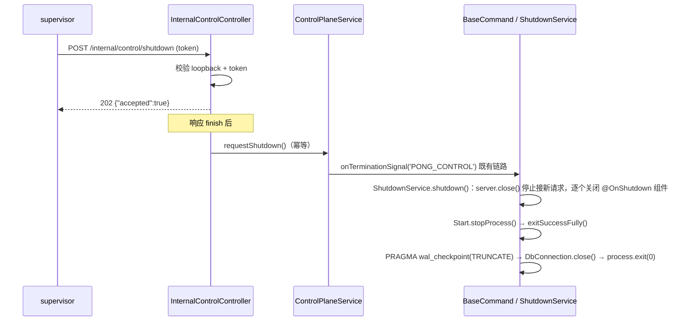

# pong loopback 控制面（control-plane）

- 状态：已实现并实测（2026-11-13，本机 Windows x64）
- 实现位置：`packages/cli/src/controllers/internal-control.controller.ts`、`packages/cli/src/services/control-plane.service.ts`
- 相关改动：`packages/cli/src/server.ts`（控制器 import）、`packages/cli/src/commands/start.ts`（注册优雅退出）、`packages/cli/src/commands/base-command.ts`（退出前显式 WAL checkpoint）
- 测试：`packages/cli/src/controllers/__tests__/internal-control.controller.test.ts`

## 1. 目标与边界

桌面监督器（`packages/desktop-shell/supervisor`）实测出两个问题：

1. pong 没有关闭控制端点，关闭只能 `taskkill /T /F`；
2. SPA catch-all 对未知 POST 返回 `200 + index.html`，状态码不能作为"已接受关闭"的判据。

本控制面只解决"本机监督器如何让 pong 优雅退出"这一件事：

- 只监听 pong 自己的编辑端口，只接受 **loopback 来源**；
- 用每次启动生成的一次性 token 认证；
- 退出复用 `pong start` 既有的 SIGTERM/优雅退出链路（`BaseCommand.onTerminationSignal` → `ShutdownService` → `Start.stopProcess` → `exitSuccessFully`），不新增第二套退出逻辑；
- 不是远程管理 API，不承载业务 IPC，不改变编辑器/公开 API 的认证。

## 2. 端点

| 方法 | 路径 | 认证 | 成功响应 |
|---|---|---|---|
| `GET` | `/internal/control/health` | 见 §3 | `200` `{"status":"ok"\|"shutting-down","pid":<number>,"uptimeMs":<number>}` |
| `POST` | `/internal/control/shutdown` | 见 §3 | `202` `{"accepted":true}`，随后异步触发优雅退出 |

- 认证头：`x-pong-control-token`。
- `POST /shutdown` 幂等：进程生命周期内最多触发一次退出；并发/重复请求仍各自返回 `202 {"accepted":true}`。
- 响应先写出，退出在响应 `finish` 之后才开始（见 §5），调用方拿到 202 时退出尚未完成。
- `health` 的 `pid` 为 pong 主进程 pid，`uptimeMs` 为 `process.uptime()` 毫秒取整。

## 3. 启用、端口与 token

- **端口**：与编辑器共用。即 `PONG_PORT` / `PONG_LISTEN_ADDRESS`（桌面监督器会探测空闲端口并强制 `127.0.0.1`），不新开端口。
- **token**：环境变量 `PONG_CONTROL_TOKEN`，启动时由 `ControlPlaneService` 构造时读取一次。
  - 未设置或为空字符串：两个端点一律 `404`，等同于"路由不存在"（不暴露控制面）。
  - 建议监督器每次启动生成 ≥16 字节随机值，只通过环境变量传递，不写入磁盘、不写日志。
- **来源限制**：按 `req.socket.remoteAddress` 判断（`127.0.0.0/8`、`::1`、`::ffff:127.x.x.x`），不使用可能被 `X-Forwarded-For` 伪造的 `req.ip`。
- **比较方式**：`timingSafeEqual`（长度不等直接拒绝）。

## 4. 路由注册顺序与可用时间窗

- 控制器以 `@RootLevelController('/internal/control')` 注册，`server.ts` 顶层 `import`，由 `ControllerRegistry.activate(app)` 在 `Server.configure()` 内挂载。
- 挂载点位于历史 API / SPA catch-all（`server.ts` 的 `historyApiHandler` 与 `express.static`）**之前**，catch-all 本身未改动。
- 实测（预热后）：`GET /healthz` 在 3.7–4.0 s 返回 200，但控制路由随 `configure()` 在 `/healthz/readiness` 变 200 时（7.5–8.2 s）才可用。此窗口内的请求会被既有 DB 门禁中间件答复 `pong is starting up. Please wait`，或落到 Express 默认 404。
- 因此监督器在调用控制端点前必须等待 **`/healthz/readiness` 返回 200**，或对控制请求做短重试（见 §7）。
- catch-all 行为保持原样（实测）：未知 `GET` 路径 → `200` + `index.html`；未知 `POST` 路径 → Express 默认 `404`。控制路由因注册更早，始终先命中。

## 5. 优雅退出时序



- 退出复用现有 SIGTERM 链路，包含 `gracefulShutdownTimeout` 强制退出定时器，因此控制端点不会让进程永久挂死。
- **WAL checkpoint**：原 `exitSuccessFully()` 只 `await dbConnection.close()`。实测在该 sqlite-pooled 驱动上，优雅退出后 `database.sqlite-wal` 不消失，且跨多次干净启动持续增长（160 KB → 214 KB → 267 KB → 321 KB）。本次在 `exitSuccessFully()` 中、`dbConnection.close()` 之前显式执行 `PRAGMA wal_checkpoint(TRUNCATE)`（仅 `DB_TYPE=sqlite` 且连接已建立时；失败仅告警）。实测同一场景：退出前 WAL 374,952 B → 退出后 **0 B**。
- 实测耗时（预热、本机 loopback，`pong-desktop` 环境变量契约）：

| 指标 | 实测值 |
|---|---|
| 202 响应（localhost，含触发前） | 2 ms |
| 202 → 进程退出 | 96–191 ms（多次运行） |
| 退出码 | `0` |
| 退出前 WAL 大小 | 374,952 B |
| 退出后 WAL 大小 | 0 B |

## 6. 失败语义

| 场景 | 响应/行为 |
|---|---|
| `PONG_CONTROL_TOKEN` 未设置/为空 | `404`，空响应体（两个端点都不存在） |
| 来源不是 loopback | `403` `{"code":403,"message":"Forbidden"}` |
| 缺少或错误 `x-pong-control-token` | `401` `{"code":401,"message":"Unauthorized"}` |
| token 正确，`GET /health` | `200`，JSON 见 §2 |
| token 正确，`POST /shutdown` | `202` `{"accepted":true}`，随后退出 |
| 并发/重复 `POST /shutdown` | 全部 `202`；只执行一次退出 |
| 退出已开始后再收到 health | 可达时返回 `"shutting-down"`；端口关闭后连接被拒 |
| 退出处理器抛错 | 记 error 日志；由既有强制退出定时器兜底（监督器仍保留 kill 兜底） |
| 调用方在 202 后断开 | 不影响退出流程 |

> 判据：监督器必须同时校验 `202` **和** JSON body `{"accepted":true}`；只信状态码不成立（历史原因：SPA catch-all 曾对未知 POST 返回 200+HTML）。

## 7. 与桌面监督器的对接约定

1. 启动前生成一次性 `PONG_CONTROL_TOKEN`，通过子进程环境变量传入（不写命令行，不落盘）。
2. 用 `GET /healthz` 判定"端口已监听"（可用于打开浏览器）；**调用控制端点前**再等 `GET /healthz/readiness` 变 `200`，或对控制请求做 250 ms 间隔、总计 ≤10 s 的重试（冷启动会拉长该窗口）。
3. 关闭顺序：`POST /internal/control/shutdown`（头 `x-pong-control-token`，超时 2 s；要求 `202` 且 body `accepted:true`）→ 等待进程退出（建议 5 s，与原 grace 一致）→ 未退出则沿用现有兜底：关闭 stdin → 等待 → `taskkill /T /F`。
4. Windows 上 `process.kill(pid, 'SIGTERM')` 等价于强制终止（实测退出码 1、无优雅清理），因此控制端点是 Windows 下唯一的优雅退出入口；不要用 SIGTERM 作为优雅路径。
5. 不把 token 打进 supervisor 日志；控制请求失败只记录状态码。

## 8. 安全说明

- 路由隐藏：token 未配置时返回 404，不泄露端点存在。
- 来源校验在 token 校验之前，远程调用者拿不到 token 正确与否的信息。
- 常量时间比较；token 不落日志、不回显。
- 仅 loopback：即使编辑端口被转发到外网，控制请求也会因源地址不是 loopback 被 `403`。

## 9. 验证

单测/集成（supertest + 真实 `ControllerRegistry`，shutdown 处理器用 mock 计数）：

```
pnpm --filter pong exec vitest run src/controllers/__tests__/internal-control.controller.test.ts --maxWorkers=1
# Test Files  1 passed (1)
#      Tests  9 passed (9)
```

覆盖：token 未配置 → 404；缺/错 token → 401；非 loopback → 403；正确 token health → 200；shutdown → 202 且处理器恰好调用一次；并发 5 次 shutdown → 全 202、处理器只调用一次；控制路由先于 catch-all、未知 POST 行为不变。

真实进程实测（`node <node24> packages/cli/bin/pong start`，随机 loopback 端口，等待 readiness 后发请求；本机同时有其它任务在跑）：

```
healthz_200_ms=3962
before_readiness_control_health status=404 type=text/html body="<!DOCTYPE html>..."
readiness_200_ms=13054
wal_while_running=53592
unknown_route status=200 type=text/html body="<!DOCTYPE html>..."
unknown_post status=404 type=text/html body="<!DOCTYPE html>..."
health_no_token status=401 type=application/json body={"code":401,"message":"Unauthorized"}
health_wrong_token status=401 type=application/json body={"code":401,"message":"Unauthorized"}
health_good_token status=200 type=application/json body={"status":"ok","pid":30668,"uptimeMs":13121}
shutdown status=202 type=application/json body={"accepted":true} ack_ms=3
exit_code=0 exit_ms=104 wal_after_exit=0
```

补充说明：`readiness` 受机器负载影响明显（空载 7.5–8.2 s，有并发任务时实测到 13 s），`/healthz` 则稳定在 3.7–4.0 s。添加 checkpoint 之前的同场景实测：`exit_ms=191 wal_after_exit=160712`（WAL 未清），之后为 `exit_ms=102–104 wal_after_exit=0`。

## 10. 已知限制

1. 控制路由随 `configure()` 一起挂载，冷启动期间（`/healthz` 已 200、`/healthz/readiness` 未 200）不可用；若 M3 需要"启动中取消"，需把该控制器的激活提前到 `AbstractServer.init()` 之后（需要给 `ControllerRegistry.activate` 增加按控制器筛选的能力）。
2. 只有 `pong start` 会创建 Server 并挂载控制面；`worker`/`webhook` 命令不提供。
3. 无速率限制：loopback + token 即安全边界。
4. token 在进程内只读取一次；修改环境变量需要重启 pong 生效。
5. 多实例场景未处理：同一数据目录并行启动仍会竞争（属既有问题，见 supervisor L4）。
