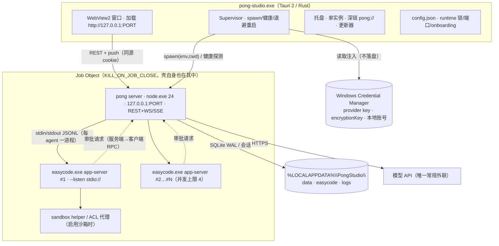
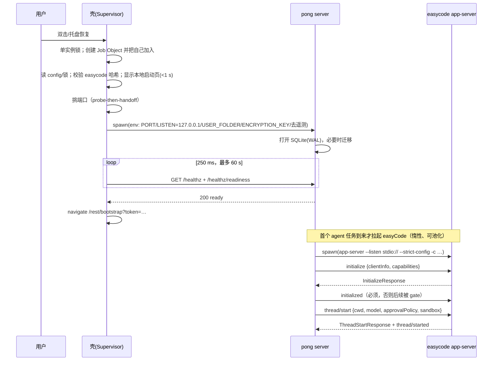
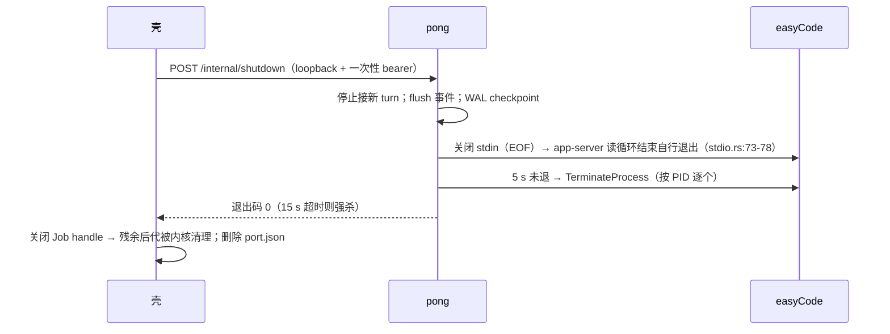

# 桌面端运行时与打包架构设计（pong-studio + easyCode）
> 状态：调研/设计稿（未提交实现）。范围：Windows 10 2004+ / Windows 11 x64，单用户本地安装。
> 引用约定：`pong-studio/` = `C:\Users\NJHTR\IdeaProjects\seekwd\pong-studio`；
> `easyCode/` = `C:\Users\NJHTR\IdeaProjects\easyCode`（Rust 工作区 `easycode-rs/`）。
> 本文只做设计与选型，不改代码。文中"实测"为本机文件系统测量，"估算"必须先验证。
> 关联：`docs/architecture/research/easycode-analysis.md`（协议/沙箱/提示词的代码级分析）。

## 0. 结论摘要
1. **壳选 Tauri 2**：壳只做四件事——开窗、拉起并看护 `pong server`、托盘/单实例/深链、签名自动更新。
   **壳不承载业务 IPC**：页面直接加载 `http://127.0.0.1:<port>`，前端零改造复用现有 Vite+Vue 产物。
2. **pong 与 easyCode 都是独立子进程**：pong 用随包 Node 24 跑（`engines: >=24` 与 `sqlite3` 原生 ABI
   决定不能借用 Electron 的 Node）；easyCode 每个并发 agent 一个 `easycode.exe app-server --listen stdio://`。
3. **进程治理放 Rust 壳**：壳启动即把自己加入 `KILL_ON_JOB_CLOSE` 的 Job Object，后代自动继承；
   壳被任务管理器强杀也不留僵尸——这是 Windows 上唯一可靠的兜底。
4. **通信全复用现有协议**：前端 ↔ pong 走 REST + push（默认 WebSocket，可切 SSE）；pong ↔ easyCode 走
   **行分隔 JSON（JSONL）**——它不是标准 JSON-RPC 2.0，不发也不收 `"jsonrpc":"2.0"`。
5. **两个最大风险**：① easyCode 的 Windows 原生路径不成熟（上游只承诺 WSL2；本机 portable 是
   `dev-small` 构建，`easycode.exe` 单文件 344 MB）；② 子进程治理（Job Object/端口/优雅退出）是整套
   架构唯一的硬骨头，做错就是僵尸进程 + 端口占用 + SQLite 损坏。
6. 落点 `packages/desktop-shell/`（不是 `apps/desktop`，见 §7.1）；easyCode 版本用 `runtime.lock.json`
   + SHA-256 pin 死，禁止独立自更新。

## 1. 事实基线（先量后设计）
### 1.1 体积实测（本机，2026-11）
| 组件 | 路径 | 实测 | 说明 |
| --- | --- | --- | --- |
| Node 24 便携版（完整解压） | `seekwd/.tools/node24` | **102.4 MB** | 含 npm/corepack；安装包只需 `node.exe` |
| Node 24 官方 zip | `seekwd/.tools/node-v24.22.2-win-x64.zip` | **36 MB** | x64 压缩下界参考 |
| pong CLI 编译产物 | `pong-studio/packages/cli/dist` | **32.1 MB** | 仅 JS，不含依赖 |
| editor-ui 构建产物 | `pong-studio/packages/frontend/editor-ui/dist` | **62.9 MB** | Vite 产物 |
| 开发态 node_modules | `pong-studio/node_modules` | **2.6 GB** | 禁止进安装包，必须走 prod 裁剪 |
| easyCode portable（整体） | `easyCode/dist/easyCode-windows-x64-portable` | **520.2 MB** | `dev-small` 构建，非 release |
| `easycode.exe` | 同上 `bin/` | **344.2 MB** | 体积主因；release+strip 预计 60–140 MB（估算） |
| `easycode-code-mode-host.exe` | 同上 `bin/` | **102.7 MB** | code mode 的 V8 host；不用则裁 |
| `easycode-windows-sandbox-setup.exe` | 同上 `easycode-resources/` | **36.3 MB** | 沙箱 provisioning；用沙箱才带，可能提权 |
| `easycode-command-runner.exe` / `computer-use` / `rg.exe` | 同上 | **37.2 MB** | 命令执行 23.1（必带）+ 桌面自动化 9.7（默认不带）+ 搜索 4.4（必带） |

安装包预算（估算，须实测）：壳+Node+pong(prod)+editor-ui+easyCode(release, 裁 code-mode/computer-use)
≈ 安装后 0.9–1.4 GB、安装包 300–450 MB；误带 `dev-small` easyCode 则升到 1.3–1.8 GB / 500–650 MB。
**easyCode 的构建 profile 直接决定安装包能否接受**——CI 必须断言 `easycode.exe < 150 MB`。

### 1.2 运行时/协议事实（代码级）
| 事实 | 证据 |
| --- | --- |
| pong 默认端口 5678、默认监听 `::`（所有网卡） | `packages/@pong/config/src/index.ts:178,182` |
| pong 有 `/healthz`（存活）与 `/healthz/readiness`（就绪） | `packages/cli/src/abstract-server.ts:146`、`frontend.service.ts:34` |
| 前端产物由 `require.resolve('pong-editor-ui')` 推导，必须在 `dist/` | `packages/cli/src/constants.ts:23` |
| push 可切：`PONG_PUSH_BACKEND=sse|websocket`，默认 websocket | `packages/cli/src/push/push.config.ts:7` |
| 数据根 `PONG_USER_FOLDER`，实例数据在 `<root>/.pong/` | 实测 `.pong-data/.pong/{database.sqlite,config,storage,nodes,git,ssh,pongEventLog*.log}` |
| 加密密钥经 `PONG_ENCRYPTION_KEY` / `_FILE` 注入 | `packages/@pong/config/src/configs/instance-settings-config.ts:19-22` |
| 认证 cookie 安全性开关 `PONG_SECURE_COOKIE`；文件节点访问限制 `PONG_BLOCK_FILE_ACCESS_TO_PONG_FILES` | `configs/auth.config.ts:12`、`configs/security.config.ts:56` |
| easyCode 数据根可被 `EASYCODE_HOME` 覆盖（默认 `%USERPROFILE%\.easycode`） | `easyCode/easycode-rs/config/src/easycode_home_symlink.rs:23` |
| app-server 默认 `stdio://`，另支持 `ws://IP:PORT`、`unix://`、`off` | `easyCode/easycode-rs/cli/src/main.rs:575-600,4685-4741` |
| stdio 是**行分隔 JSON**：读 stdin 每行、写 stdout 每行 | `easycode-rs/app-server-transport/src/transport/stdio.rs:73,89` |
| 不是 JSON-RPC 2.0（无 `jsonrpc` 字段） | `easycode-rs/app-server-protocol/src/rpc.rs:1-2` |
| 握手 `initialize` → `initialized`，之后才放行其它方法 | `protocol/common.rs:500`；`request_processors/initialize_processor.rs:134-146` |
| 方法：`thread/start`、`thread/resume`、`turn/start`、`turn/interrupt`、`model/list` | `protocol/common.rs:552,558,1057,1075,3701` |
| 通知：`turn/started`、`turn/completed`、`thread/status/changed`、`item/*` | `protocol/common.rs:1980-2030` |
| 服务端→客户端请求：`item/commandExecution/requestApproval`、`item/tool/requestUserInput`、`mcpServer/elicitation/request` | `protocol/common.rs:2952,3034,3062,3103` |
| 无 provider 时首启进 TUI 配置中心（必须配置预置绕过） | `easyCode/README.md` |
| 上游只承诺 macOS/Linux/WSL2，Windows 原生未列入 | `easyCode/docs/install.md` |
| pong 仓库没有 `.github/workflows/` | 目录实测（CI 从零搭） |

### 1.3 由事实推出的三个硬约束
1. **Node 不能被壳"吸收"**：pong 要 Node ≥24 且 `sqlite3@5.1.7` 原生模块匹配 ABI。Electron 自带 Node 随版本走、原生模块要 `electron-rebuild`；把 pong 放进 Electron 主进程是 ABI 地狱。→ Node 24 作 sidecar。
2. **页面必须与 pong 同源**：pong 用 cookie 会话。若页面从 `tauri://` / `http://tauri.localhost` 加载再跨源
   调 API，就要同时处理 CORS、`SameSite`、`Secure` 三个坑（http 下 `SameSite=None; Secure` 不可用）。
   → 壳加载 `http://127.0.0.1:PORT`；代价是壳 IPC 对该页面不可用（本来也不需要）。
3. **壳不能拥有业务进程**：easyCode 归 pong 拥有。否则"壳重启 pong"与"pong 重启 easyCode"两套生命周期互相踩。壳只拥有 pong。

## 2. 桌面壳选型
### 2.1 三个候选
| 代号 | 方案 | 形态 |
| --- | --- | --- |
| **A** | Tauri 2 | Rust 壳 + WebView2 显示 `http://127.0.0.1:PORT`；Node/easyCode 为 sidecar |
| **B** | Electron | Electron 主进程 + Chromium 显示同一 URL；Node/easyCode 走 `child_process` |
| **C** | 本地 Web + 原生启动器 | 小 exe 拉服务后 `Start-Process http://127.0.0.1:PORT`，用默认浏览器 |

### 2.2 维度对比（1–5，5 最好）
| 维度 | A Tauri 2 | B Electron | C 启动器 | 说明 |
| --- | --- | --- | --- | --- |
| 壳自身体积（不含 Node/easyCode） | 5（~8–15 MB） | 2（~150–200 MB） | 5（<2 MB） | A/C 只带 webview 绑定 |
| 冷启动到首帧 | 4（~0.3–0.8 s） | 3（~1–2 s） | 2（浏览器冷启 1–3 s） | 见 §2.3 |
| Windows 支持 | 4（MSVC + WebView2；NSIS per-user） | 5（最成熟） | 3（单实例/托盘/关机自研） | B 生态最厚 |
| Node 子进程管理 | 4（windows-rs 直接建 Job Object） | 3（JS 方便，Job 需 addon 或 `taskkill /T`） | 2（可做但无 UI 承载） | 关键差异在兜底 |
| 自动更新 | 4（updater 插件 + minisign） | 5（electron-updater） | 2（自研） | 离线场景更新是例外通道 |
| 调试体验 | 3（`tauri dev` + WebView2 DevTools + Rust 日志） | 5（主进程 `--inspect`、DevTools、生态） | 2（一个 exe） | B 唯一明显优势 |
| 与 Vite+Vue 复用度 | 5（直接加载 dist 零改造） | 5（loadURL） | 5（浏览器天然同源） | 前提是同源（§1.3-2） |
| 离线/免外部依赖 | 3（依赖 WebView2 Evergreen） | 5（自带 Chromium） | 5（依赖默认浏览器） | A 的真实代价 |
| 签名/安装器 | 4（NSIS `installMode: currentUser`） | 4（NSIS/Squirrel） | 3 | 都需 Authenticode |
| **合计** | **38/50** | **40/50** | **30/50** | 加权接近，靠三条否决性事实定案 |

### 2.3 启动时延要拆开算（否则选型被误导）
```text
壳进程启动        ~0.2–0.5 s（A） / ~0.8–1.5 s（B）
  └─ spawn node.exe + pong start
       └─ pong 引导  ~4–12 s（DB 迁移、node 加载、DI、健康就绪）
            └─ 窗口导航到 URL（readiness 200 之后）
```

用户感知的"慢"来自 pong，不是壳。**设计决策：壳先显示本地启动页（Tauri 本地 HTML，不依赖 pong），
并行预热服务，readiness 200 后 `window.navigate(url)`**。冷启动体感 ≈ 壳时延（<1 s）。
反过来：不要为省 0.5 s 去接受 Electron 的 150 MB + ABI 风险。

### 2.4 推荐：A（Tauri 2），写明它的边界
1. **职责匹配**：壳 = 进程 supervisor + 浏览器 + 系统集成。Rust 直接调 `CreateJobObject` /
   `AssignProcessToJobObject` / `PROC_THREAD_ATTRIBUTE_JOB_LIST`，无需原生 addon。
2. **不在业务主链路加技术栈**：页面加载 pong URL，壳与页面零 IPC。Tauri/Rust/插件升级不影响前端，
   回归面收敛到"窗口 + 生命周期"。
3. **体积可控**：壳 ~10 MB；而 Node(~85 MB 单 exe) + pong(prod) + editor-ui(63 MB) + easyCode 已约 1 GB，
   Electron 再叠 ~180 MB 是纯浪费；C 虽最省但缺应用身份（§2.5）。
4. **更新模型与"离线优先"兼容**：minisign 签名产物 + 可关闭的更新检查，正好是 §6.1 的唯一外联例外。
5. **团队已有 Rust 事实**（easyCode 是 Rust），壳的维护成本被摊薄。

必须写进约束（否则 Tauri 会变成第二个 Electron）：

- **不启用 remote IPC**：capability 不为 `http://127.0.0.1:*` 开 `remote.urls`；壳能力只经 pong 的 REST 暴露。
- **壳不写业务状态**：SQLite/会话/事件全在 pong/easyCode；壳只有 `config.json`。
- **窗口是可丢的**：关窗=退出（可配置最小化托盘），但进程树由 Job Object 保证收回。

### 2.5 两个被否决方案
**B（Electron）否决，三条硬理由**：

1. **Node 复用是伪收益**：pong 需要 Node ≥24 + `sqlite3` 匹配 ABI。Electron 的 Node 由版本决定，主进程加载
   `sqlite3` 要 `electron-rebuild`；依赖树里还有 `isolated-vm`、`@parcel/watcher` 等原生件，是长期 ABI 地雷。
   结论：B 仍要外挂 Node 24 sidecar（+85 MB），"自带 Node"成为纯重复。
2. **Job Object 无原生路径**：要么塞 `windows`/`job-object` npm addon（又把原生模块塞回 Electron），
   要么退回 `taskkill /T /F`（进程树被 TerminateProcess 打断时不可靠，且可能误杀）。风险落在最易出事故处。
3. **体积与启动**：+150–200 MB、+1 s 冷启动，换来我们**不用**的能力（主进程 Node、IPC、DevTools 直达）。
   唯一真收益是调试，保留为回退方案（§2.6）。

**C（本地 Web + 原生启动器）否决，三条硬理由**：

1. **没有应用身份**：无窗口/托盘/任务栏分组/深链/文件选择器/审批弹窗。而"命令审批"是产品核心交互
   （`item/commandExecution/requestApproval` 必须在 UI 里被回答），浏览器标签页做不到阻塞式审批。
2. **生命周期不可控**：用户关标签页后服务仍在跑（或以为关了），没有"退出应用"语义；启动器可持 Job Object，
   但没有 UI 告诉用户"你的 agent 还在跑"。
3. **无签名的应用边界**：签名的只是"拉起动作"，用户看到的是浏览器；更新、权限、崩溃归属都没有主体。

### 2.6 选型触发器（何时回退 B）
离线机且不能预装 WebView2、又不愿带 bootstrapper → 评估 B；WebView2 与 SSE/代理出现无法绕过的兼容问题 → 评估 B；Rust 维护成为阻塞（无人能改 supervisor）→ B + `windows` addon。

## 3. 打包与分发
### 3.1 安装包内容（一个 NSIS 安装器）
```text
PongStudio-Setup-<ver>.exe                 # NSIS 3，per-user，默认无 UAC（沙箱除外）
├─ pong-studio.exe                         # Tauri 壳（签名）
├─ resources\
│  ├─ runtime\node.exe                     # Node 24.22.2（只带 node.exe，~85 MB 未压缩）
│  ├─ pong\                                # pong 生产运行时（pnpm deploy 产物）
│  │  ├─ package.json / node_modules\      # prod-only，含 sqlite3 prebuilt .node
│  │  ├─ bin\pong                          # 入口脚本（node.exe 执行）
│  │  ├─ dist\                             # cli 产物 32 MB
│  │  └─ node_modules\pong-editor-ui\dist\ # 前端 63 MB（EDITOR_UI_DIST_DIR 依赖此路径）
│  └─ easycode\                            # easyCode portable 裁剪版
│     ├─ bin\{easycode.exe, easycode-command-runner.exe}
│     ├─ easycode-resources\easycode-windows-sandbox-setup.exe   # 仅启用沙箱时
│     ├─ easycode-path\rg.exe
│     └─ easycode-package.json             # layoutVersion / variant / entrypoint
├─ locales\
└─ uninstall.exe
```

裁剪规则（每 MB 都要有理由）：

- **easyCode**：只留 `easycode.exe` + `easycode-command-runner.exe` + `rg.exe` +（可选）sandbox-setup；
  裁 `easycode-code-mode-host.exe`（102.7 MB）与 `easycode-computer-use.exe`（9.7 MB），除非明确要用。
  裁剪后必须跑 §7.6 冒烟矩阵确认 app-server 仍可启动。
- **easyCode 必须 release profile**：`lto="thin"`, `strip="symbols"`, `panic="abort"`；
  本机 portable 是 `dev-small`（344 MB），属不可接受输入。
- **pong**：用 `pnpm deploy --prod` 的隔离依赖树，禁止拷开发态 node_modules（2.6 GB）；再删 `*.map`、
  `test/`、文档与 examples（预计再省 10–20%）。
- **Node**：只带 `node.exe`（+ 依赖 DLL），不带 npm/corepack（省 ~20 MB）。
- **SQLite**：确认 `node_modules/sqlite3/build/Release/node_sqlite3.node` 为 win-x64 + Node 24 ABI；
  CI 用 `node -e "require('sqlite3')"` 断言，防 pnpm 提升导致 require 断裂。

### 3.2 安装目录（per-user，规避 UAC 与 Program Files 权限）
```text
%LOCALAPPDATA%\Programs\PongStudio\      # 刻意不带空格：降低 .cmd/TOML/引号类事故面
```

- NSIS `installMode: "currentUser"`，默认无提权；仅"启用 Windows 沙箱"时提示一次 UAC。
- 安装目录**只读**：所有写操作重定向到 §3.3。这条作为 CI 断言（装完置只读，跑一次自检）。
- 卸载默认保留数据目录；提供"同时删除本地数据"复选框（危险操作二次确认）。

### 3.3 数据目录约定（`%LOCALAPPDATA%`）
```text
%LOCALAPPDATA%\PongStudio\               # 唯一可写根；ACL 默认：当前用户 + Administrators
├─ config.json                          # 壳配置：端口偏好/窗口状态/语言（不含密钥）
├─ data\                                # PONG_USER_FOLDER
│  └─ .pong\
│     ├─ config                         # pong 实例配置（encryptionKey 走 CredMan 注入）
│     ├─ database.sqlite(-wal,-shm)     # SQLite WAL：执行/事件/凭据
│     ├─ storage\ nodes\ git\ ssh\
│     └─ pongEventLog*.log
├─ easycode\                            # EASYCODE_HOME（覆盖 %USERPROFILE%\.easycode）
│  ├─ config.toml                       # 壳首启写入（§3.5）
│  ├─ sessions\  log\
│  └─ .integrity                        # easycode.exe 哈希缓存（首启校验后写入）
├─ logs\{shell,pong,easycode}\
└─ runtime\                             # 端口文件、启动锁、崩溃计数、更新暂存
```

| 数据 | 位置 | 理由 |
| --- | --- | --- |
| 模型 provider API Key | Credential Manager（`PongStudio/provider/<id>`） | 绝不落明文（§6.2） |
| pong 加密密钥 | Credential Manager（`PongStudio/encryptionKey`），spawn 时 env 注入 | 落文件会被备份/复制泄露 |
| easyCode provider 引用 | `easycode/config.toml` 只放 credential 引用 | easyCode 本身如此设计 |
| 会话/事件/执行记录 | `data\.pong\database.sqlite` | 单一数据源，便于备份/回放 |
| 崩溃计数/端口/锁 | `runtime\`（可安全删除） | "删掉重来"不影响数据 |

### 3.4 首次启动引导（目标：不出现"注册/登录/邀请/团队"）
```text
Step 0  壳启动页 → 检测 config.json 是否存在
Step 1  模式：[本机使用（推荐）] [连接已有 pong 实例（URL+token）] [高级]
Step 2  模型 provider（可"稍后配置"）：
        预设 DeepSeek / OpenAI / Qwen / Zhipu GLM / Kimi / SiliconFlow / OpenRouter /
             Ollama / LM Studio / 自定义（base_url + wire_api: chat|responses）
        → 存 CredMan；生成 easyCode 的 spawn 覆盖（-c model_provider / openai_base_url + env）
Step 3  本地账号（自动，不暴露）：生成 demo@pong.local + 随机强密码 → pong 内部引导端点建 owner
        → showSetupOnFirstLoad=false；关闭注册/邀请/SMTP/SSO/LDAP；密码存 CredMan
Step 4  easyCode 初始化：写 config.toml（§3.5）；冒烟 initialize+initialized 后退出
Step 5  （可选）工作区根目录 → 文件边界白名单
→ 启动 pong → readiness 200 → 导航 http://127.0.0.1:PORT/rest/bootstrap?token=<一次性> → 302 到 /
```

- **自动登录**：pong 新增**仅 loopback、一次性、60 s TTL** 的引导端点（`GET /rest/bootstrap?token=`），
  校验后设会话 cookie 并 302；token 由壳内存持有、跳转即失效。不要"注入 cookie 到 WebView2"——跨版本不稳。
- **跳过注册**：预创建 owner + `showSetupOnFirstLoad=false`，比隐藏按钮可靠。
- **provider 只有一份真相**：pong 侧存 key（CredMan），easyCode 只接收 spawn 参数；禁止双写。
- 引导状态机持久化 `config.json.onboardingStep`；失败可恢复，不重跑已完成步骤。
- 引导期网络请求（Ollama 探测、provider 校验）必须可跳过；离线也能完成。

### 3.5 easyCode 的预置配置（避免 TUI 化）
```toml
# 由 pong-studio 桌面壳生成，勿手改（下次启动会覆盖）
model_provider = "pong-relay"          # spawn 时 -c 覆盖优先
approval_policy = "on-request"
sandbox_mode = "workspace-write"
[sandbox_workspace_write]
network_access = false                  # 只允许模型 API：命令执行默认断网
```

spawn 时用 `--config key=value` 覆盖（easyCode TS SDK 即此模式）+ `--strict-config` 防用户手改漂移；
provider key 用 env 注入，不进 argv（argv 会进进程列表/日志）。

## 4. 进程拓扑
### 4.1 拓扑图


### 4.2 角色与所有权
| 角色 | 进程 | 谁拉起 | 生命周期 | 责任 |
| --- | --- | --- | --- | --- |
| 壳 | `pong-studio.exe` | 用户/开机自启 | 应用生命周期 | 窗口、托盘、单实例、更新、Job Object 持有者 |
| pong server | `node.exe pong start` | 壳 | 由壳看护；崩溃重启 | REST/push、DB、凭据、agent 编排、事件持久化 |
| easyCode agent | `easycode.exe app-server` | **pong** | 按需；进程池 | 推理/工具/命令执行/审批发起 |
| sandbox helper | `easycode-windows-sandbox-setup.exe` 等 | easyCode | 常驻/一次性 | ACL 与沙箱代理（仅启用沙箱时） |
| 命令执行 | `easycode-command-runner.exe`、`git.exe`、`rg.exe` | easyCode | 每次命令 | 工具执行 |

**所有权原则**：壳只直接拥有 pong；easyCode 归 pong（只有 pong 知道哪个 thread 在跑、哪个 turn 要中断、
哪个审批要回答）。壳再管一层会让两套重启策略互相打架。

### 4.3 端口分配（不要写死 5678）
```text
for candidate in [cfg.port, 5678, 5679..5699]:
    s = bind(127.0.0.1, candidate, SO_EXCLUSIVEADDRUSE)   # 先占位
    if ok: port = candidate; break
close(s)                                                   # 释放给 pong
spawn pong with PONG_PORT=port
if pong exits EADDRINUSE within 5 s: 重新挑端口重试 3 次
```

- **probe-then-handoff 有竞态**（释放→pong 绑定之间可能被抢）：用"重试 + `runtime\port.json`（pid+时间戳）"
  把窗口压到毫秒级；`PONG_LISTEN_ADDRESS=127.0.0.1` 让端口只在本机可见。
- 端口写 `runtime\port.json`、退出时删；壳与 pong 都读它，作为单实例锁之外的第二道保险。
- 不要让 pong 监听 `0`：配置校验与编辑器 URL 都按显式端口设计，收益不值得风险。
- **必须覆盖 `PONG_LISTEN_ADDRESS=127.0.0.1`**：默认 `::` 会暴露到局域网并触发防火墙弹窗。

### 4.4 启动时序


### 4.5 健康检查（分层，不只看进程存活）
| 层 | 探测 | 频率 | 失败处置 |
| --- | --- | --- | --- |
| L0 进程 | `WaitForSingleObject(handle,0)` / 退出码 | 1 s | 进入重启策略 |
| L1 存活 | `GET /healthz` | 启动期 250 ms → 稳态 5 s | 连续 3 次失败 → kill+重启 |
| L2 就绪 | `GET /healthz/readiness`（DB/迁移/DI 完成） | 启动期 250 ms，最长 60 s | 超时 → "启动失败"+日志入口 |
| L3 easyCode 就绪 | `initialize`→`initialized` 往返 <5 s；`model/list` 低成本探针 | 每次 spawn | 超时 → 杀该进程，thread 标失败 |
| L4 turn 活性 | 长时间无事件（>120 s）但进程存活 | 每 turn | **不杀**，UI 显示"可能卡住"+中断按钮 |

> L4 不做自动杀：模型推理可能长时间无输出，误杀比卡住更伤。

### 4.6 崩溃重启
- pong：1 s/2 s/4 s 退避，**10 分钟内最多 3 次**；超过进入"崩溃屏"（日志尾部 + 打开日志目录 + 重置配置），
  不无限重启（避免刷日志与烧 CPU）。
- 重启前先探测 `runtime\port.json` + `/healthz`：已有 pong 在跑则**接管**而不是再拉一个
  （"壳崩溃后用户手动重开"的常见路径）。
- easyCode：**不自动重启**。进程死亡 = 该 turn 失败，thread 标 `interrupted`，用户可 `thread/resume` 续跑。
  自动重启会在"模型/沙箱/凭据坏了"时反复撞墙。
- 每次重启写 `runtime\crash.json`（时间/退出码/最后 100 行日志），便于归类。

### 4.7 退出与孤儿清理（Windows 重点）
**硬保证**：壳启动早期创建 Job 并把自己加入：

```text
CreateJobObjectW(NULL, L"PongStudio-<session-uuid>")
SetInformationJobObject(job, JobObjectExtendedLimitInformation,
    { LimitFlags = JOB_OBJECT_LIMIT_KILL_ON_JOB_CLOSE })
AssignProcessToJobObject(job, GetCurrentProcess())      // 关键：先放自己
```

此后 pong 与 easyCode 都是**后代自动继承 Job**，不依赖"spawn 后立刻 assign"的竞态
（子进程在 assign 前就 fork 出孙进程时会漏）。壳被任务管理器结束/崩溃/被更新器替换时，最后一个 job
handle 关闭 → 整棵树被内核杀掉。

- Win8+ 支持嵌套 Job，先 `IsProcessInJob(GetCurrentProcess(), NULL, &inJob)` 检测（企业启动器可能已在 Job 内）。
- 需要脱离的辅助进程（一次性 updater helper）用 `CREATE_BREAKAWAY_FROM_JOB` 显式放行，其余不放行。
- `taskkill /T /F /PID <pong>` 只作**兜底**（调试态/Job 被绕过），不作主路径。

**优雅退出**（顺序不能反）：



为什么不用信号/`taskkill`：Windows 上 Node 的 `child.kill()` 实际是 `TerminateProcess`（**没有 SIGTERM 语义**）；
`taskkill` 不带 `/F` 对控制台程序基本无效（发 WM_CLOSE 给窗口而非进程）。所以"优雅"只能靠**协议内通道**：
HTTP 控制端点 + 关闭 stdin（EOF 是 app-server 的合法退出信号）。

### 4.8 多 agent 并发模型
- **一个 agent 线程一个 `easycode.exe`**：协议明确"一个 Session 同时只有一个 Task，并行任务建议每线程一个"
  （`protocol_v1.md`），不要在一个进程里并发多线程。
- 进程池 key = `(workspaceRoot, model, sandboxPolicy, approvalPolicy)`；同 key 按 threadId 复用（`thread/resume`），
  **空闲 10 min 回收**，最多 4 个常驻（可配）。
- 内存粗估：每 app-server 150–400 MB（含 code-mode host 时更高，需实测）；4 并发 + pong(~300 MB) +
  WebView2(~200 MB) ≈ 1.5–2.5 GB。启动页显示"当前 agent 数/内存"。
- **不用共享 daemon**（`easycode app-server daemon`）：引入第二套生命周期、控制 socket（Windows 命名管道）、
  版本漂移。结论：每进程 stdio，最简也最好排障。

## 5. 通信链路
### 5.1 前端 ↔ pong（复用 REST + push）
| 通道 | 现状 | 桌面端用法 |
| --- | --- | --- |
| REST | Express `/rest/**` + cookie 会话 | 原样复用；壳保证页面与 API 同源 |
| 实时推送 | `PONG_PUSH_BACKEND=sse|websocket`（默认 websocket） | 默认保持 WS；WebView2/代理兼容问题可切 SSE，前端两种都支持 |
| 静态资源 | `EDITOR_UI_DIST_DIR` 由 pong 直接服务 | 不改打包路径 |

```text
PONG_PORT=<port>  PONG_LISTEN_ADDRESS=127.0.0.1  PONG_USER_FOLDER=%LOCALAPPDATA%\PongStudio\data
PONG_ENCRYPTION_KEY=<CredMan 注入>  PONG_SECURE_COOKIE=false  PONG_PUSH_BACKEND=websocket
PONG_BLOCK_FILE_ACCESS_TO_PONG_FILES=true  PONG_LOG_LEVEL=info  PONG_LOG_OUTPUT=...\logs\pong
PONG_DIAGNOSTICS_ENABLED=false  PONG_VERSION_NOTIFICATIONS_ENABLED=false  PONG_TEMPLATES_ENABLED=false
PONG_PERSONALIZATION_ENABLED=false  PONG_HIRING_BANNER_ENABLED=false  PONG_ENFORCE_SETTINGS_FILE_PERMISSIONS=false
```

> 前 6 个来自 `@pong/config` 与 `frontend.service`；后 6 个来自仓库根 `start-pong.ps1` 的既有去云基线。

### 5.2 pong ↔ easyCode（stdio JSONL）
事实（§1.2）：**行分隔 JSON，无 `jsonrpc` 字段**，四类消息 Request/Notification/Response/Error。
建议固化为 `packages/@pong/easycode-bridge` 的协议层：

```text
pong → easycode（请求/通知）
  initialize {clientInfo:{name,version}, capabilities:{...}}
  initialized                                  # 必须，否则 connection gate 拒绝后续
  thread/start {cwd, model, approvalPolicy, sandbox, baseInstructions?}
  thread/resume {threadId}                     # pong/壳重启后续跑
  turn/start {threadId, input:[{type:"text",text}], outputSchema?}
  turn/interrupt {threadId, turnId}
  model/list | configManager/*                 # 能力探测/配置读取（按需）

easycode → pong（通知）
  turn/started、item/started、item/agentMessage/delta、item/reasoning/*、
  item/commandExecution/outputDelta、turn/completed{usage}、thread/status/changed、item/*（fileChange/tool 结果）

easycode → pong（服务端请求，必须应答，否则 turn 挂住）
  item/commandExecution/requestApproval  → Accept/AcceptForSession/Decline/Cancel
  item/fileChange/requestApproval
  item/tool/requestUserInput
  mcpServer/elicitation/request
```

工程约束：

- **背压**：出站队列满时 app-server 会主动断开慢消费者（`app-server/src/transport.rs:161-179`）。pong 侧必须
  独立读 stdout：读线程 → 内存队列 → 异步写库/推送；绝不在读循环里 `await` DB 或前端推送。
- **必须应答审批**：仓库里没找到 app-server 侧审批超时实现（见 `easycode-analysis.md` §2.6），pong 必须自建
  超时（建议 5 min → 自动 `Decline` 并提示）。
- **stderr 单独读并落日志**：easyCode 诊断在 stderr；不要与 stdout 混流（会破坏 JSONL）。
- **stdout 只允许 JSON 行**：日志/`LOG_FORMAT` 走 stderr。
- **一次 spawn 一个连接**：不要多路复用同一 app-server 给多个 pong 消费者（断线与重连语义会乱）。

### 5.3 事件持久化（先落库，再推送）
原则：**UI 可以丢，事件不能丢**。每个 turn 的事件先写 SQLite，再 push。

```text
easycode EventMsg → bridge 归一化(event_id, thread_id, turn_id, seq, type, payload)
                  ├─ INSERT agent_event(thread_id, seq, type, payload, ts)  # 事务批量（50 ms 或 100 条）
                  ├─ 更新 agent_thread.status / turn 摘要
                  └─ push（WS/SSE）给前端
```

- `seq` 每 thread 单调递增（单写者事务里 `MAX(seq)+1` 安全；pong 单实例写 SQLite 无并发写）。
- 前端断线重连带 `since=<lastSeq>` 拉增量，复用现有 push 的"重连重放"语义，不引入第二套游标。
- 高频 delta 合并写：`agentMessage/delta` 每 50 ms 聚合一批，turn 结束补一条最终全文（保证"重放=最终态"）。
- 保留策略：按 turn 数/天数裁剪（默认 30 天）；大 payload 落 `storage/` 只存引用。

### 5.4 断线/崩溃恢复矩阵
| 故障 | 表现 | 恢复策略 |
| --- | --- | --- |
| 窗口刷新/WebView 崩溃 | 前端内存态丢失 | 重拉 thread/turn 快照 + `since=lastSeq`；壳无动作 |
| push 断开 | 事件不再实时 | 自动重连 + 增量补拉；WS/SSE 共用同一 `since` |
| pong 崩溃 | easyCode stdin EOF 退出 | 壳重启 pong；前端重连；进行中 turn 标 `interrupted`，可 `thread/resume` |
| easyCode 崩溃 | 该 turn 事件中断 | 不自动重启；标失败；UI 给"重新运行/续跑" |
| 壳崩溃/被强杀 | 整棵进程树 | Job Object → 内核清理；重开时探测遗留 pong 并接管 |
| 断电/SQLite 损坏 | DB 打不开 | 启动 `PRAGMA quick_check`；损坏则备份并提示"重建/从备份恢复" |

## 6. 本地安全
### 6.1 网络面：默认全关，只开两个口
| 面 | 规则 |
| --- | --- |
| 入站 | 只监听 `127.0.0.1`（覆盖默认 `::`）；不做 UPnP/端口映射 |
| 出站（常规） | 只允许模型 provider（HTTPS）；遥测/模板/版本通知/云任务/marketplace/connector 全关 |
| 出站（例外） | 更新检查（用户可关）；Ollama/LM Studio 走 `127.0.0.1` |
| WebView2 | 页面只允许 `http://127.0.0.1:<port>`；拦截 `window.open`（外链走系统浏览器） |
| 进程级 | 子进程环境变量收敛（最小 PATH、不继承无关 secret）；`network_access=false` 时命令默认断网 |

诚实说明：除非装防火墙规则或走系统代理，**无法在内核层证明**子进程不访问其它域。能做的是配置级关闭 +
代码审计 + CI 用代理做外联白名单回归（§7.6）。另：WebView2 Evergreen 自身访问微软更新域，需在隐私说明列出。

### 6.2 密钥与凭据
| 秘密 | 存放 | 注入 | 禁止 |
| --- | --- | --- | --- |
| 模型 provider API Key | CredMan（`PongStudio/provider/<id>`） | spawn easyCode 时 env | 写入 config.toml/argv/日志/SQLite 明文 |
| pong 加密密钥 | CredMan（`PongStudio/encryptionKey`），首启随机 32 字节 | `PONG_ENCRYPTION_KEY` env | 落 `data\.pong\config` 明文、进备份 |
| 本地账号密码 | CredMan（`PongStudio/localAccount`） | 引导时使用 | 写配置文件 |
| 会话 cookie | WebView2 profile（OS 级） | pong 下发 | 落日志 |

CredMan 条目用 `CRED_PERSIST_LOCAL_MACHINE`（单用户本机），DPAPI 绑定用户账户：换机/换用户无法解密，
这是特性不是缺陷。进程内存里的 key 无法避免（easyCode 需要），不做"内存加密"（收益远低于复杂度）。
日志统一 redaction（复用 `@pong/utils`），`-c`/env 参数按白名单打印。卸载/重置提供"清除凭据"（删 CredMan + 数据）。

### 6.3 命令审批
- easyCode 侧：`approval_policy="on-request"` + `approvals_reviewer=user`；**关闭 `auto_review`（guardian 自动批准）**
  ——单用户桌面下"自动批准"等于把风险交给模型。
- pong 接管 UI：`item/commandExecution/requestApproval` → `agent_approval` 表 → push 前端 → 用户点选 → 应答 RPC。
  语义要分清：`Decline` 只拒本次、turn 继续；`Cancel` 中断整个 turn。
- 超时：5 min 未答 → 自动 `Decline` + 提示（easyCode 不保证超时行为）。
- `danger-full-access` 只作**单 turn 覆盖**（当次对话显式勾选），绝不持久化。
- 审计：谁、什么命令、cwd、决策、时间全部落库并可在 UI 查看——事后追责的唯一依据。

### 6.4 文件边界
| 边界 | 规则 |
| --- | --- |
| 工作区根 | 用户显式添加的目录（`workspaceRoots[]`），默认空 |
| easyCode 沙箱 | `workspace-write` + `writableRoots=workspaceRoots` + `network_access=false` |
| pong 文件节点 | `PONG_BLOCK_FILE_ACCESS_TO_PONG_FILES=true`；默认阻止访问 `data\`、`easycode\`、安装目录 |
| 敏感目录 | 默认拒绝 `%USERPROFILE%`、`C:\Windows`、`C:\Program Files*`、网络盘（可覆盖但需显式确认） |
| 符号链接/重解析点 | 解析后仍在允许根内才放行（防 `..` 与 junction 逃逸） |
| 长路径 | 接受 `\\?\` 前缀（Rust/Node 都能处理）；展示时去前缀 |

可选增强（不进首版）：Windows 沙箱（AppContainer + ACL 代理）需 `sandbox-setup.exe`（36.3 MB）与一次提权，
且 fork 的 Windows 沙箱成熟度未验证（§9）。首版用"进程 + 路径约束 + 审批"，沙箱留到 M4 评审。

### 6.5 本地单用户：可放弃 vs 绝不能放弃
| 可以放弃（写明理由） | 绝不能放弃（理由） |
| --- | --- |
| 多租户隔离、角色/权限模型（owner 单人） | **只监听 loopback**：`::` 默认会暴露局域网，本机其它进程/恶意页面也能访问 |
| SSO/LDAP/SAML/邮件与邀请流程 | **密钥不落明文**：CredMan/DPAPI，绝无"配置里的 API key" |
| CSRF 强化、密码策略、MFA（单用户 + 本机） | **命令审批不可绕过**：模型可被 prompt injection 驱动执行任意命令 |
| 传输 TLS（loopback 无意义；http 下 secure cookie 反而坏） | **更新与 easyCode 二进制必须签名/哈希校验**：否则=任意代码执行通道 |
| 许可证/配额/用量计费 | **文件边界默认拒绝**（至少 data/、安装目录、系统目录） |
| 崩溃上报/遥测 | **日志脱敏**：别把 key/token 写进日志再发给别人 |
| 水平扩展/集群/队列（单实例 SQLite） | **端口/IPC 端点鉴权**：本机其它进程（含恶意网页）不能调 `/internal/shutdown` |

## 7. 工程集成
### 7.1 落点：`packages/desktop-shell/`（不是 `apps/desktop`）
1. 仓库没有 `apps/` 约定；`pnpm-workspace.yaml` 只匹配 `packages/*`、`packages/@pong/*`、`packages/frontend/**` 等。
   新增 `apps/` 要改工作区、turbo pipeline、边界检查、CI 过滤——为目录名改基础设施。
2. `packages/cli` 这个"可部署应用"本来就在 `packages/*` 下，先例已存在。
3. Tauri 的 `src-tauri/`（Cargo 工程）放 `packages/desktop-shell/src-tauri` 完全独立，只需在
   `knip`/`boundaries` 里排除。包名建议 `@pong/desktop-shell`（private），目录名与品牌解耦。

### 7.2 仓库目录结构（新增/改动）
```text
pong-studio/
├─ packages/
│  ├─ desktop-shell/                        # 新增：Tauri 2 壳
│  │  ├─ package.json                       # @pong/desktop-shell（private）
│  │  ├─ runtime.lock.json                  # Node/easyCode/WebView2 版本与哈希（唯一真相）
│  │  ├─ src-tauri/
│  │  │  ├─ Cargo.toml / build.rs / tauri.conf.json
│  │  │  ├─ capabilities/default.json       # 不开 remote IPC
│  │  │  ├─ icons/
│  │  │  └─ src/{main,job,supervisor,port,shutdown,runtime_lock,secrets,onboarding,logs}.rs
│  │  ├─ ui/                                # 启动页/引导页（独立 Vite 入口）
│  │  ├─ scripts/{build-runtime,vendor-easycode,verify-runtime}.mjs | sign-windows.ps1
│  │  └─ README.md
│  └─ @pong/
│     └─ easycode-bridge/                    # 新增：pong 侧集成层（Node/TS）
│        ├─ src/transport/stdio-jsonl.ts     # 行分隔 JSON 读写、背压、stderr 分离
│        ├─ src/protocol/generated/          # app-server generate-ts 产物（版本锁）
│        ├─ src/session-manager.ts           # 进程池/thread 生命周期/断线恢复
│        ├─ src/approval-bridge.ts           # 审批请求 ↔ pong 事件总线
│        └─ src/event-store.ts               # 落库 + seq + 增量
├─ scripts/build-desktop.mjs                 # 根级编排（pnpm → runtime → tauri build）
└─ docs/architecture/research/desktop-runtime-analysis.md   # 本文
```

### 7.3 构建流水线（命令级）
```powershell
pnpm install --frozen-lockfile
pnpm build                                      # cli/dist 32MB + editor-ui/dist 63MB

# 组装 pong 生产运行时：pnpm deploy --prod，再拷 editor-ui/dist、断言 sqlite3 ABI、删 map/test/文档
node packages/desktop-shell/scripts/build-runtime.mjs --out stage/runtime/pong --target win-x64

# 取 easyCode（CI 从固定 URL 下载并校验 sha256；不在 Windows 本地编译全量 Rust）
node packages/desktop-shell/scripts/vendor-easycode.mjs --lock packages/desktop-shell/runtime.lock.json --out stage/runtime/easycode

# 生成协议类型（版本锁；CI 校验无 diff）
stage/runtime/easycode/bin/easycode.exe app-server generate-ts --out packages/@pong/easycode-bridge/src/protocol/generated

# 构建壳 + NSIS 安装包（per-user）
pnpm --filter=@pong/desktop-shell exec tauri build --bundles nsis --target x86_64-pc-windows-msvc
# 产物：src-tauri/target/release/bundle/nsis/PongStudio_<ver>_x64-setup.exe
pwsh packages/desktop-shell/scripts/sign-windows.ps1 -Path <setup.exe>
pnpm --filter=@pong/desktop-shell exec tauri signer sign <setup.exe>
```

开发态：终端 1 `pnpm --filter=pong dev`（或 `start-pong.ps1`，端口 5678）；
终端 2 `pnpm --filter=@pong/desktop-shell dev -- --url http://127.0.0.1:5678 --no-spawn`。

### 7.4 版本锁定（唯一真相 + 校验）
```json
{
  "runtimeLockVersion": 1,
  "node": { "version": "24.22.2", "url": "https://nodejs.org/dist/v24.22.2/node-v24.22.2-win-x64.zip", "sha256": "<...>" },
  "easycode": {
    "version": "<release-tag>", "target": "x86_64-pc-windows-msvc", "layoutVersion": 1, "entrypoint": "bin/easycode.exe",
    "url": "https://<release>/easyCode-windows-x64-portable.zip", "sha256": "<...>",
    "requiredFiles": ["bin/easycode.exe", "bin/easycode-command-runner.exe", "easycode-path/rg.exe"],
    "pruned": ["bin/easycode-code-mode-host.exe", "bin/easycode-computer-use.exe"] },
  "webview2": { "channel": "evergreen", "minVersion": "120.0.0.0" }
}
```

- **easyCode 版本跟随 pong-studio 版本**，不独立升级。发版 = `(pong version, easycode version)` 二元组；
  只能整包升级（避免"协议生成类型"与"旧二进制"错配）。
- 首次启动校验 `easycode.exe`/`command-runner.exe`/`rg.exe` 的 SHA-256，结果缓存 `easycode/.integrity`
  （含 mtime/size，命中跳过）；不一致 → 拒绝启动并提示"修复安装"。
- 禁止 easyCode 自更新：不调 `daemon update`，配置/环境关闭更新检查；升级只走我们的安装器。
- `generate-ts` 产物带 `generatedFrom` 头注释；CI `git diff --exit-code` 保证"二进制变 → 类型必须变"。

### 7.5 CI（`.github/workflows/desktop.yml`，从零新增；下为示意，非逐字可执行）
```yaml
jobs:
  runtime:          # windows-latest：保证路径/脚本与目标一致
    - pnpm install --frozen-lockfile && pnpm build
    - node packages/desktop-shell/scripts/{build-runtime,vendor-easycode,verify-runtime}.mjs
    - upload-artifact: runtime-stage
  shell:            # windows-latest
    - rustup stable + cargo cache
    - tauri build --bundles nsis
    - sign（Authenticode + RFC3161）+ tauri signer sign
    - upload-artifact: setup.exe / latest.json / .sig
  smoke:            # 安装后跑无头自检
    - 静默装到 %LOCALAPPDATA%\Programs\PongStudio
    - PongStudio.exe --self-test   # spawn pong → readiness → easycode initialize → exit 0
    - 断言：安装目录只读可运行；数据目录生成；只有 127.0.0.1 监听
```

门禁：`easycode.exe < 150 MB`、安装包 `< 500 MB`、pong runtime `< 1.2 GB`；`desktop-shell` 版本 == `pong`
版本；lock 的 easycode sha 与 `generate-ts` 注释一致。签名覆盖壳/安装器/更新产物；Node 与 easyCode 官方
二进制不重签，靠 lock 哈希保证完整性。

### 7.6 测试策略（桌面特化）
| 层 | 测什么 | 怎么测 |
| --- | --- | --- |
| 单元 | stdio JSONL 编解码、断行/超长行、背压 | Vitest（bridge） |
| 单元 | 事件归一化 | lock 版本 `generate-ts` 产物 + 固定 JSONL 回放（录制/重放） |
| 集成 | 进程池/thread 生命周期/崩溃恢复 | 真启 easyCode（CI 用 fake 模型/回放）；断言重启后 `thread/resume` 成功 |
| 集成 | 端口 probe-then-handoff | 占住 5678 → 断言换端口且 UI 可用 |
| 系统 | Job Object 清理 | spawn 树 → `TerminateProcess(shell)` → 断言 0 后代存活（`Get-CimInstance Win32_Process`） |
| 系统 | 优雅退出 | 有 turn 在跑时退出 → 断言 WAL 已 checkpoint、easyCode 正常退出 |
| 系统 | 长路径/空格/Unicode 用户名 | 在 `C:\Users\<含空格/中文>\...` 与深度 >260 的目录安装运行 |
| 系统 | 断网 | 断网下引导可完成、pong 可启动、错误可读 |
| 回归 | 外联白名单 | 本地代理/抓包跑完整 turn，断言只命中模型 API 域 |

## 8. 风险表（Windows 专项优先）
| # | 风险 | 触发条件 | 影响 | 概率 | 缓解 | 严重度 |
| --- | --- | --- | --- | --- | --- | --- |
| R1 | **easyCode Windows 原生不成熟** | 上游只承诺 WSL2；fork 的 portable 是 `dev-small`、`version:0.0.0` | agent 跑不起来/随机崩；路径、ACL、沙箱全是未验证面 | 高 | M0 先做最小可用矩阵（起/停/中断/审批/沙箱）；lock 版本固定；保留 WSL2 备选（引入 WSL 依赖，暂不推荐） | **blocker** |
| R2 | **easyCode 体积失控** | 误带 dev-small、未裁 code-mode-host/computer-use | 安装包 500–650 MB，分发/升级成本高 | 高 | CI 体积门禁 + release profile + 裁剪清单 + 可选组件 | major |
| R3 | **孤儿进程/僵尸** | 壳崩溃、Job 创建失败、assign 竞态、breakaway 误用 | 残留 node/easycode 进程，占端口吃内存 | 中 | 壳自入 Job（§4.7）；退出前遍历子进程；`taskkill /T /F` 兜底；自动化用例 | **blocker** |
| R4 | 端口占用 | 用户开着 dev pong(5678)/其它服务；probe 竞态 | 启动失败或 UI 指向错误实例 | 中 | probe-then-handoff + 重试 + `port.json` + 错误页显示占用进程 | major |
| R5 | 杀软误报/SmartScreen | 未签名、NSIS 静默安装、Node 拉起 powershell/cmd、UPX | 装不上/被隔离；企业环境直接拦截 | 高 | Authenticode（EV/Trusted Signing）+ 微软误报报备；不用 UPX；改用 Rust 原生 API 替代 powershell 包装 | **blocker** |
| R6 | 长路径 >260 | 深 node_modules、用户路径深 | 装不上/加载失败/卸载残留 | 中 | 短安装路径 + 清单检测 + `\\?\`（Rust）+ NSIS 长路径支持 | major |
| R7 | 路径含空格/Unicode | 用户名含空格/中文；目录带空格 | 命令被拆词、TOML 转义错 | 中 | 目录名不带空格；一切参数用 argv（无 shell）；TOML 用正斜杠；专项用例 | major |
| R8 | WebView2 缺失/过旧 | Win10 LTSC/Server、精简系统、禁更新 | 壳白屏 | 中 | 安装器检测 + Evergreen bootstrapper（需网络）/离线包；不支持则明确报错 | major |
| R9 | 更新通道 MITM/降级 | 更新源 HTTP、签名未校验、允许降级 | 任意代码执行 | 低 | minisign 签名 + 仅 HTTPS + 版本单调 + 失败回滚 | **blocker** |
| R10 | SQLite WAL 损坏 | 强杀、磁盘满、数据目录放 OneDrive | 数据打不开/丢事件 | 中 | 优雅退出 + checkpoint；启动 `quick_check`；备份；检测并禁止 OneDrive/网络盘 | major |
| R11 | 控制端点被本机恶意进程调用 | `/internal/shutdown`、bootstrap token 泄露 | 拒绝服务/会话劫持 | 低 | 一次性 token + TTL + 只接受 loopback；校验 Origin；控制口用独立随机端口或命名管道 | major |
| R12 | 模型 key 泄露到日志/崩溃包 | 打印 argv/env、诊断日志 | 凭据泄露 | 中 | env 而非 argv；统一 redaction；崩溃包生成前再扫一遍 | major |
| R13 | 两套 provider 配置漂移 | 用户在 easyCode TUI 另配一套 | 行为不一致、难排障 | 中 | `--strict-config` + 禁 TUI 入口 + 文档 | minor |
| R14 | 企业 TLS 拦截 | 企业代理 MITM | 用户无法用 | 低 | 支持系统证书/代理；错误信息给诊断路径 | minor |
| R15 | 多 agent 并发内存/句柄耗尽 | 4 个 easyCode + pong + WebView2 | 卡顿/OOM | 中 | 并发上限、空闲回收、句柄泄漏监测（每 60 s 采样） | major |

## 9. 待实测清单（这些不是结论）
1. `easycode.exe` release+strip 后的真实体积与 RSS（当前只有 `dev-small` 344 MB 的数据）。
2. `code-mode-host.exe` 是否可裁：跑通 `thread/start` + 命令执行 + patch。
3. easyCode Windows 原生 sandbox provision 是否需管理员权限、是否需重启。
4. `pnpm deploy --prod` 后 `pong-editor-ui` 是否仍能被 `require.resolve` 到（workspace 包 + deploy 语义）；
   否则改为显式复制并 patch `EDITOR_UI_DIST_DIR`。
5. pong runtime 真实解开体积（估算 400–900 MB）与启动时延分布（DB 迁移 vs node 加载）。
6. Tauri 加载 `http://127.0.0.1` 时 WebView2 的 cookie/SSE/WebSocket 行为（同源判定、第三方 cookie 策略）。
7. WebView2 在离线机上的最小可用性与更新行为。
8. 关闭全部遥测后 easyCode/pong 的实际外联域名清单（抓包）。
9. `PONG_ENCRYPTION_KEY` 与"config 文件里已存在的旧 key"的优先级（避免换机后解不开凭据）。
10. 长路径 + 空格 + Unicode + 只读安装目录组合下的安装/卸载残留。

## 10. 推荐落点与下一步
1. **M0（可行性）**：`easycode-bridge` 跑通 `initialize → thread/start → turn/start → 审批 → turn/completed`，
   全程 JSONL 录制回放；同时固化 `runtime.lock.json` 与体积门禁。**M0 失败则桌面路线整体重评（R1）**。
2. **M1（运行时骨架）**：Tauri 壳 + Job Object + supervisor + 端口 + 优雅退出；先跑假 pong（`/healthz` 桩）把进程治理在无业务干扰下测透。
3. **M2（打包）**：`build-runtime.mjs` + NSIS + 签名 + 安装/卸载/覆盖安装；数据目录与首启引导。
4. **M3（集成）**：pong 侧 agent 编排、审批 UI、事件持久化与断线恢复；删除 easyCode TUI 入口。
5. **M4（硬化）**：崩溃恢复、内存/句柄监控、AV 误报报备、离线/企业代理、风险表逐项关闭。

## 11. 参考（代码索引）
- pong：`packages/@pong/config/src/index.ts:178,182`；`packages/cli/src/constants.ts:23`；
  `packages/cli/src/push/push.config.ts:7`；`packages/cli/src/abstract-server.ts:146`；
  `packages/@pong/config/src/configs/{instance-settings,auth,security}.config.ts`；
  根 `start-pong.ps1` / `start-pong.cmd`（桌面化环境变量基线）。
- easyCode：`easycode-rs/app-server-transport/src/transport/stdio.rs:73,89`；
  `easycode-rs/app-server-protocol/src/rpc.rs:1-2`；
  `easycode-rs/app-server-protocol/src/protocol/common.rs:500,552,558,1057,1075`；
  `easycode-rs/cli/src/main.rs:575-600,632-687`；`easycode-rs/config/src/easycode_home_symlink.rs:23`；
  `docs/{authentication,install,config}.md`；`dist/easyCode-windows-x64-portable/easycode-package.json`。
- 关联：`docs/architecture/research/easycode-analysis.md`。
