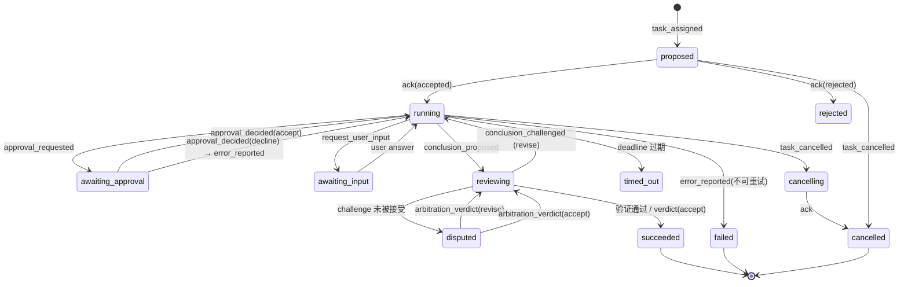
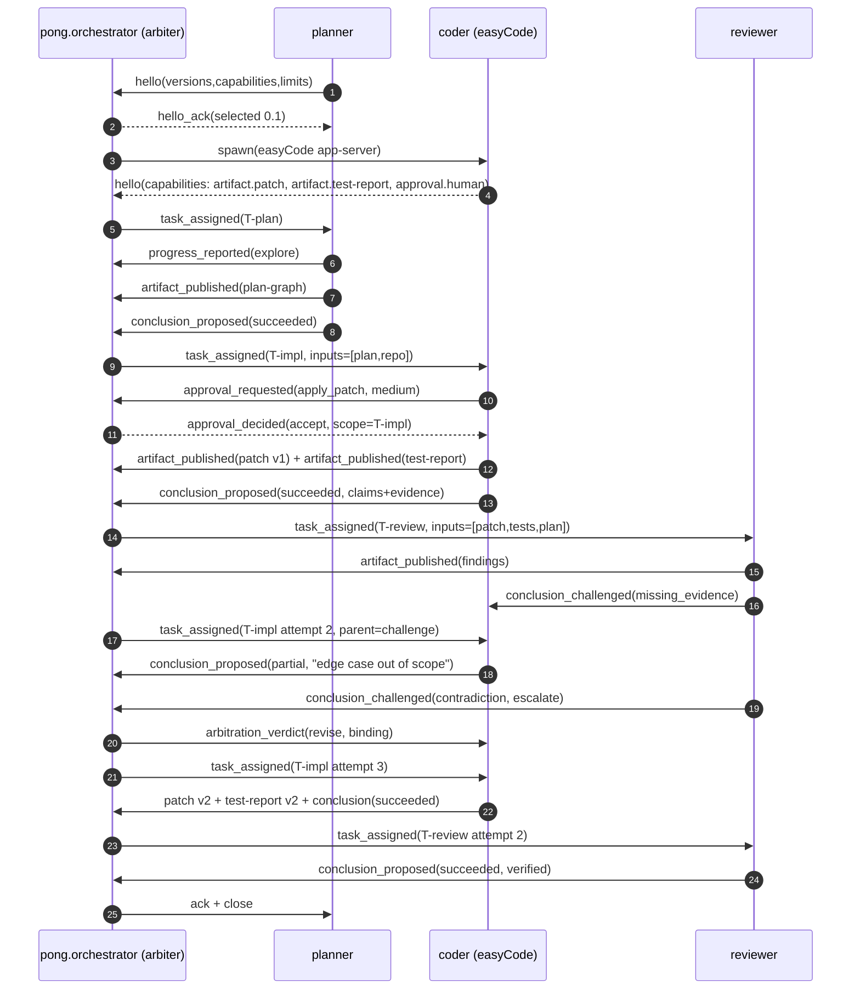

# 多 Agent 结构化通信协议分析（v0 草案）
> 目标：为 pong-studio（n8n 本地化二开，TypeScript）+ easyCode（Rust 编码 agent，可子进程嵌入，JSON 事件流）设计一套 agent 间结构化通信协议，替代"agent 用人类自然语言互相说话"的默认做法。
>
> 配套文档：[easycode-analysis.md](./easycode-analysis.md)（easyCode 集成面事实基线）。本文不重复其方法表，只引用其结论。
>
> 证据等级标注（全文遵守，读者据此判断可信度）：
> - **[R]** 本仓库代码 / 迁移 / 生成文档可复查，给出路径。
> - **[S]** 公开规范或官方文档可查证，给出 URL。
> - **[J]** 本文设计判断，需要评审，不属于事实。
>
> 状态：研究/设计草案，未实现。日期：2026-11-12。

## 0. 结论先行（TL;DR）
1. **问题不在措辞，在接口形状。** 现有系统里 agent 间通信的接口是 `String in → String out`：pong 的 `delegate_subagent` 输入 `goal`/`context`/`expectedOutput` 三个自由文本字段，输出 `answer: string`；easyCode 的协作工具有 9 个原语，但参数仍只有 `prompt: Option<String>`，结果仍是 `AgentStatus::Completed(Option<String>)` [R]。自然语言接口迫使每一跳都做一次**有损重叙事**（re-narration），这不是提示词能修好的。
2. **六类失败模式都有可观测信号**（§2.2）：歧义、上下文膨胀、幻觉传递、不可验证、不可回放、token 成本。它们不是六个独立问题，而是同一个根因的六个症状：**通信报文里没有"契约"，只有"叙述"**。
3. **协议缺的不是传输，是语义层。** MCP 解决了工具调用面，A2A 解决了跨组织任务面，ACP 解决了 REST run 面 [S]；本地多 agent 缺的是：谁负责（ownership）、交付物是什么（artifact）、凭什么判定完成（acceptance/verdict）。这三个问题自然语言永远答不干净。
4. **五个关键设计决定**（§3、§4）：

| 编号 | 决定 | 一句话理由 |
| --- | --- | --- |
| D1 | **双写：append-only 黑板为真源 + 点对点增量** | 黑板保证可回放与可审计，点对点保证低延迟与低扇出 |
| D2 | **引用优先：只传 content-addressed artifact 引用 + 有界摘要** | 上下文膨胀的唯一根治办法是不让上下文进入报文 |
| D3 | **三角色分离：producer / verifier / arbiter，写者不得自验** | 解决"结论无法验证"和"同源偏差" |
| D4 | **可执行验证优先于 LLM 裁决** | 能跑测试就不要投票；投票只处理不可自动判定的冲突 |
| D5 | **单一 schema 来源 + 双向生成** | easyCode 已有 `ts_rs`/`schemars` 导出（318 个 JSON Schema、748 个 TS 文件）[R]，pong 侧用 Zod 做运行时校验 + 契约测试 |

5. **可测目标**（当前为假设，用 §11 的验收项验证）：跨 agent 消息 p50 ≤ 2 KB；handoff 输入 token 相比自然语言基线降低 ≥ 60%；每条 `conclusion` 的断言 100% 带 evidence 引用；同一消息重复投递不产生二次副作用；任一历史任务可从日志重放到同状态。
6. **不承诺**：不追求跨组织互操作（A2A 已覆盖），不替代 MCP 工具面，不消灭自然语言——自然语言保留在两个位置：agent 内部推理、报文里的 `notes`/`rationale` 逃生舱（§5）。
7. **两个最大风险**：模型不按 schema 产出（用 tool-calling 包装 + 修复回路 + 自然语言降级兜底，§9 R2）；协议变成编排层单点与延迟税（无状态 envelope + 幂等 + 旁路直连，§9 R4）。

## 1. 问题域与约束
### 1.1 目标宿主
| 宿主 | 角色 | 关键事实（证据） |
| --- | --- | --- |
| **pong-studio** | 编排层、UI、持久化、审批、artifact 存储 | 已有 durable 事件总线：`instance_ai_events` 以 `(threadId, seq)` 为主键，`seq` 即 SSE 回放游标；ephemeral 事件（text/reasoning delta）不落库 [R] `packages/@pong/instance-ai/src/event-bus/event-bus.interface.ts`、`docs/generated/postgres-schema/public.instance_ai_events.md` |
| | | 已有输入队列语义：`agent_message_queue.messageId` 唯一索引 + `position` 排序 + `steeringOrder`（§3.8 的幂等与顺序先例）[R] `docs/generated/postgres-schema/public.agent_message_queue.md` |
| | | 已有"模型可见投影"概念：`agents_messages.modelContent` 与 `modelContextAt`——同一行消息对模型与对 UI 可以不同 [R] `public.agents_messages.md` |
| | | 已有版本化文档先例：`agent_plan.formatVersion` + `revision` + `agent_plan_history` [R] `public.agent_plan.md` |
| **easyCode** | 编码 agent 内核；每个会话（或任务组）一个 app-server 子进程（stdio），进程内可托管多个 thread | 传输是 stdio 上的四型 RPC（Request/Notification/Response/Error），**不是 JSON-RPC 2.0**，支持 W3C trace context [R] `easycode-rs/app-server-protocol/src/rpc.rs`；集成面与生命周期见配套文档 §2 |
| | | 已有多 agent 原语共 9 个：`SpawnAgent` / `SendInput` / `ResumeAgent` / `Wait` / `CloseAgent` / `SendMessage` / `FollowupTask` / `InterruptAgent` / `ListAgents` [R] `easycode-rs/protocol/src/items.rs`（`CollabAgentTool`） |
| | | 已有共享黑板实现：agent message board（channels / posts / threads / subscriptions）+ `BoardNotification` 绑定 `turn_id`，且"通知绝不能启动新 turn" [R] `easycode-rs/agent-message-board-client/src/protocol.rs`、`ext/agent-message-board/src/types.rs` |
| **交互形态** | Windows 本地单用户；agent 数量 2-5；任务秒到分钟级 | 不需要跨网络信任模型，但需要"人能看懂、能中断、能重放"（§10 的取舍都由此而来） |

### 1.2 术语
| 术语 | 定义 | 不变量 |
| --- | --- | --- |
| **Agent** | 一个可寻址的执行者，有 `agent_id`、`role`、`instance`（进程/线程引用） | 身份在任务生命周期内稳定 |
| **Task** | 一次可验收的工作单元，有 `task_id`、规格、验收标准、预算、截止时间 | `task_id` 全局唯一；状态单调不可回退（除显式 `reopen`） |
| **Attempt** | Task 的一次执行尝试，有 `attempt` 序号 | 重试复用 `task_id`，递增 `attempt`，复用 `idempotency_key` |
| **Envelope** | 所有消息的公共外壳（§3.3） | 字段闭集；payload 由 `kind` 决定 |
| **Artifact** | 不可变、内容寻址的交付物（patch / test report / plan graph / findings / log 切片） | 一经发布不可修改；新版本 = 新 digest + `parents` 引用 |
| **Claim** | 一条可证伪的断言，带 confidence 与 evidence 引用 | 无 evidence 的 claim 只能标 `hypothesis` |
| **Conclusion** | Task 的交付声明：状态 + claims + artifacts + 验收结果 | 必须是终态消息，且只能由 task 的 owner 发出 |

### 1.3 本文不解决
- 工具调用协议（MCP 已覆盖）；跨组织 agent 发现（A2A AgentCard 已覆盖）。
- 模型路由、prompt 工程、记忆系统。
- 分布式共识、多副本一致性（本地单用户场景不需要；§9 R4 讨论单点风险）。

## 2. 问题论证：自然语言 agent 间通信的失败模式
### 2.1 现状：接口形状就是根因
| 位置 | 现在的接口形状 | 证据 |
| --- | --- | --- |
| pong `delegate_subagent` 工具 | 输入 `goal` + `context` + `expectedOutput` 三个字符串；`context` 的说明是 *"All details the child needs, since it sees nothing else"* | [R] `packages/@pong/agents/src/types/runtime/delegation.ts`；工具描述见 `runtime/tools/delegate-sub-agent-tool.ts:94-97` |
| pong 子 agent 结果 | `answer: string`（`structuredOutput` 是可选附加物，不是契约） | [R] `delegation.ts`（`delegateSubAgentOutputSchema`） |
| pong 子 agent 系统提示 | *"The child cannot see this conversation or your memory, so everything it needs must be in the call."* | [R] `delegate-sub-agent-tool.ts:121` |
| easyCode 协作工具 | `CollabAgentToolCallItem.prompt: Option<String>`；`receiver_agents[]` 只带 `thread_id`/`nickname`/`role` | [R] `easycode-rs/protocol/src/items.rs` |
| easyCode agent 状态 | `AgentStatus::Completed(Option<String>)`——最终结果就是一个可选字符串 | [R] `easycode-rs/protocol/src/protocol.rs`（`AgentStatus`） |
| easyCode 黑板 | post 正文是 `text: String`，预览是 `text_preview + n_chars + truncated` | [R] `ext/agent-message-board/src/types.rs`（`PostContent`/`PostPreview`） |
| pong `Message an Agent` 节点 | 工作流节点向 agent 发一条消息；结构化输出靠"从示例生成 schema" | [R] `packages/nodes-base/nodes/MessageAnAgent/` |

**关键观察：这不是"多 agent 缺少一个协议"，而是"多 agent 已经有了一个协议，只不过协议是自然语言"。** 系统已经解决了传递（消息队列、事件流、黑板），没有解决的是：消息里到底该放什么、接收方如何判断它是否完整、如何证明它是对的。

### 2.2 六类失败模式
| 编号 | 失败模式 | 产生机制 | 现有系统里的可观测信号 | 后果 |
| --- | --- | --- | --- | --- |
| **F1** | **歧义与指代漂移** | 自由文本没有必填槽位；接收方必须自行补全省略项（"在上一步基础上"、"按之前的约定"） | 同一任务两次分派时可选字段缺失率；子 agent 反问次数 | 返工轮次上升，父 agent 需要多轮澄清 |
| **F2** | **上下文膨胀** | 子 agent 上下文隔离，父 agent 被迫把上下文**全文重述**进 `context` 字符串；fan-out N 份 | `context` 字段的长度分布；单任务输入 token / 子 agent 数 | 成本随并行度线性放大，长上下文中的中段信息被忽略（lost-in-the-middle [S]） |
| **F3** | **幻觉传递** | 自然语言断言没有 provenance；下游无法区分"事实 / 推断 / 猜测"，且会继承上游措辞 | `conclusion` 中无 artifact/命令引用的断言比例 | 错误级联，reviewer 只能"再猜一次"，越往后越不敢推翻 |
| **F4** | **不可验证** | 交付物是散文；完成声明（"已修复"）没有可执行证据 | 无测试报告 / 无 diff / 无复现命令的完成声明比例 | 验证退化为"读起来对不对"，reviewer 沦为第二个作者 |
| **F5** | **不可回放 / 不可重试** | 自然语言轨迹无法确定性重放；缺幂等键，重试会重复副作用（重复写文件、重复提交） | 重试后重复副作用次数；故障无法复现的比例 | 失败只能靠日志考古；重试不敢做，只能人工介入 |
| **F6** | **token 成本与延迟** | 每跳全量自然语言；前缀不稳定导致 prompt cache 失效；黑板 `MAX_BODY` 允许 512 KiB 正文，**保护了传输，没保护上下文** | 输入 token/任务；cache hit rate；p95 首 token 延迟 | 并行度越高越贵；协议越"聊"越慢 |

> F6 的证据补充：`agent-message-board-client/src/protocol.rs` 的 `MAX_BODY = 512 * 1024`、`MAX_RESPONSE = 1024 * 1024` [R]。512 KiB 英文正文约 13 万 token——远超任何模型窗口。同类保护在 pong 的 `PostPreview` 里已经有正确形态：**有界预览 + 字符数 + 截断标记 + 游标翻页**（`Page.next_cursor`）[R]。这说明系统里已经存在"有界摘要"的正确做法，只是没有把它提升为通信契约。

### 2.3 一条具体的失败链（为什么单点修补无效）
```
用户: "给 MessageAnAgent 增加参数校验，并补测试"
  └─ planner(父) 分派给 coder  → context: "在现有实现基础上加校验，参考 pong 的惯例"   ← F1：惯例未枚举
       └─ coder 自己找了 3 个"惯例"，猜了 1 个                          ← F3：猜测被写成陈述句
            └─ coder 回: "已完成，测试通过"                                ← F4：无命令、无输出、无 diff 引用
                 └─ reviewer 读这段话，写"LGTM"                            ← F4 传染：验证者没有可验证物
                      └─ 父 agent 汇总: "已完成" → 用户发现边界参数未处理     ← F3+F4 级联
```

重试这条链不能修好它：重试只会重新生成另一段自然语言。**能在结构上切断链条的只有三件事**：把"惯例"变成 `acceptance[]`（F1）、把"猜测"变成带 evidence 的 claim（F3）、把"完成"变成 `conclusion + test_report artifact`（F4）。

### 2.4 已有实践能给什么、不能给什么
| 实践 | 机制要点（可查证） | 本设计可用之处 | 不适用之处 |
| --- | --- | --- | --- |
| **MCP** [S] | JSON-RPC 2.0；`initialize` 首交互完成**协议版本协商 + 能力协商 + 实现信息交换**；生命周期含 timeouts / error handling | 生命周期与能力协商的模板；工具输入 schema 的写法；"能力声明决定行为"的思路 | 它是 client↔server 的**工具面**，不是对等协作面；没有 task / artifact / 验收语义 |
| **A2A** [S] | Task / TaskStatus / TaskState / Message / Part / Artifact；AgentCard 发现；**幂等**与**版本协商**有专章；JSON-RPC / gRPC / REST 三种绑定；SSE 流与 push | Task 状态机、Artifact 抽象、"artifact 与 message 分离"、幂等语义 | 面向跨组织、HTTP 为主、能力声明体积大；本地单用户多 agent 用它是过度设计 |
| **ACP**（IBM/BeeAI）[S] | REST；Agent Manifest、**Agent Run 生命周期**、Message Structure / Metadata、Artifacts；官方公告**已并入 A2A / Linux Foundation** | "run" 作为执行单位；message metadata 作为扩展位 | 同为跨进程 REST 假设；已停止独立演进，不应作为目标 |
| **Claude Code subagents** [S] | 每个 subagent 有独立上下文窗口、独立工具集与模型；调用方只收到其最终结果 | 证明"上下文隔离 + 单一结果"在工程上有效且高效 | 调用接口仍是自然语言 prompt；无 artifact 契约、无验收标准、无仲裁 |
| **Codex/easyCode collab** [R] | spawn / send_input / resume / wait / close / send_message / followup / interrupt / list_agents；`AgentStatus` 状态机；黑板（channels/posts/threads/subscriptions） | 已有全部**控制面**原语；已有 turn 绑定的投递语义（通知不得启动新 turn） | 数据面仍是字符串；无内容寻址、无验收、无仲裁 |
| **黑板架构 / 元组空间 / 事件溯源** [S] | Hearsay-II 黑板模型；Linda 元组空间；event sourcing + pub/sub + 消费者游标 | append-only 日志做真源、订阅 + 游标做增量、幂等消费做重放 | 传统黑板**没有 schema 约束**，内容质量不可控——正是本设计要补的一层 |

**结论：** 传输、控制面、发现机制都已有成熟答案；缺的是**语义层**。所以本协议不重新发明传输，只在既有传输之上定义"报文语义 + 产物寻址 + 验证闭环"。

## 3. 协议设计 v0
### 3.1 设计原则
| 编号 | 原则 | 反例（明确不做） |
| --- | --- | --- |
| P1 | **信封严格，载荷渐进**：信封字段闭集且必填；`kind` 之外允许 `x-*` 扩展字段 | 不要一开始就定义 30 种消息 |
| P2 | **引用优先于复制**：报文只带 artifact 引用 + 有界摘要；原文按需拉取 | 不要把文件内容、日志、diff 内联进消息 |
| P3 | **每条断言可归因**：claim 必须带 evidence 引用，否则降级为 `hypothesis` | 不接受无出处的"已完成" |
| P4 | **协议传事实与请求，不传思维链**：推理留在 agent 内部 | 不把 reasoning deltas 塞进跨 agent 报文 |
| P5 | **默认幂等**：任何消息可安全重投；副作用由接收方去重表裁决 | 不允许"重试即重复执行" |
| P6 | **状态转换可重放**：日志是唯一真源，任何状态可由日志重建 | 不要有只存在于内存的状态 |
| P7 | **双向版本协商**：握手失败要能明确降级或拒绝，而不是静默错解 | 不要"发出去再看对方能不能懂" |
| P8 | **人类可读是一等需求**：每条报文必须能直接渲染成人类可读卡片 | 不要把可调试性推给"另写一个 UI 适配器" |

### 3.2 分层
```
L3  语义层（本协议）    task / claim / artifact / verdict / approval
    ───────────────────────────────────────────────────────────
L2  报文层（本协议）    Envelope + 强类型 payload + 版本协商
    ───────────────────────────────────────────────────────────
L1  传输层（复用）      easyCode app-server stdio RPC  |  pong 事件总线/SSE  |  DB 队列/黑板
    ───────────────────────────────────────────────────────────
L0  执行层（复用）      easyCode turn / tool / sandbox  |  pong workflow / nodes
```

协议只定义 L2 + L3。**L1 不做抽象泄漏**：适配器负责把本协议消息映射为 `turn/start`、`SendInput`、board post 等具体调用（§7）。

### 3.3 Envelope（公共外壳）
| 字段 | 类型 | 必填 | 说明 |
| --- | --- | --- | --- |
| `protocol` | `const "pong.agent/0.1"` | 是 | 语义版本；major 不兼容，minor 只增 |
| `kind` | enum | 是 | 消息类型（§3.4）；决定 `payload` 的 schema |
| `id` | ULID string | 是 | 消息唯一 ID，生产者生成 |
| `sent_at` | RFC3339 UTC | 是 | 产生时间；不用于排序（排序用日志 `seq`） |
| `from` / `to` | `AgentRef` | 是 | `{agent_id, role, instance}`；`to` 可以是单个 agent 或 `role:broadcast` |
| `task_id` | string | 是 | 所属任务；控制类消息（hello/ack）用固定握手 ID（如 `handshake.<agent>`） |
| `attempt` | int ≥ 1 | 否 | 默认 1；重试递增 |
| `trace_id` / `parent_id` | string / ULID | 否 | 链路关联；`parent_id` 指向被回复的消息（可复用 easyCode 的 W3C trace context [R]） |
| `idempotency_key` | string | 是 | 生产者生成；接收方去重（§3.8） |
| `deadline` | RFC3339 UTC | 否 | 应答期限；过期未回复 = 失败（不是"还在想"） |
| `artifacts` | `ArtifactRef[]` | 否 | 本消息引用的产物（只引用，不内联） |
| `payload` | object | 是 | `kind` 对应的强类型体 |
| `notes` | string ≤ 2 KB | 否 | **逃生舱**：给模型/人的自由补充；不参与校验（§5.2） |

> 设计取舍：`notes` 是刻意保留的自由文本。协议如果完全不给自由文本出口，模型会把信息塞进错误字段或直接违反 schema；给一个**有界、明确不参与判定**的字段，比假装消灭自然语言更可控。

### 3.4 消息类型（v0 共 11 种）
| `kind` | 方向 | 作用 | 必填 payload 要点 | 期望回复 |
| --- | --- | --- | --- | --- |
| `hello` | 双向 | 版本/能力/限额协商 | `versions[]`, `capabilities[]`, `limits{}` | `hello_ack` |
| `task_assigned` | 分派方→执行方 | 下发任务规格 | `goal{}`, `inputs[]`, `acceptance[]`, `constraints[]`, `budget{}`（期限用信封 `deadline`） | `ack` 或 `progress_reported` |
| `progress_reported` | 执行方→分派方 | 进度与中间状态 | `phase`, `percent?`, `summary` ≤ 400 chars, `claims[]?` | 无（可忽略） |
| `artifact_published` | 任意→黑板 | 发布产物 | `artifact`（`ArtifactRef` + manifest） | `ack` |
| `approval_requested` | 执行方→审批方 | 请求人类/策略批准 | `action`, `risk`, `why`, `diff?`, `command?`, `options[]`, `expires_at` | `approval_decided` |
| `approval_decided` | 审批方→执行方 | 批准决定 | `decision`（accept/accept_for_session/decline/cancel）, `granted_scope?` | `ack` |
| `error_reported` | 任意→上游 | 结构化错误 | `code`（枚举）, `retryable`, `message` ≤ 280 chars, `evidence[]?`, `state?` | 由上游决定重试/取消 |
| `conclusion_proposed` | 执行方→验证方 | 交付声明 | `status`, `summary`, `claims[]`, `artifacts[]`, `acceptance_results[]` | `conclusion_challenged` 或仲裁关闭 |
| `conclusion_challenged` | 验证方→执行方 | 质疑 | `target`（conclusion/claim id）, `reason_kind`, `argument`, `evidence[]`, `requested_action` | 修订后的 `conclusion_proposed`，或升级仲裁 |
| `arbitration_verdict` | 仲裁者→双方 | 裁决冲突 | `dispute_id`, `ruling`, `basis[]`, `rationale` ≤ 600 chars, `binding: true` | `ack` |
| `task_cancelled` | 上游→执行方 | 协作式取消 | `reason`, `cascade`, `grace_ms` | `ack`（含已完成部分） |

另有 `ack`（通用确认：`accepted` / `rejected` / `duplicate`）与 `hello_ack` 两个控制报文，计入 schema 但不算业务类型。

### 3.5 强类型 schema 策略
1. **单一来源**：协议 schema 写成 JSON Schema（draft 2020-12）作为规范文本；TypeScript 从 Zod 定义生成/校验，Rust 侧沿用 easyCode 的 `serde + ts_rs + schemars` 惯例 [R]（`protocol/src/items.rs` 的 `#[serde(tag = "type")]` 就是可复用的判别式联合写法）。
2. **判别式联合**：`kind` 为判别字段，与 easyCode 的 `TurnItem` 风格一致；消费方必须对未知 `kind` 返回 `ack{status:"rejected", code:"unsupported_kind"}`，不得崩溃。
3. **向后兼容规则**：只增字段、只增枚举值、只放宽约束；不做隐式默认值变更；删除字段走 major。CI 用"旧 schema 校验新样例 + 新 schema 校验旧样例"双向验证。
4. **校验即网关**：所有入站报文先过 schema 校验；失败不静默丢弃，而是产生 `error_reported{code:"schema_violation"}` 并把原始报文存为 artifact（便于统计模型失败率，§9 R2）。
5. **约束输出、不约束推理**：schema 只约束 `payload`；`notes` 与 `rationale` 保留自由文本（§5.2）。

### 3.6 内容寻址 artifact
- **标识**：`sha256:<64 hex>`，对**规范字节**计算（UTF-8、键排序、无空白）；引用形式 `artifact://sha256/<digest>`。
- **不可变**：同一 digest 内容唯一；新版本是**新 artifact**，用 `parents[]` 指向旧 digest（与 git blob 一致的心智模型）。
- **manifest**：`{digest, media_type, bytes, summary ≤ 400 chars, producer{agent_id, task_id}, parents[], created_at, redactions[]}`。
- **内联阈值**：< 2 KB 且 `text/*` 可内联到 `payload`；其余一律引用。**任何 agent 都不得把 artifact 全文塞进下一跳报文**。
- **类型注册**：`application/vnd.pong.patch+unified-diff`、`+test-report+json`、`+plan-graph+json`、`+findings+json`、`+log-slice+text`。未知媒体类型允许存在，但消费方必须声明处理能力。
- **权限随引用传播**：artifact 继承产生它的 workspace ACL；跨任务引用需要显式 `grant`（pong 已有 `agent_file_grants` 先例 [R]）。
- **保留与 GC**：orphan artifact 保留 N 天；被 `conclusion` / `verdict` 引用的 artifact 不允许 GC（审计证据）。
- **发布前脱敏**：publish 时对已知 secret 形态做 redaction 并记录 `redactions[]`；**摘要（summary）本身也必须脱敏**（摘要会进模型上下文，是新的泄漏面）。

### 3.7 版本协商与能力握手
1. 连接建立后双方各发 `hello`（或单向 `hello` + `hello_ack`，由分派方先发）。
2. `hello.versions[]` 是**支持的协议版本列表**（不是"我用的版本"）；接收方选最高共同 major，返回 `hello_ack{selected, capabilities[], limits{}}`。
3. `capabilities[]` 形如 `artifact.patch`、`artifact.test-report`、`approval.human`、`events.streaming`、`replay.long`；不支持的能力必须**显式缺席**，而不是"收到了再说"。
4. `limits{}`：`max_message_bytes`、`max_artifact_bytes`、`max_summary_chars`、`max_batch`。**协商限额后，超限报文按 `error_reported{code:"limit_exceeded"}` 拒绝**，不发半截。
5. 无共同 major：`hello_ack{selected:null, error:{code:"incompatible_version"}}`，任务在分派阶段失败，**不允许"尽力解析"**。
6. 补充：easyCode app-server **没有协议版本协商**，只有 `initialize.capabilities.experimentalApi` 开关 [R]（配套文档 §9.1）。因此**版本协商必须由 pong 的编排层承担**，easyCode 侧只能靠"锁版本 + schema 快照 diff"兜底（§7.1、§11）。

### 3.8 超时、重试、幂等
| 机制 | 规则 |
| --- | --- |
| **超时** | 每条消息可带 `deadline`；`task_assigned` 必须带。到期未回复 → 上游记录 `error_reported{code:"timeout", retryable:true}`，并触发取消或重派。**审批必须有超时**：easyCode 仓库内未找到审批超时实现 [R]，宿主必须自己兜（建议 60-120s，超时按 `decline` 处理并可选 `turn/interrupt`，见配套文档 §10.4） |
| **重试** | 仅 `retryable:true` 可重试；指数退避 + jitter；`attempt` 递增；**重试必须复用 `idempotency_key`**；不可重试码：`schema_violation`、`capability_missing`、`incompatible_version`、`permission_denied` |
| **幂等** | 接收方维护去重表 `(idempotency_key → message_id, outcome)`，保留 ≥ 24h；重复投递返回 `ack{status:"duplicate"}`，**不再执行副作用**。语义 = at-least-once 投递 + 去重 = 有效一次（effectively-once；不是 exactly-once，不要宣称） |
| **顺序** | 不承诺全局顺序；同一 `task_id` 内以日志 `seq` 为准；跨任务只保证因果（`parent_id` 链） |
| **租约** | 执行方对 task 持租约（`lease_expires_at`）；租约过期且无心跳（`progress_reported`）→ 上游可重派，旧执行方的后续消息按 `stale_attempt` 拒绝 |

### 3.9 取消语义
- 取消是**协作式**的：`task_cancelled{cascade:true}` 先送达，执行方在下一个安全点停止（一个 turn 结束、一个工具返回、一次文件写入前），回 `ack{status:"accepted", completed_parts[]}`。
- **cascade**：父任务取消 → 子任务级联取消；`grace_ms` 给出收敛窗口（默认 5s），超时由编排层强制终止（对 easyCode 即 `turn/interrupt`，必要时重建进程 [R] 配套文档 §10.5）。
- **状态机**：`running → cancelling → cancelled`；`cancelling` 期间不再接受新 `task_assigned`，但接受 `artifact_published`（保留已完成产出）。
- **取消不是回滚**：workspace 副作用不会自动还原；需要回滚时由执行方发布 `revert-patch` artifact 并按审批流程执行。协议必须明确这一点，否则用户会以为"取消 = 没发生"。
- **迟到消息**：取消后到达的 `conclusion_proposed` 按 `stale_attempt` 标记归档，不参与裁决（但仍进日志，用于审计）。

### 3.10 Task 状态机


不变量：状态只沿箭头迁移；每次迁移由**一条日志消息**触发；`succeeded` 必须引用至少一个 `artifact` 与一条 `conclusion`。

## 4. 机制取舍
### 4.1 共享黑板 vs 点对点：双写
| 维度 | 纯点对点 | 纯黑板 | 双写（本设计） |
| --- | --- | --- | --- |
| 延迟 | 低 | 高（需轮询/订阅） | 点对点走增量，黑板走真源 |
| 可回放 | 差（谁存谁负责） | 好 | 好（黑板是唯一真源） |
| 扇出成本 | N 份复制 | 一份 + 引用 | 一份 + 引用 |
| 新 agent 加入 | 需重放历史 | 读黑板即可 | 读黑板即可 |
| 一致性问题 | 无中心真相 | 需要 schema 约束 | 用 artifact digest + 状态机约束 |

**决策**：`task_assigned` / `approval_*` / `conclusion_*` 走点对点（需要明确收件人与责任）；`artifact_published` / `progress_reported` / `error_reported` 写黑板（需要广播与回放）。黑板在 pong 侧复用 `instance_ai_events` 式 append-only log + `seq` 游标 [R]；在 easyCode 侧可复用 message board 的 channel/thread/subscription 模型 [R]，但**post 正文必须改成"引用 + 有界预览"**，或直接在 `payload` 里放 ArtifactRef（§8.2）。

### 4.2 上下文压缩边界：只传引用 + 摘要
三条硬规则：

1. **报文里的 artifact 只有 manifest，没有正文**；正文由消费方按需 `read`。
2. **摘要由生产者写、读者可拉全量、验证者必须拉全量**。摘要 ≤ 400 chars，且必须包含"结论一句话 + 证据类型 + 位置"。
3. **摘要是不可信输入**（untrusted data）：它进模型上下文，因此必须脱敏、不得包含指令性文本；消费方应把摘要标记为数据（pong 已有 `untrusted-content` 机制先例 [R]）。

预算公式（用于编排层限流，不是协议字段）：

```
child_ctx = task_spec(≤1.5KB) + Σ_{i∈top-k} artifact_i.summary(≤400B) + last_n_claims + 工具 schema 开销
k 默认 15，n 默认 10；超出时按"与验收标准的相关性"排序，而不是按时间
```

### 4.3 结构化产物（协议必须认识的 5 种）
| 产物 | 媒体类型 | 必含字段 | 用途 |
| --- | --- | --- | --- |
| **patch / diff** | `...+patch+unified-diff` | 目标路径、base blob digest、unified diff、可选 revert digest | 可应用、可回滚、可验证"改了什么" |
| **test report** | `...+test-report+json` | `command[]`、`exit_code`、`duration_ms`、`stdout_digest`、`tests{total,failed,skipped}`、`coverage?` | 可执行证据；reviewer 不必"读代码猜" |
| **plan graph** | `...+plan-graph+json` | 节点 `{task_id, goal, acceptance[], deps[]}`、边、`format_version`、`revision` | 任务分解可审查、可增量修订（对齐 `agent_plan` 的 `formatVersion`/`revision` [R]） |
| **findings** | `...+findings+json` | `{artifact, file, line?, severity, rule, evidence_ref, suggested_fix?}` | 评审结论可定位、可去重、可统计 |
| **log slice** | `...+log-slice+text` | 起止偏移、截断标记、原始 digest | 失败复现的最小证据，避免整日志进上下文 |

### 4.4 验证者与仲裁者
| 角色 | 职责 | 硬约束 |
| --- | --- | --- |
| **Producer** | 产出 artifact 与 conclusion | 不得给自己的 conclusion 打"通过" |
| **Verifier** | 对 conclusion 做独立验证，发 `conclusion_challenged` 或确认 | 必须**拉全量 artifact**；优先跑 acceptance 里的可执行检查；同一 verifier 不得连续三次否决同一 claim 而不给新证据（防死循环） |
| **Arbiter** | 只裁决"不可自动判定"的冲突 | 必须写 `basis[]`（引用 acceptance 原文/证据）；裁决 `binding:true`；一次冲突只裁一次，新证据才能重开 |
| **Approver** | 人类或策略引擎，处理权限/风险动作 | 有超时；决策必须带 `granted_scope`（避免"一次批准 = 永久放行"） |

**为什么验证者不能是作者**：同模型自评存在自偏好偏差，且作者已经"相信"自己的结论；协议层面强制角色分离，比在 prompt 里写"请严格评审"有效得多 [J]。

### 4.5 冲突解决：三层
1. **机械冲突**（可自动判定）：schema 不合法、digest 不匹配、验收命令非零退出、patch 无法应用 → 直接按失败处理，不需要 LLM 参与。
2. **事实冲突**（证据可比较）：双方 claim 指向不同 evidence → 仲裁者比较证据强度（可执行 > 可复现日志 > 代码引用 > 叙述），裁决写 `basis[]`。
3. **意图冲突**（规格本身歧义）：`acceptance[]` 两种解读都成立 → **升级为 `approval_requested` 给人**，由人选择解释或补充验收标准，结果回写为 `plan-graph` 的新 revision。协议不假装能解决价值判断。

防死锁：同一 `(task_id, claim_id)` 的 `challenge ↔ revise` 循环上限 3 次；超过直接升级人类，并记录为协议级指标（`challenge_loop_exceeded`）。

## 5. 如何让协议提升模型能力，而不是限制它
### 5.1 把"自由"放在正确的层
| 层 | 自由度 | 理由 |
| --- | --- | --- |
| agent 内部推理（thinking / 草稿 / 工具试探） | **完全自由，不进协议** | 这是模型能力的主要来源；任何 schema 化都会损害它 |
| 跨 agent 的**请求与事实** | **强约束**（envelope + payload） | 需要机器可校验、可重放、可审计 |
| 跨 agent 的**补充说明** | 弱约束（`notes` ≤ 2 KB、`rationale` ≤ 600 chars） | 保留人类可读性与边缘信息 |

一句话：**schema 约束"交付"，不约束"思考"。**

### 5.2 schema 约束输出，但保留逃生舱
- `conclusion.claims[]` 是必填结构；如果模型确实无法结构化表达，允许 `claims: []` + `notes` 说明，但此时状态**不得为 `succeeded`**（最多 `partial`），并由 verifier 兜底。这是"结构优先，但不把模型逼到撒谎"的折中。
- `notes` / `rationale` 明确标注"不参与判定"，避免模型把关键信息藏进自由文本而系统却依赖它。

### 5.3 工具化通信：让模型"调用"而不是"说话"
把消息类型包装成工具（MCP/function calling 风格），模型通过 tool call 发消息，而不是输出一段 JSON 文本：

```text
send_task_assignment(task_spec)     publish_artifact(manifest, content_ref)
report_progress(phase, summary)     request_approval(action, risk, diff)
file_challenge(target, reason, evidence)   propose_conclusion(status, claims, artifacts)
```

好处：参数由 schema 校验（模型不会输出语法坏 JSON）；错误可回喂（`error_reported` 作为 tool result 返回给模型，形成修复回路）；权限与预算可以在工具层拦截。这与 easyCode 已有 `dynamicTools` 注入机制天然契合 [R]（配套文档 §10.2），不需要改内核。

### 5.4 假设与证据记录（可回退的知识）
- claim 结构：`{statement, confidence ∈ [0,1], evidence[], falsifier?, status: hypothesis|supported|refuted}`。
- `falsifier` 是"什么观察能推翻我"——强制模型写出可证伪条件，比要求它"更自信/更谨慎"有效 [J]。
- 被推翻的 claim 不删除，标 `refuted` 并 `supersedes` 指向新 claim：形成可回退的假设链。这直接复用了 pong `agent_plan_history` 的 revision 思路 [R]。
- 统计价值：`refuted` 比例、平均 confidence 校准误差，是评估 agent 质量的现成指标。

### 5.5 可回放带来的能力（不是合规负担）
1. **故障可复现**：日志 + artifact digest 足以重建任意历史上下文；重放不需要重新调模型。
2. **A/B 与回归**：同一任务规格换模型/提示词重跑，比较 `conclusion` 与 `acceptance_results`，而不是比较两段自然语言。
3. **从失败中学习**：`challenge → revise` 的模式可聚类成失败模式库，反哺 planner 的 `acceptance` 模板。
4. **上下文可重建**：新 agent 加入时读黑板即可，不需要"人肉转录历史"。

### 5.6 协议不承诺的事
不承诺提升单次推理质量。协议提升的是**协作的可组合性**：减少返工、让验证可执行、让并行安全。单 agent 的推理能力由模型与提示词决定，协议既不能替代也不应干预。

## 6. 协议 v0：JSON Schema 草案
> 规范文本用 JSON Schema draft 2020-12。为控制篇幅：省略 `description`；用 `unevaluatedProperties: false` 做闭集（放在 `allOf` **外层**，否则会误伤信封字段）；`format` 只标注不强制（由实现校验器开启）。

### 6.1 完整 schema（13 种消息，覆盖任务/进度/产物/错误/审批/结论/质疑/裁决/取消/确认）
```json
{
  "$schema": "https://json-schema.org/draft/2020-12/schema", "$id": "https://pong.dev/schemas/agent-protocol/0.1/schema.json", "title": "pong agent protocol v0",
  "allOf": [
    {"$ref":"#/$defs/envelope"},
    {
      "oneOf": [
        {"properties":{"kind":{"const":"hello"},"payload":{"$ref":"#/$defs/payload_hello"}},"required":["kind","payload"]},
        {"properties":{"kind":{"const":"hello_ack"},"payload":{"$ref":"#/$defs/payload_hello_ack"}},"required":["kind","payload"]},
        {"properties":{"kind":{"const":"task_assigned"},"payload":{"$ref":"#/$defs/payload_task_assigned"}},"required":["kind","payload"]},
        {"properties":{"kind":{"const":"progress_reported"},"payload":{"$ref":"#/$defs/payload_progress_reported"}},"required":["kind","payload"]},
        {"properties":{"kind":{"const":"artifact_published"},"payload":{"$ref":"#/$defs/payload_artifact_published"}},"required":["kind","payload"]},
        {"properties":{"kind":{"const":"error_reported"},"payload":{"$ref":"#/$defs/payload_error_reported"}},"required":["kind","payload"]},
        {"properties":{"kind":{"const":"approval_requested"},"payload":{"$ref":"#/$defs/payload_approval_requested"}},"required":["kind","payload"]},
        {"properties":{"kind":{"const":"approval_decided"},"payload":{"$ref":"#/$defs/payload_approval_decided"}},"required":["kind","payload"]},
        {"properties":{"kind":{"const":"conclusion_proposed"},"payload":{"$ref":"#/$defs/payload_conclusion_proposed"}},"required":["kind","payload"]},
        {"properties":{"kind":{"const":"conclusion_challenged"},"payload":{"$ref":"#/$defs/payload_conclusion_challenged"}},"required":["kind","payload"]},
        {"properties":{"kind":{"const":"arbitration_verdict"},"payload":{"$ref":"#/$defs/payload_arbitration_verdict"}},"required":["kind","payload"]},
        {"properties":{"kind":{"const":"task_cancelled"},"payload":{"$ref":"#/$defs/payload_task_cancelled"}},"required":["kind","payload"]},
        {"properties":{"kind":{"const":"ack"},"payload":{"$ref":"#/$defs/payload_ack"}},"required":["kind","payload"]}
      ]
    }
  ],
  "unevaluatedProperties": false,
  "$defs": {
    "digest": {"type":"string","pattern":"^sha256:[0-9a-f]{64}$"},
    "evidence_ref": {"type":"string","pattern":"^(artifact://sha256/[0-9a-f]{64}|command:.{1,500}|claim:[A-Za-z0-9_-]{1,64})$"},
    "agent_ref": {
      "type": "object", "required": ["agent_id","role"],
      "properties": {
        "agent_id": {"type":"string","minLength":1,"maxLength":128},
        "role": {"type":"string","enum":["planner","coder","reviewer","verifier","arbiter","approver","orchestrator"]},
        "instance": {"type":"string","maxLength":256}
      },
      "unevaluatedProperties": false
    },
    "artifact_ref": {
      "type": "object", "required": ["digest","media_type","bytes","summary"],
      "properties": {
        "digest": {"$ref":"#/$defs/digest"}, "uri": {"type":"string","pattern":"^artifact://sha256/[0-9a-f]{64}$"},
        "media_type": {"type":"string","pattern":"^[a-z0-9.+-]+/[a-z0-9.+-]+$"},
        "bytes": {"type":"integer","minimum":0}, "summary": {"type":"string","maxLength":400},
        "parents": {"type":"array","items":{"$ref":"#/$defs/digest"},"maxItems":16,"uniqueItems":true},
        "inline_text": {"type":"string","maxLength":2048}
      },
      "unevaluatedProperties": false
    },
    "claim": {
      "type": "object", "required": ["id","statement","status"],
      "properties": {
        "id": {"type":"string","pattern":"^[A-Za-z0-9_-]{1,64}$"}, "statement": {"type":"string","minLength":1,"maxLength":2000},
        "status": {"type":"string","enum":["hypothesis","supported","refuted"]},
        "confidence": {"type":"number","minimum":0,"maximum":1}, "falsifier": {"type":"string","maxLength":500},
        "evidence": {"type":"array","items":{"$ref":"#/$defs/evidence_ref"},"maxItems":32},
        "supersedes": {"type":"string","pattern":"^[A-Za-z0-9_-]{1,64}$"}
      },
      "if": {"properties":{"status":{"const":"supported"}},"required":["status"]}, "then": {"required":["evidence"],"properties":{"evidence":{"minItems":1}}},
      "unevaluatedProperties": false
    },
    "acceptance": {
      "type": "object", "required": ["id","check","spec"],
      "properties": {
        "id": {"type":"string","maxLength":64}, "check": {"type":"string","enum":["command","assertion","artifact_matches","human"]},
        "spec": {"type":"string","minLength":1,"maxLength":2000},
        "expected": {"type":"string","maxLength":1000}, "timeout_ms": {"type":"integer","minimum":0}
      },
      "unevaluatedProperties": false
    },
    "goal": {
      "type": "object", "required": ["intent","objective"],
      "properties": {
        "intent": {"type":"string","minLength":1,"maxLength":1000}, "objective": {"type":"string","minLength":1,"maxLength":2000},
        "non_goals": {"type":"array","items":{"type":"string","maxLength":500},"maxItems":20}
      },
      "unevaluatedProperties": false
    },
    "budget": {
      "type": "object",
      "properties": {"max_tokens":{"type":"integer","minimum":0},"max_wall_ms":{"type":"integer","minimum":0},"max_tool_calls":{"type":"integer","minimum":0}},
      "unevaluatedProperties": false
    },
    "limits": {
      "type": "object", "required": ["max_message_bytes","max_artifact_bytes","max_summary_chars"],
      "properties": {
        "max_message_bytes": {"type":"integer","minimum":1024}, "max_artifact_bytes": {"type":"integer","minimum":0},
        "max_summary_chars": {"type":"integer","minimum":32},
        "max_batch": {"type":"integer","minimum":1}
      },
      "unevaluatedProperties": false
    },
    "error": {
      "type": "object", "required": ["code","message"],
      "properties": {
        "code": {
          "type": "string",
          "enum": [
            "schema_violation",
            "unsupported_kind",
            "incompatible_version",
            "capability_missing",
            "limit_exceeded",
            "timeout",
            "cancelled",
            "conflict",
            "tool_failed",
            "precondition_failed",
            "permission_denied",
            "stale_attempt",
            "internal"
          ]
        },
        "message": {"type":"string","maxLength":280}, "retryable": {"type":"boolean","default":false},
        "evidence": {"type":"array","items":{"$ref":"#/$defs/evidence_ref"},"maxItems":16},
        "state": {"type":"object"}
      },
      "unevaluatedProperties": false
    },
    "payload_hello": {
      "type": "object", "required": ["versions","capabilities","limits","agent"],
      "properties": {
        "versions": {"type":"array","minItems":1,"items":{"type":"string","pattern":"^[0-9]+\\.[0-9]+$"},"uniqueItems":true},
        "capabilities": {"type":"array","items":{"type":"string","pattern":"^(artifact|events|approval|replay|tools)\\.[a-z0-9-]+$"},"uniqueItems":true},
        "limits": {"$ref":"#/$defs/limits"}, "agent": {"$ref":"#/$defs/agent_ref"}
      },
      "unevaluatedProperties": false
    },
    "payload_hello_ack": {
      "type": "object", "required": ["selected"],
      "properties": {
        "selected": {"anyOf":[{"type":"null"},{"type":"string","pattern":"^[0-9]+\\.[0-9]+$"}]},
        "capabilities": {"type":"array","items":{"type":"string","maxLength":64}},
        "limits": {"$ref":"#/$defs/limits"}, "error": {"$ref":"#/$defs/error"}
      },
      "unevaluatedProperties": false
    },
    "payload_task_assigned": {
      "type": "object", "required": ["goal","acceptance"],
      "properties": {
        "goal": {"$ref":"#/$defs/goal"}, "acceptance": {"type":"array","minItems":1,"items":{"$ref":"#/$defs/acceptance"},"maxItems":32},
        "inputs": {"type":"array","items":{"$ref":"#/$defs/artifact_ref"},"maxItems":32},
        "constraints": {"type":"array","items":{"type":"string","maxLength":500},"maxItems":32},
        "required_capabilities": {"type":"array","items":{"type":"string","maxLength":64},"uniqueItems":true},
        "budget": {"$ref":"#/$defs/budget"},
        "max_attempts": {"type":"integer","minimum":1,"maximum":10,"default":3}
      },
      "unevaluatedProperties": false
    },
    "payload_progress_reported": {
      "type": "object", "required": ["phase","summary"],
      "properties": {
        "phase": {"type":"string","minLength":1,"maxLength":64}, "percent": {"type":"integer","minimum":0,"maximum":100},
        "summary": {"type":"string","minLength":1,"maxLength":400},
        "claims": {"type":"array","items":{"$ref":"#/$defs/claim"},"maxItems":16}, "next_step": {"type":"string","maxLength":400}
      },
      "unevaluatedProperties": false
    },
    "payload_artifact_published": {"type":"object","required":["artifact"],"properties":{"artifact":{"$ref":"#/$defs/artifact_ref"},"purpose":{"type":"string","maxLength":200}},"unevaluatedProperties":false},
    "payload_error_reported": {"type":"object","required":["error"],"properties":{"error":{"$ref":"#/$defs/error"}},"unevaluatedProperties":false},
    "payload_approval_requested": {
      "type": "object", "required": ["action","risk","why","options","expires_at"],
      "properties": {
        "action": {"type":"string","minLength":1,"maxLength":200}, "risk": {"type":"string","enum":["low","medium","high","critical"]},
        "why": {"type":"string","minLength":1,"maxLength":1000},
        "diff": {"$ref":"#/$defs/artifact_ref"}, "command": {"type":"string","maxLength":2000}, "requested_scope": {"type":"string","maxLength":200},
        "options": {"type":"array","minItems":2,"items":{"type":"string","enum":["accept","accept_for_session","decline","cancel"]},"uniqueItems":true},
        "expires_at": {"type":"string","format":"date-time"}
      },
      "unevaluatedProperties": false
    },
    "payload_approval_decided": {
      "type": "object", "required": ["decision","decided_by"],
      "properties": {
        "decision": {"type":"string","enum":["accept","accept_for_session","decline","cancel"]}, "decided_by": {"$ref":"#/$defs/agent_ref"},
        "granted_scope": {"type":"string","maxLength":200},
        "reason": {"type":"string","maxLength":500}
      },
      "unevaluatedProperties": false
    },
    "payload_conclusion_proposed": {
      "type": "object", "required": ["status","summary","acceptance_results"],
      "properties": {
        "status": {"type":"string","enum":["succeeded","partial","failed","cancelled"]}, "summary": {"type":"string","minLength":1,"maxLength":2000},
        "claims": {"type":"array","items":{"$ref":"#/$defs/claim"},"maxItems":64},
        "acceptance_results": {
          "type": "array",
          "items": {
            "type": "object", "required": ["acceptance_id","passed"],
            "properties": {
              "acceptance_id": {"type":"string","maxLength":64}, "passed": {"type":"boolean"}, "detail": {"type":"string","maxLength":500},
              "evidence": {"type":"array","items":{"$ref":"#/$defs/evidence_ref"},"maxItems":16}
            },
            "unevaluatedProperties": false
          }
        },
        "open_questions": {"type":"array","items":{"type":"string","maxLength":500},"maxItems":16}
      },
      "unevaluatedProperties": false
    },
    "payload_conclusion_challenged": {
      "type": "object", "required": ["target","reason_kind","argument","requested_action"],
      "properties": {
        "target": {"type":"string","minLength":1,"maxLength":128},
        "reason_kind": {"type":"string","enum":["unsupported_claim","contradiction","missing_evidence","scope_creep","regression","ambiguity"]},
        "argument": {"type":"string","minLength":1,"maxLength":2000}, "evidence": {"type":"array","items":{"$ref":"#/$defs/evidence_ref"},"maxItems":32},
        "requested_action": {"type":"string","enum":["revise","retest","escalate","withdraw"]}
      },
      "unevaluatedProperties": false
    },
    "payload_arbitration_verdict": {
      "type": "object", "required": ["dispute_id","ruling","rationale","binding"],
      "properties": {
        "dispute_id": {"type":"string","minLength":1,"maxLength":128}, "ruling": {"type":"string","enum":["accept","reject","revise","escalate"]},
        "basis": {"type":"array","items":{"$ref":"#/$defs/evidence_ref"},"maxItems":32},
        "rationale": {"type":"string","minLength":1,"maxLength":600}, "binding": {"const":true}, "decided_by": {"$ref":"#/$defs/agent_ref"}
      },
      "unevaluatedProperties": false
    },
    "payload_task_cancelled": {
      "type": "object", "required": ["reason"],
      "properties": {"reason":{"type":"string","minLength":1,"maxLength":500},"cascade":{"type":"boolean","default":true},"grace_ms":{"type":"integer","minimum":0,"maximum":60000}},
      "unevaluatedProperties": false
    },
    "payload_ack": {
      "type": "object", "required": ["ack_of","status"],
      "properties": {
        "ack_of": {"type":"string","pattern":"^[0-9A-HJKMNP-TV-Z]{26}$"}, "status": {"type":"string","enum":["accepted","rejected","duplicate"]},
        "completed_parts": {"type":"array","items":{"$ref":"#/$defs/artifact_ref"},"maxItems":32},
        "error": {"$ref":"#/$defs/error"}
      },
      "unevaluatedProperties": false
    },
    "envelope": {
      "type": "object", "required": ["protocol","kind","id","sent_at","from","to","task_id","idempotency_key","payload"],
      "properties": {
        "protocol": {"const":"pong.agent/0.1"},
        "kind": {
          "type": "string",
          "enum": [
            "hello",
            "hello_ack",
            "task_assigned",
            "progress_reported",
            "artifact_published",
            "error_reported",
            "approval_requested",
            "approval_decided",
            "conclusion_proposed",
            "conclusion_challenged",
            "arbitration_verdict",
            "task_cancelled",
            "ack"
          ]
        },
        "id": {"type":"string","pattern":"^[0-9A-HJKMNP-TV-Z]{26}$"}, "sent_at": {"type":"string","format":"date-time"}, "from": {"$ref":"#/$defs/agent_ref"},
        "to": {"$ref":"#/$defs/agent_ref"},
        "task_id": {"type":"string","minLength":1,"maxLength":128}, "attempt": {"type":"integer","minimum":1,"default":1},
        "trace_id": {"type":"string","maxLength":64},
        "parent_id": {"type":"string","pattern":"^[0-9A-HJKMNP-TV-Z]{26}$"}, "idempotency_key": {"type":"string","minLength":8,"maxLength":128},
        "deadline": {"type":"string","format":"date-time"},
        "artifacts": {"type":"array","items":{"$ref":"#/$defs/artifact_ref"},"maxItems":32}, "payload": {"type":"object"},
        "notes": {"type":"string","maxLength":2048}
      }
    }
  }
}
```

## 7. 三 agent 完整时序示例（planner → coder → reviewer）
场景：给 `MessageAnAgent` 增加参数校验并补测试。图中省略所有 `ack`（除关键路径）与重复 `progress_reported`。



### 7.1 阶段 0：版本与能力协商
```jsonl
{"protocol":"pong.agent/0.1","kind":"hello","id":"01JY0R2M4W7K8Q3Z5N6P7T8V9A","sent_at":"2026-11-12T15:00:00Z","from":{"agent_id":"planner.1","role":"planner","instance":"easycode:thread/0188"},"to":{"agent_id":"pong.orchestrator","role":"orchestrator","instance":"main"},"task_id":"handshake.planner","idempotency_key":"hello:planner.1:1","payload":{"versions":["0.1"],"capabilities":["artifact.plan-graph","events.streaming","tools.coding"],"limits":{"max_message_bytes":65536,"max_artifact_bytes":10485760,"max_summary_chars":400},"agent":{"agent_id":"planner.1","role":"planner","instance":"easycode:thread/0188"}}}
{"protocol":"pong.agent/0.1","kind":"hello_ack","id":"01JY0R2M4W7K8Q3Z5N6P7T8V9B","sent_at":"2026-11-12T15:00:01Z","from":{"agent_id":"pong.orchestrator","role":"orchestrator","instance":"main"},"to":{"agent_id":"planner.1","role":"planner"},"task_id":"handshake.planner","idempotency_key":"hello_ack:planner.1:1","payload":{"selected":"0.1","capabilities":["approval.human","events.streaming","replay.long"],"limits":{"max_message_bytes":65536,"max_artifact_bytes":10485760,"max_summary_chars":400}}}
{"protocol":"pong.agent/0.1","kind":"hello","id":"01JY0R2M4W7K8Q3Z5N6P7T8V9C","sent_at":"2026-11-12T15:00:02Z","from":{"agent_id":"coder.1","role":"coder","instance":"easycode:thread/0199"},"to":{"agent_id":"pong.orchestrator","role":"orchestrator"},"task_id":"handshake.coder","idempotency_key":"hello:coder.1:1","payload":{"versions":["0.1"],"capabilities":["artifact.patch","artifact.test-report","approval.human","events.streaming"],"limits":{"max_message_bytes":65536,"max_artifact_bytes":52428800,"max_summary_chars":400},"agent":{"agent_id":"coder.1","role":"coder","instance":"easycode:thread/0199"}}}
```

### 7.2 阶段 1：planner 产出计划
```jsonl
{"protocol":"pong.agent/0.1","kind":"task_assigned","id":"01JY0R2M4W7K8Q3Z5N6P7T8V9D","sent_at":"2026-11-12T15:00:05Z","from":{"agent_id":"pong.orchestrator","role":"orchestrator"},"to":{"agent_id":"planner.1","role":"planner"},"task_id":"task_plan","idempotency_key":"assign:task_plan:1","deadline":"2026-11-12T15:05:00Z","payload":{"goal":{"intent":"拆解参数校验需求","objective":"产出可执行的任务图：实现、测试、评审各自的验收标准","non_goals":["不实现代码"]},"acceptance":[{"id":"AC-P1","check":"assertion","spec":"任务图节点均含 acceptance[]，且至少一个 command 检查"}],"budget":{"max_tokens":30000,"max_wall_ms":300000}}}
{"protocol":"pong.agent/0.1","kind":"progress_reported","id":"01JY0R2M4W7K8Q3Z5N6P7T8V9E","sent_at":"2026-11-12T15:00:40Z","from":{"agent_id":"planner.1","role":"planner"},"to":{"agent_id":"pong.orchestrator","role":"orchestrator"},"task_id":"task_plan","idempotency_key":"progress:task_plan:1","payload":{"phase":"explore","percent":40,"summary":"定位到 MessageAnAgentV2 在 node.ts 中组装参数；现有测试无空参数用例","next_step":"产出 plan-graph"}}
{"protocol":"pong.agent/0.1","kind":"artifact_published","id":"01JY0R2M4W7K8Q3Z5N6P7T8V9F","sent_at":"2026-11-12T15:01:10Z","from":{"agent_id":"planner.1","role":"planner"},"to":{"agent_id":"role:broadcast","role":"orchestrator"},"task_id":"task_plan","idempotency_key":"artifact:plan_1:1","payload":{"purpose":"任务图","artifact":{"digest":"sha256:2222222222222222222222222222222222222222222222222222222222222222","media_type":"application/vnd.pong.plan-graph+json","bytes":2048,"summary":"3 节点 4 边：impl→review；impl 含 2 条 command 验收","parents":[]}}}
{"protocol":"pong.agent/0.1","kind":"conclusion_proposed","id":"01JY0R2M4W7K8Q3Z5N6P7T8V9G","sent_at":"2026-11-12T15:01:20Z","from":{"agent_id":"planner.1","role":"planner"},"to":{"agent_id":"pong.orchestrator","role":"orchestrator"},"task_id":"task_plan","idempotency_key":"conclusion:task_plan:1","payload":{"status":"succeeded","summary":"计划完成：先实现后评审，评审必须复跑 AC-I1","claims":[{"id":"PLAN-1","statement":"评审节点必须拉全量 patch 与 test report，不能只看摘要","status":"supported","confidence":0.9,"evidence":["artifact://sha256/2222222222222222222222222222222222222222222222222222222222222222"]}],"acceptance_results":[{"acceptance_id":"AC-P1","passed":true,"evidence":["artifact://sha256/2222222222222222222222222222222222222222222222222222222222222222"]}],"open_questions":[]}}
```

### 7.3 阶段 2：coder 实现（含审批与产物）
```jsonl
{"protocol":"pong.agent/0.1","kind":"task_assigned","id":"01JY0R2M4W7K8Q3Z5N6P7T8V9H","sent_at":"2026-11-12T15:01:30Z","from":{"agent_id":"pong.orchestrator","role":"orchestrator"},"to":{"agent_id":"coder.1","role":"coder"},"task_id":"task_impl","attempt":1,"idempotency_key":"assign:task_impl:1","deadline":"2026-11-12T15:20:00Z","payload":{"goal":{"intent":"为 MessageAnAgent 增加参数校验","objective":"在 nodes/MessageAnAgent 内实现 validateNodeParameters 并在 v2 执行前调用","non_goals":["不改变节点 UI","不改动核心校验框架"]},"acceptance":[{"id":"AC-I1","check":"command","spec":"pnpm --filter pong-nodes-base test -- MessageAnAgent","expected":"exit 0"},{"id":"AC-I2","check":"assertion","spec":"缺少必填参数时抛 UserError","expected":"新增用例通过"}],"inputs":[{"digest":"sha256:2222222222222222222222222222222222222222222222222222222222222222","media_type":"application/vnd.pong.plan-graph+json","bytes":2048,"summary":"任务图：impl→review"},{"digest":"sha256:1111111111111111111111111111111111111111111111111111111111111111","media_type":"application/vnd.pong.repo-snapshot+json","bytes":4096,"summary":"现状与基线"}],"constraints":["不得使用 any","遵循 UserError/OperationalError 分层"],"budget":{"max_tokens":120000,"max_wall_ms":900000,"max_tool_calls":80},"max_attempts":3}}
{"protocol":"pong.agent/0.1","kind":"progress_reported","id":"01JY0R2M4W7K8Q3Z5N6P7T8V9J","sent_at":"2026-11-12T15:04:00Z","from":{"agent_id":"coder.1","role":"coder"},"to":{"agent_id":"pong.orchestrator","role":"orchestrator"},"task_id":"task_impl","idempotency_key":"progress:task_impl:1","payload":{"phase":"implement","percent":50,"summary":"已写 validateNodeParameters + 3 个单元测试，准备改 v2 节点调用点","next_step":"申请写文件"}}
{"protocol":"pong.agent/0.1","kind":"approval_requested","id":"01JY0R2M4W7K8Q3Z5N6P7T8V9K","sent_at":"2026-11-12T15:04:10Z","from":{"agent_id":"coder.1","role":"coder"},"to":{"agent_id":"pong.orchestrator","role":"approver"},"task_id":"task_impl","idempotency_key":"approval:task_impl:patch1","deadline":"2026-11-12T15:06:10Z","payload":{"action":"apply_patch","risk":"medium","why":"修改 3 个文件、新增 1 个文件；仅触及 MessageAnAgent 与测试","diff":{"digest":"sha256:3333333333333333333333333333333333333333333333333333333333333333","media_type":"application/vnd.pong.patch+unified-diff","bytes":6144,"summary":"+120/-8，3 文件，无删除","parents":[]},"requested_scope":"task:task_impl","options":["accept","accept_for_session","decline","cancel"],"expires_at":"2026-11-12T15:06:10Z"}}
{"protocol":"pong.agent/0.1","kind":"approval_decided","id":"01JY0R2M4W7K8Q3Z5N6P7T8V9M","sent_at":"2026-11-12T15:04:30Z","from":{"agent_id":"pong.approver","role":"approver","instance":"human"},"to":{"agent_id":"coder.1","role":"coder"},"task_id":"task_impl","idempotency_key":"approval_decision:task_impl:patch1","payload":{"decision":"accept","decided_by":{"agent_id":"pong.approver","role":"approver"},"granted_scope":"task:task_impl","reason":"改动面符合预期"}}
{"protocol":"pong.agent/0.1","kind":"artifact_published","id":"01JY0R2M4W7K8Q3Z5N6P7T8V9N","sent_at":"2026-11-12T15:05:10Z","from":{"agent_id":"coder.1","role":"coder"},"to":{"agent_id":"role:broadcast","role":"orchestrator"},"task_id":"task_impl","idempotency_key":"artifact:patch_1:1","payload":{"purpose":"实现 patch v1","artifact":{"digest":"sha256:4444444444444444444444444444444444444444444444444444444444444444","media_type":"application/vnd.pong.patch+unified-diff","bytes":6144,"summary":"validateNodeParameters + 3 用例 + v2 调用点","parents":[]}}}
{"protocol":"pong.agent/0.1","kind":"artifact_published","id":"01JY0R2M4W7K8Q3Z5N6P7T8V9P","sent_at":"2026-11-12T15:06:40Z","from":{"agent_id":"coder.1","role":"coder"},"to":{"agent_id":"role:broadcast","role":"orchestrator"},"task_id":"task_impl","idempotency_key":"artifact:test_1:1","payload":{"purpose":"AC-I1 执行证据","artifact":{"digest":"sha256:5555555555555555555555555555555555555555555555555555555555555555","media_type":"application/vnd.pong.test-report+json","bytes":1024,"summary":"MessageAnAgent 12 passed / 0 failed；exit 0；42s","parents":[]}}}
{"protocol":"pong.agent/0.1","kind":"conclusion_proposed","id":"01JY0R2M4W7K8Q3Z5N6P7T8V9Q","sent_at":"2026-11-12T15:07:00Z","from":{"agent_id":"coder.1","role":"coder"},"to":{"agent_id":"pong.orchestrator","role":"orchestrator"},"task_id":"task_impl","attempt":1,"idempotency_key":"conclusion:task_impl:1","payload":{"status":"succeeded","summary":"参数校验已实现，12 个用例通过","claims":[{"id":"C1","statement":"AC-I1 在改动后通过","status":"supported","confidence":0.95,"evidence":["artifact://sha256/5555555555555555555555555555555555555555555555555555555555555555"]}],"acceptance_results":[{"acceptance_id":"AC-I1","passed":true,"evidence":["artifact://sha256/5555555555555555555555555555555555555555555555555555555555555555"]},{"acceptance_id":"AC-I2","passed":true,"detail":"新增用例 MessageAnAgent.validation.spec.ts:31"}],"open_questions":[]}}
```

### 7.4 阶段 3：reviewer 质疑 → 仲裁 → 修订
```jsonl
{"protocol":"pong.agent/0.1","kind":"task_assigned","id":"01JY0R2M4W7K8Q3Z5N6P7T8V9R","sent_at":"2026-11-12T15:07:10Z","from":{"agent_id":"pong.orchestrator","role":"orchestrator"},"to":{"agent_id":"reviewer.1","role":"reviewer"},"task_id":"task_review","attempt":1,"idempotency_key":"assign:task_review:1","deadline":"2026-11-12T15:15:00Z","payload":{"goal":{"intent":"独立验证实现","objective":"拉全量 patch 与 test report，复跑 AC-I1，检查边界参数","non_goals":["不修改代码"]},"acceptance":[{"id":"AC-R1","check":"command","spec":"pnpm --filter pong-nodes-base test -- MessageAnAgent","expected":"exit 0"},{"id":"AC-R2","check":"assertion","spec":"空数组/未定义参数均被校验覆盖","expected":"每个边界 1 个用例"}],"inputs":[{"digest":"sha256:4444444444444444444444444444444444444444444444444444444444444444","media_type":"application/vnd.pong.patch+unified-diff","bytes":6144,"summary":"patch v1"},{"digest":"sha256:5555555555555555555555555555555555555555555555555555555555555555","media_type":"application/vnd.pong.test-report+json","bytes":1024,"summary":"12 passed"},{"digest":"sha256:2222222222222222222222222222222222222222222222222222222222222222","media_type":"application/vnd.pong.plan-graph+json","bytes":2048,"summary":"任务图"}],"budget":{"max_tokens":60000,"max_wall_ms":480000}}}
{"protocol":"pong.agent/0.1","kind":"progress_reported","id":"01JY0R2M4W7K8Q3Z5N6P7T8V9S","sent_at":"2026-11-12T15:08:30Z","from":{"agent_id":"reviewer.1","role":"reviewer"},"to":{"agent_id":"pong.orchestrator","role":"orchestrator"},"task_id":"task_review","idempotency_key":"progress:task_review:1","payload":{"phase":"verify","percent":60,"summary":"AC-I1 复跑通过；发现空数组参数未覆盖（AC-R2 不满足）","next_step":"发布 findings"}}
{"protocol":"pong.agent/0.1","kind":"artifact_published","id":"01JY0R2M4W7K8Q3Z5N6P7T8V9T","sent_at":"2026-11-12T15:09:00Z","from":{"agent_id":"reviewer.1","role":"reviewer"},"to":{"agent_id":"role:broadcast","role":"orchestrator"},"task_id":"task_review","idempotency_key":"artifact:findings_1:1","payload":{"purpose":"评审发现","artifact":{"digest":"sha256:6666666666666666666666666666666666666666666666666666666666666666","media_type":"application/vnd.pong.findings+json","bytes":900,"summary":"1 high：空数组未校验；2 low：命名与日志","parents":[]}}}
{"protocol":"pong.agent/0.1","kind":"conclusion_challenged","id":"01JY0R2M4W7K8Q3Z5N6P7T8V9V","sent_at":"2026-11-12T15:09:20Z","from":{"agent_id":"reviewer.1","role":"reviewer"},"to":{"agent_id":"coder.1","role":"coder"},"task_id":"task_impl","parent_id":"01JY0R2M4W7K8Q3Z5N6P7T8V9Q","idempotency_key":"challenge:task_impl:C1:1","payload":{"target":"C1","reason_kind":"missing_evidence","argument":"C1 只证明 AC-I1；AC-R2 要求空数组/未定义参数各有 1 个用例，当前仅 3 个用例且无空数组","evidence":["artifact://sha256/6666666666666666666666666666666666666666666666666666666666666666","artifact://sha256/4444444444444444444444444444444444444444444444444444444444444444"],"requested_action":"revise"}}
{"protocol":"pong.agent/0.1","kind":"task_assigned","id":"01JY0R2M4W7K8Q3Z5N6P7T8V9W","sent_at":"2026-11-12T15:09:30Z","from":{"agent_id":"pong.orchestrator","role":"orchestrator"},"to":{"agent_id":"coder.1","role":"coder"},"task_id":"task_impl","attempt":2,"parent_id":"01JY0R2M4W7K8Q3Z5N6P7T8V9V","idempotency_key":"assign:task_impl:2","deadline":"2026-11-12T15:14:00Z","payload":{"goal":{"intent":"处理评审质疑","objective":"补齐空数组/未定义参数用例并复跑","non_goals":["不改动实现方式"]},"acceptance":[{"id":"AC-I3","check":"assertion","spec":"空数组与 undefined 各有 1 个用例","expected":"2 个新增用例通过"},{"id":"AC-I1","check":"command","spec":"pnpm --filter pong-nodes-base test -- MessageAnAgent","expected":"exit 0"}],"inputs":[{"digest":"sha256:4444444444444444444444444444444444444444444444444444444444444444","media_type":"application/vnd.pong.patch+unified-diff","bytes":6144,"summary":"patch v1"},{"digest":"sha256:6666666666666666666666666666666666666666666666666666666666666666","media_type":"application/vnd.pong.findings+json","bytes":900,"summary":"findings"}],"budget":{"max_tokens":40000,"max_wall_ms":300000},"max_attempts":3}}
{"protocol":"pong.agent/0.1","kind":"conclusion_proposed","id":"01JY0R2M4W7K8Q3Z5N6P7T8V9X","sent_at":"2026-11-12T15:11:00Z","from":{"agent_id":"coder.1","role":"coder"},"to":{"agent_id":"reviewer.1","role":"reviewer"},"task_id":"task_impl","attempt":2,"idempotency_key":"conclusion:task_impl:2","payload":{"status":"partial","summary":"空数组用例已补；undefined 属上游 zod 已校验，判定为非目标","claims":[{"id":"C2","statement":"undefined 由上游 zod schema 校验，不需要在本节点重复","status":"hypothesis","confidence":0.5,"falsifier":"若 v1 节点绕过 zod，则该断言不成立"}],"acceptance_results":[{"acceptance_id":"AC-I3","passed":false,"detail":"仅补了空数组用例"},{"acceptance_id":"AC-I1","passed":true}]}}
{"protocol":"pong.agent/0.1","kind":"conclusion_challenged","id":"01JY0R2M4W7K8Q3Z5N6P7T8V9Y","sent_at":"2026-11-12T15:11:20Z","from":{"agent_id":"reviewer.1","role":"reviewer"},"to":{"agent_id":"pong.orchestrator","role":"arbiter"},"task_id":"task_impl","attempt":2,"parent_id":"01JY0R2M4W7K8Q3Z5N6P7T8V9X","idempotency_key":"challenge:task_impl:C2:1","payload":{"target":"C2","reason_kind":"contradiction","argument":"计划节点明确要求 v2 与 v1 一致校验；『上游已校验』与 non_goals 中『不改变节点 UI』无关，且 v1 节点不走 zod","evidence":["artifact://sha256/2222222222222222222222222222222222222222222222222222222222222222","artifact://sha256/6666666666666666666666666666666666666666666666666666666666666666"],"requested_action":"escalate"}}
{"protocol":"pong.agent/0.1","kind":"arbitration_verdict","id":"01JY0R2M4W7K8Q3Z5N6P7T8V9Z","sent_at":"2026-11-12T15:12:00Z","from":{"agent_id":"pong.arbiter","role":"arbiter","instance":"policy-v1"},"to":{"agent_id":"role:broadcast","role":"coder"},"task_id":"task_impl","idempotency_key":"verdict:task_impl:C2:1","payload":{"dispute_id":"task_impl/C2","ruling":"revise","basis":["artifact://sha256/2222222222222222222222222222222222222222222222222222222222222222"],"rationale":"plan-graph 的 AC-R2 覆盖 undefined；v1 节点不经 zod，因此 C2 为 hypothesis 且已被反驳。补齐用例后重跑 AC-I1。","binding":true,"decided_by":{"agent_id":"pong.arbiter","role":"arbiter"}}}
{"protocol":"pong.agent/0.1","kind":"task_assigned","id":"01JY0R2M4W7K8Q3Z5N6P7T8VBA","sent_at":"2026-11-12T15:12:10Z","from":{"agent_id":"pong.orchestrator","role":"orchestrator"},"to":{"agent_id":"coder.1","role":"coder"},"task_id":"task_impl","attempt":3,"parent_id":"01JY0R2M4W7K8Q3Z5N6P7T8V9Z","idempotency_key":"assign:task_impl:3","deadline":"2026-11-12T15:16:00Z","payload":{"goal":{"intent":"执行裁决","objective":"补齐 undefined 用例，复跑全部验收","non_goals":[]},"acceptance":[{"id":"AC-I3","check":"assertion","spec":"空数组与 undefined 各有 1 个用例","expected":"全部通过"},{"id":"AC-I1","check":"command","spec":"pnpm --filter pong-nodes-base test -- MessageAnAgent","expected":"exit 0"}],"inputs":[{"digest":"sha256:4444444444444444444444444444444444444444444444444444444444444444","media_type":"application/vnd.pong.patch+unified-diff","bytes":6144,"summary":"patch v1"}],"budget":{"max_tokens":40000,"max_wall_ms":300000},"max_attempts":3}}
{"protocol":"pong.agent/0.1","kind":"artifact_published","id":"01JY0R2M4W7K8Q3Z5N6P7T8VBB","sent_at":"2026-11-12T15:14:30Z","from":{"agent_id":"coder.1","role":"coder"},"to":{"agent_id":"role:broadcast","role":"orchestrator"},"task_id":"task_impl","idempotency_key":"artifact:patch_2:1","payload":{"purpose":"实现 patch v2","artifact":{"digest":"sha256:7777777777777777777777777777777777777777777777777777777777777777","media_type":"application/vnd.pong.patch+unified-diff","bytes":7168,"summary":"在 v1 基础上补 2 个边界用例；+38/-2","parents":["sha256:4444444444444444444444444444444444444444444444444444444444444444"]}}}
{"protocol":"pong.agent/0.1","kind":"artifact_published","id":"01JY0R2M4W7K8Q3Z5N6P7T8VBC","sent_at":"2026-11-12T15:15:40Z","from":{"agent_id":"coder.1","role":"coder"},"to":{"agent_id":"role:broadcast","role":"orchestrator"},"task_id":"task_impl","idempotency_key":"artifact:test_2:1","payload":{"purpose":"AC-I1/AC-I3 证据","artifact":{"digest":"sha256:8888888888888888888888888888888888888888888888888888888888888888","media_type":"application/vnd.pong.test-report+json","bytes":1200,"summary":"14 passed / 0 failed；exit 0；47s","parents":["sha256:5555555555555555555555555555555555555555555555555555555555555555"]}}}
{"protocol":"pong.agent/0.1","kind":"conclusion_proposed","id":"01JY0R2M4W7K8Q3Z5N6P7T8VBD","sent_at":"2026-11-12T15:15:50Z","from":{"agent_id":"coder.1","role":"coder"},"to":{"agent_id":"reviewer.1","role":"reviewer"},"task_id":"task_impl","attempt":3,"idempotency_key":"conclusion:task_impl:3","payload":{"status":"succeeded","summary":"边界用例补齐，14 个用例通过","claims":[{"id":"C3","statement":"AC-I1 与 AC-I3 同时满足","status":"supported","confidence":0.95,"evidence":["artifact://sha256/8888888888888888888888888888888888888888888888888888888888888888","artifact://sha256/7777777777777777777777777777777777777777777777777777777777777777"]}],"acceptance_results":[{"acceptance_id":"AC-I1","passed":true,"evidence":["artifact://sha256/8888888888888888888888888888888888888888888888888888888888888888"]},{"acceptance_id":"AC-I3","passed":true,"detail":"2 个新增边界用例"}],"open_questions":[]}}
```

### 7.5 阶段 4：验证闭环
```jsonl
{"protocol":"pong.agent/0.1","kind":"conclusion_proposed","id":"01JY0R2M4W7K8Q3Z5N6P7T8VBE","sent_at":"2026-11-12T15:17:30Z","from":{"agent_id":"reviewer.1","role":"reviewer"},"to":{"agent_id":"pong.orchestrator","role":"orchestrator"},"task_id":"task_review","attempt":2,"idempotency_key":"conclusion:task_review:2","payload":{"status":"succeeded","summary":"复跑 AC-R1 通过；AC-R2 已满足；无回归","claims":[{"id":"R1","statement":"patch v2 在干净检出上复跑通过","status":"supported","confidence":0.9,"evidence":["artifact://sha256/8888888888888888888888888888888888888888888888888888888888888888","command:pnpm --filter pong-nodes-base test -- MessageAnAgent"]}],"acceptance_results":[{"acceptance_id":"AC-R1","passed":true,"evidence":["artifact://sha256/8888888888888888888888888888888888888888888888888888888888888888"]},{"acceptance_id":"AC-R2","passed":true,"detail":"空数组/undefined 各 1 例"}],"open_questions":[]}}
{"protocol":"pong.agent/0.1","kind":"ack","id":"01JY0R2M4W7K8Q3Z5N6P7T8VBF","sent_at":"2026-11-12T15:17:40Z","from":{"agent_id":"pong.orchestrator","role":"orchestrator"},"to":{"agent_id":"reviewer.1","role":"reviewer"},"task_id":"task_review","idempotency_key":"ack:task_review:2","payload":{"ack_of":"01JY0R2M4W7K8Q3Z5N6P7T8VBE","status":"accepted"}}
```

### 7.6 取消路径（变体，3 条消息）
```jsonl
{"protocol":"pong.agent/0.1","kind":"task_cancelled","id":"01JY0R2M4W7K8Q3Z5N6P7T8VBG","sent_at":"2026-11-12T15:10:00Z","from":{"agent_id":"pong.orchestrator","role":"orchestrator"},"to":{"agent_id":"coder.1","role":"coder"},"task_id":"task_impl","attempt":2,"idempotency_key":"cancel:task_impl:2","payload":{"reason":"用户停止","cascade":true,"grace_ms":5000}}
{"protocol":"pong.agent/0.1","kind":"ack","id":"01JY0R2M4W7K8Q3Z5N6P7T8VBH","sent_at":"2026-11-12T15:10:03Z","from":{"agent_id":"coder.1","role":"coder"},"to":{"agent_id":"pong.orchestrator","role":"orchestrator"},"task_id":"task_impl","attempt":2,"idempotency_key":"ack:cancel:task_impl:2","payload":{"ack_of":"01JY0R2M4W7K8Q3Z5N6P7T8VBG","status":"accepted","completed_parts":[{"digest":"sha256:4444444444444444444444444444444444444444444444444444444444444444","media_type":"application/vnd.pong.patch+unified-diff","bytes":6144,"summary":"patch v1（已保留）"}]}}
{"protocol":"pong.agent/0.1","kind":"ack","id":"01JY0R2M4W7K8Q3Z5N6P7T8VBJ","sent_at":"2026-11-12T15:10:04Z","from":{"agent_id":"pong.orchestrator","role":"orchestrator"},"to":{"agent_id":"coder.1","role":"coder"},"task_id":"task_impl","attempt":2,"idempotency_key":"ack:cancel_confirm:2","payload":{"ack_of":"01JY0R2M4W7K8Q3Z5N6P7T8VBH","status":"accepted"}}
```

> 示例说明：ID 是合法长度但**虚构**的 ULID；digest 为重复字符的示意值；时间戳使用同一日期以便阅读。`to` 为广播时 `agent_id` 用 `role:broadcast` 约定值（正式实现建议加 `recipients[]`，v0 从简）。

### 7.7 成本对比（估算，需 §11 实测）
| 环节 | 自然语言基线（估算） | 结构化（估算） | 说明 |
| --- | --- | --- | --- |
| 父 → 子任务分派 | 600-1500 tokens（复述上下文） | 250-400 tokens（goal + acceptance + 2 个 artifact manifest） | 上下文不再复制，只引用 |
| 子 → 父完成回报 | 200-500 tokens（散文 + 复述） | 120-260 tokens（conclusion + claims + evidence 引用） | 证据是引用，不是内联 |
| 评审质疑 | 300-800 tokens（描述 + 贴代码） | 100-200 tokens（target + reason + 2 个 evidence） | 定位精确，不用贴代码 |
| 单任务总量（3 agent） | 3-8k tokens | 1-2k tokens | 目标降幅 ≥ 60% |

> 这些数字是**待验证假设**：用同一任务分别跑自然语言版与协议版，记录实际 token（pong 已有 `usage` 与 `agent_budget_spend` 可采集 [R]）。

## 8. 协议与 easyCode 事件流的映射建议
### 8.1 原则：easyCode 说"发生了什么"，pong 说"这意味着什么"
| 层 | 归属 | 理由 |
| --- | --- | --- |
| 执行事实（turn / tool / patch / approval / usage） | **easyCode 原生，直接复用** | 它已经是最权威的执行观测点；重定义只会产生第二套真相 |
| 协作语义（任务规格、产物发布、结论、质疑、裁决、跨任务状态机） | **pong 编排层产生** | easyCode 无版本协商、无自我验证、无跨进程任务状态机（配套文档 §9.1、§10.6） |
| 传输 | 各用各的：easyCode app-server stdio；pong 事件总线 / DB 队列 | 不做统一传输抽象，只做统一语义 |

**不要修改 easyCode 的 wire format。** 适配层做单向映射；用 `easycode generate-json-schema --out <tmp>` 与 pong 内置快照做 diff，升级时阻断不兼容变更 [R]（配套文档 §10.6）。

### 8.2 映射表（协议 13 种消息）
| 协议 `kind` | 直接复用的 easyCode 事件/类型 | pong 编排层新增 | 映射规则与坑 |
| --- | --- | --- | --- |
| `hello` / `hello_ack` | `initialize` / `initialized`（仅连接级握手）、`userAgent` 版本自检 | 协议版本 + 能力 + 限额协商 | easyCode **无协议版本协商**，只有 `experimentalApi` 开关 [R]；协商必须由 pong 完成，能力映射成 `artifact.patch`、`approval.human` 等自定义项 |
| `task_assigned` | `thread/start`（cwd/model/sandbox/dynamicTools）+ `turn/start`（input + `outputSchema`） | 任务规格渲染器：`goal/acceptance/budget` → 稳定模板文本 | 规格不是"一句话"：模板固定可测试；`outputSchema` 直接复用 conclusion 的 payload schema，让模型输出可校验 |
| `progress_reported` | `turn/started`、`turn/completed`、`item/started`、`thread/tokenUsage/updated`、`SubAgentActivityItem`、`CollabAgentToolCallItem.status` | phase/summary 聚合；percent 可选 | **有损聚合**：easyCode 不提供细粒度进度，就不要伪造 percent；summary 由适配器写，≤ 400 chars |
| `artifact_published` | `TurnItem::FileChange`（diff）、`CommandExecution`（exec output）、`TurnItem::Plan`、`ReviewOutputEvent`、`ContextCompaction` | 内容寻址、脱敏、manifest、blob/DB 存储、ACL 继承 | diff 必须带 base blob digest；test report 由 command execution 聚合（命令/退出码/耗时/stdout digest）；raw 日志先切 `log-slice` 再发布 |
| `error_reported` | `error{willRetry}`、`turn/failed`、`AgentErrorContext`（容量/重复路径/child startup 等）、协议错误体 | 归一化为 13 个错误码；决定 `retryable` | easyCode 的错误是**执行错误**；协作错误（`schema_violation`、`stale_attempt`、`conflict`）只能由 pong 产生 |
| `approval_requested` | `item/commandExecution/requestApproval`、`item/fileChange/requestApproval`、`item/permissions/requestApproval`、`item/tool/requestUserInput`、`mcpServer/elicitation/request` | 风险分级、超时、审计、人类卡片、`expires_at` | **必须自建超时**（easyCode 无内置审批超时 [R]）；`item/tool/call`（dynamic tools）由 pong 内部执行，不打扰用户 |
| `approval_decided` | 对上述 server request 的 response `{decision}` | `granted_scope`、`decided_by`、审计日志 | 决策枚举映射：允许→`accept`，本次会话允许→`accept_for_session`，拒绝→`decline`，拒绝并停止→`cancel`；**一次批准不得成为永久放行** |
| `conclusion_proposed` | `turn/completed`（含 usage）+ 最终 `item/agentMessage` + `CollabAgentToolCallItem.agents_states[thread].Completed(Option<String>)` | claims / acceptance_results / evidence 组装与强校验 | 用 `outputSchema` 约束模型输出；自由文本只允许出现在 `summary` 与 `notes`；校验失败 → `error_reported{schema_violation}` 并保留原始输出为 artifact |
| `conclusion_challenged` | **无原生对应** | verifier 工具 + 规则引擎（digest 不匹配、验收命令非零、patch 无法应用可直接生成） | 机械冲突不经过 LLM；只有语义冲突才需要 verifier 判断 |
| `arbitration_verdict` | **无原生对应** | pong arbiter（策略引擎或人类） | 只处理不可自动判定的冲突；必须 `binding:true` 且写 `basis[]` |
| `task_cancelled` | `turn/interrupt`（响应延迟到 `TurnAborted` [R]）、`CollabAgentTool::InterruptAgent`、进程终止 | 级联、grace、`completed_parts` 聚合、5s 未收敛则重建进程 | 取消不回滚；保留已完成 artifact；迟到消息标 `stale_attempt` |
| `ack` | RPC response / notification 的到达性 | 幂等去重表 | 对齐 `agent_message_queue.messageId` 唯一索引的既有做法 [R]；`duplicate` 不得执行副作用 |
| （黑板承载） | message board：channels / posts / threads / subscriptions / `PostPreview` / `Page.next_cursor` | 把 envelope 放进 `post.text`，或只在 post 里放摘要 + ArtifactRef | board 的 `MAX_BODY=512KiB` 是传输上限、不是上下文预算 [R]；`BoardNotification` 绑定 `turn_id` 且"通知不得启动新 turn"，这条规则应上升为协议投递语义 |

### 8.3 关联 ID 映射
| 协议字段 | easyCode 对应 | 规则 |
| --- | --- | --- |
| `task_id` | `thread_id` | 推荐一个 task 一个 thread；attempt 用新 thread，或 `thread/resume` 续跑（保留历史） |
| `id` / `parent_id` | RPC request id / `turn_id` / `tool_call_id` | 出站消息 `id` 作为 trace 前缀；回复消息 `parent_id` 挂到触发它的 turn |
| `trace_id` | `rpc.trace: W3cTraceContext` [R] | 直接透传，便于一次链路追踪跨 pong / easyCode |
| `artifact.digest` | file change / patch item | digest 由 pong 计算，**不信任** easyCode 的 item id 作为内容标识 |
| `attempt` | turn 序号（thread 内） | 重试语义由 pong 拥有；easyCode 的 turn 只是执行单位 |

### 8.4 适配器骨架（伪代码，单向）
```ts
// pong 侧：easyCode app-server 通知 → 协议消息。绝不反向修改 easyCode 的 wire format。
function onEasyCodeNotification(n: AppServerNotification, ctx: TaskCtx): ProtocolMessage[] {
  switch (n.method) {
    case 'turn/started':
      return [progress(ctx, { phase: 'working', summary: 'turn started' })];
    case 'item/completed': {
      const item = n.params.item;
      if (item.type === 'fileChange') return [publishPatch(ctx, item)];         // pong 计算 digest + 脱敏
      if (item.type === 'commandExecution') return [publishTestReport(ctx, item)];
      return [];
    }
    case 'item/commandExecution/requestApproval':
      return [approvalRequested(ctx, n.params, { risk: classifyCommand(n.params.command) })];
    case 'turn/completed':
      return [conclusionFromTurn(ctx, n.params)];  // 强校验 payload；失败 → errorReported(code: schema_violation)
    case 'error':
      return [errorReported(ctx, mapError(n.params), { retryable: n.params.willRetry === true })];
    default:
      return [];                                   // 未知通知忽略，不崩溃（向后兼容）
  }
}
```

## 9. 自我反驳：五个最大设计风险与缓解
| 编号 | 风险 | 早期信号 | 缓解 | 残余风险 |
| --- | --- | --- | --- | --- |
| **R1** | **过度设计，落地失败**：13 种消息、版本协商、仲裁，团队与模型都用不起来 | M1 后仍有 >30% handoff 走自然语言；没人写 challenge；schema 修改频率 < 1 次/月（说明没人用） | 只先做 3 种消息（`task_assigned` / `artifact_published` / `conclusion_proposed`）；其余按需启用；保留自然语言 fallback，不设"必须结构化"的硬门槛 | 协议成为"文档上的架构"，代码里只有 3 个类型——这仍可接受 |
| **R2** | **模型不按 schema 产出**：JSON 语法错误、枚举越界、漏必填字段 | `schema_violation` 率 > 5%；修复回路平均 > 2 轮 | 用 tool calling 包装（参数由框架校验）；把校验错误作为 tool result 回喂（修复回路）；≤ 2 轮后降级为 `notes` 自由文本 + verifier 兜底；把违约率做成模型选择指标 | 复杂结论（多 claim 交叉引用）仍可能退化；需限制 claim 数量上限 |
| **R3** | **版本僵化 / schema 地狱**：每次需求都改 schema，旧日志无法解析 | 兼容性 CI 开始需要豁免；回放旧任务失败 | 只增不删、只放宽；`x-*` 扩展位；日志保留**原始字节** + 解析版本号；schema 注册表 + 哈希；协议版本与 payload 版本分离 | 回放旧日志需要旧 schema 副本，存储成本增加 |
| **R4** | **编排层单点与延迟税**：所有消息过 pong，pong 挂了全停；每跳多一次序列化/持久化 | 端到端 p95 延迟上升 > 200ms；pong 主进程 CPU 峰值升高 | 无状态 envelope（可重放重建）；点对点旁路（agent 直连 easyCode board 的路径允许，但必须补写黑板）；批量 ack；持久化异步写 | 旁路会破坏"单一真源"，需要有对账任务 |
| **R5** | **安全与隐私**：artifact 含 secret、摘要被注入、跨任务越权引用 | 脱敏告警；引用 403 率；prompt injection 审计命中 | 发布前脱敏并记 `redactions[]`；摘要标记为不可信数据；ACL 随引用传播；引用需 `grant`；TTL + GC 白名单（被 conclusion 引用的不回收） | 摘要脱敏难穷尽；跨 agent 的 prompt injection 面仍然存在（协议只能缩小，不能消除） |

**次级风险（不单列，但需在实现评审时确认）：**

- **同源验证偏差**：verifier 与 producer 用同一模型时可能"互相认同"。缓解：验收优先用可执行检查；verifier 必须跑独立命令；定期抽查 verifier 的否决率。
- **指标污染**：把 `claims` 数量、`challenge` 数量当 KPI，会激励刷指标。缓解：只看"验收通过率 + 返工率 + 平均 attempt 数"。
- **回放泄露**：完整回放 = 完整敏感数据副本。缓解：回放默认脱敏视图，原始日志单独加密存储。

## 10. 明确不该进协议的东西（防过度设计）
| 不该进 | 原因 | 正确位置 |
| --- | --- | --- |
| 思维链 / reasoning 增量 | 体积大、不可验证、泄露风险；协议传事实不传思考 | agent 内部；最多落本地 trace |
| 具体 prompt 模板、系统提示词、模型选择 | 属于实现策略，会随模型迭代 | 编排层配置 / prompt 管理系统 |
| UI 状态（颜色、动画、进度条百分比、折叠态） | 表现层关注点；协议只需 `phase` + `summary` | 前端 |
| 传输层重试、分帧、编码、压缩 | 已有传输各自解决 | L1 传输层 |
| 认证凭据、API key、密钥材料 | 安全边界；协议只传 handle / scope 引用 | 凭据管理器 |
| 业务领域对象（node 参数、workflow 结构、credential 语义） | 会把 pong 的业务演进锁死 | workflow SDK / 节点包 |
| 工具实现细节、沙箱策略、命令白名单 | 属于 easyCode 执行层 | easyCode 配置 + pong 策略引擎 |
| 完整对话历史 | 与"只传引用"直接冲突 | 黑板 + artifact store |
| 排序 / 评分 / 竞价 / 声誉算法 | 不是通信问题；过早引入会扭曲行为 | 独立评估系统（复用 `agent_eval_*` 表 [R]） |
| 细粒度权限模型本身 | 协议只应携带 `scope` 引用，不重新定义 ACL | 权限服务 |
| agent 人格 / 语气 / 角色扮演设定 | 模型行为问题，不是协议字段 | 角色配置（easyCode `agent-roles` 已有文件化 role [R]） |
| 人类审批 UI 布局与文案 | 产品设计 | 前端 i18n |

判据：**"如果没有这条信息，接收方能否正确完成验收？"** 不能 → 进协议；能 → 不进。

## 11. 落地路线与验收
| 里程碑 | 内容 | 退出标准 |
| --- | --- | --- |
| **M0**（约 1 周） | 3 种消息（`task_assigned` / `artifact_published` / `conclusion_proposed`）+ JSON Schema + Zod 校验 + append-only 日志 | schema 校验通过；重复投递 100 次只执行 1 次；任一任务可 replay 到同状态 |
| **M1**（约 2 周） | easyCode app-server 适配器（§8.4）+ 审批超时 + artifact 存储（digest/脱敏/ACL）+ 取消 | 3 agent 场景端到端跑通；审批超时 60-120s 生效；取消 5s 内收敛或进程重建 |
| **M2**（约 2 周） | `conclusion_challenged` / `arbitration_verdict` / 规则引擎（机械冲突）+ 指标 + token A/B | 质疑→修订闭环成功率 ≥ 80%；token 降幅实测 ≥ 60%；仲裁升级率 < 20% |

**验收清单（可直接转测试用例）：**

1. 旧 schema 校验新样例、新 schema 校验旧样例均通过（兼容性）。
2. 未知 `kind` 返回 `ack{status:"rejected", error.code:"unsupported_kind"}`，进程不崩溃。
3. 同一 `idempotency_key` 重投 N 次：副作用 1 次，其余返回 `duplicate`。
4. `deadline` 过期：产生 `error_reported{code:"timeout", retryable:true}`，任务状态正确迁移。
5. 父任务取消：子任务级联取消，已发布 artifact 保留，迟到 conclusion 标 `stale_attempt`。
6. `supported` claim 无 evidence：schema 校验直接拒绝。
7. `conclusion_proposed{status:"succeeded"}` 缺 artifact 引用：状态机拒绝迁移到 `succeeded`。
8. 回放：从日志重建任务状态 = 运行时状态（逐字段比对）。
9. 同任务自然语言版 vs 协议版 token 实测对比（pong `usage` / `agent_budget_spend` [R]）。

**开放问题（需评审决定）：**

- artifact 存哪里：pong DB blob（`binary_data` 已有 [R]）/ 本地文件系统 / 对象存储？脱敏在哪一层做？
- easyCode message board 与 pong 黑板谁是主？建议 pong 为真源，board 只做 agent 间低延迟旁路。
- easyCode 的 collab 工具（9 个原语）在 app-server 外部是否可驱动？若不可，本协议的控制面只能由 pong 实现（需实测确认）。
- 模型拒绝结构化输出时的降级策略：`partial` + verifier，还是直接升级人类？
- 协议版本升级窗口：随 pong 版本走，还是独立版本线？
- 是否复用 A2A 的 `AgentCard` 子集做能力发布（可降低未来互操作成本，但增加实现面）？

## 12. 参考
### 公开规范 / 官方文档（[S]）
- Model Context Protocol — Lifecycle（initialize、版本协商、能力协商、timeouts、error handling）：<https://modelcontextprotocol.io/specification/2025-06-18/basic/lifecycle>
- Model Context Protocol — Architecture（JSON-RPC 2.0、client/server 角色）：<https://modelcontextprotocol.io/specification/2025-06-18/architecture>
- Agent2Agent (A2A) Protocol — Specification（Task / TaskStatus / TaskState / Message / Part / Artifact、AgentCard、幂等、版本协商、JSON-RPC/gRPC/REST 绑定）：<https://a2a-protocol.org/latest/specification/>
- Agent Communication Protocol (ACP) — Welcome（Agent Run Lifecycle、Message Structure/Metadata、Artifacts；官方声明已并入 A2A / Linux Foundation）：<https://agentcommunicationprotocol.dev/introduction/welcome>
- Claude Code — Create custom subagents（独立上下文窗口、独立工具与模型、只返回最终结果）：<https://code.claude.com/docs/en/sub-agents>
- Liu et al., *Lost in the Middle: How Language Models Use Long Contexts*（长上下文中段信息被忽略）：<https://arxiv.org/abs/2307.03172>
- Nii, H. P., *Blackboard Systems: The Blackboard Model of Problem Solving and the Evolution of Blackboard Architectures*, AI Magazine 7(2), 1986（黑板架构）。
- Gelernter, D., *Generative communication in Linda*, ACM TOPLAS 7(1), 1985（元组空间 / 生成式通信）。

### 本仓库事实（[R]，可逐行复查）
**pong-studio：**

- `packages/@pong/agents/src/types/runtime/delegation.ts` — `delegate_subagent` 输入/输出 schema（`goal`/`context`/`expectedOutput`/`answer`）。
- `packages/@pong/agents/src/runtime/tools/delegate-sub-agent-tool.ts` — 工具描述与系统提示（"child cannot see this conversation"）。
- `packages/@pong/agents/src/types/runtime/event.ts` — 子 agent 生命周期事件（`subagent_started` / `subagent_completed` / `subagent_chunk`）。
- `packages/@pong/instance-ai/src/event-bus/event-bus.interface.ts` — durable 事件 + `seq` 回放游标 + ephemeral 事件不落库。
- `docs/generated/postgres-schema/public.instance_ai_events.md` — `(threadId, seq)` 主键、`payload`/`type`/`runId`。
- `docs/generated/postgres-schema/public.agents_messages.md` — `modelContent` / `modelContextAt`（模型可见投影）。
- `docs/generated/postgres-schema/public.agent_message_queue.md` — `messageId` 唯一索引、`position`、`steeringOrder`。
- `docs/generated/postgres-schema/public.agent_plan.md` — `formatVersion` + `revision` + history。
- `packages/nodes-base/nodes/MessageAnAgent/` — 工作流内"发消息给 agent"节点（v1/v2/v3/v3.1）。

**easyCode（sibling checkout：`C:\Users\NJHTR\IdeaProjects\easyCode`）：**

- `easycode-rs/app-server-protocol/src/rpc.rs` — 四型 RPC、非 JSON-RPC 2.0、W3C trace context。
- `easycode-rs/protocol/src/items.rs` — `TurnItem` 判别式联合、`CollabAgentToolCallItem`、`SubAgentActivityItem`。
- `easycode-rs/protocol/src/protocol.rs` — `AgentStatus`（`Completed(Option<String>)` 等）、`CollabAgentRef`。
- `easycode-rs/protocol/src/agent_error.rs` — `AgentErrorContext`（容量/重复路径/child startup 等）。
- `easycode-rs/agent-message-board-client/src/protocol.rs` — `MAX_BODY`/`MAX_RESPONSE`、`BoardNotification` 绑定 `turn_id`。
- `easycode-rs/ext/agent-message-board/src/types.rs` — `PostContent` / `PostPreview` / `Page.next_cursor`。
- `easycode-rs/ext/agent-message-board/src/permissions.rs` — 结构化 denial、1k token 内。
- `easycode-rs/agent-roles/src/agent_role_config.rs` — 文件化 agent role。
- `easycode-rs/docs/protocol_v1.md` — Op/EventMsg、Task/Turn 语义、传输可以是 NDJSON。
- 配套分析：[easycode-analysis.md](./easycode-analysis.md)（app-server 集成面、审批/取消/版本契约）。

### 未验证 / 需实测（不要当事实引用）
- easyCode 审批请求**无内置超时**：仓库内未搜到 `approval_timeout` 类实现（由配套文档 §2.6 标注）；本文据此要求 pong 自建超时。
- easyCode collab 工具能否从 app-server 外部驱动（还是仅内核内部）：未验证。
- §7.7 的 token 降幅：估算，需 M2 实测。
- 模型对 13 种消息的 schema 遵循率：未知，需在 M0 采样统计。
