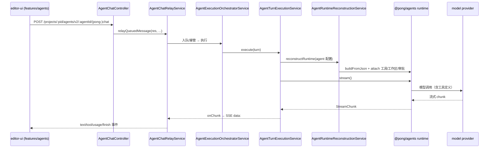
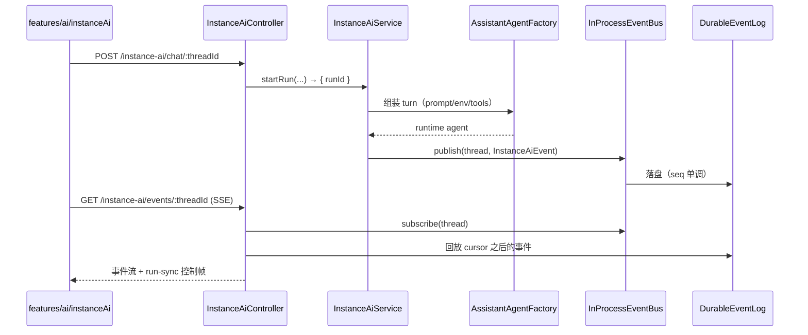

# pong-studio 现有 AI/Agent 基座盘点与 studio 集成改造面分析

> 目的：判断在「pong-studio（n8n 2.48 深度二开、已删 license/套餐 UI、pnpm workspace）注入 easyCode 运行时」时，哪些基座可复用、哪些必须改造、哪些应删除；并给出落点候选与否决理由。
>
> 范围：`C:\Users\NJHTR\IdeaProjects\seekwd\pong-studio`（下文路径均相对该目录）。easyCode 侧事实见同目录 `easycode-analysis.md`（下称「easyCode 报告」），本文不重复其内核分析。
>
> 方法：只读代码，逐条给出「文件:行号」。未打开核对的文件标注「文件级」。所有结论以当前工作区源码为准（n8n 2.48 基线 + pong 二开层）。

---

## 0. 结论摘要（先给判断）

1. **pong-studio 不是一个「有 AI 功能的 n8n」，而是一个已经长出完整 agent 平台的三层结构**：`@pong/agents`（AI SDK 上的 agent 运行时）→ `@pong/instance-ai`（域工具与事件协议）→ `packages/cli/src/modules/{instance-ai,agents,chat-hub,mcp}`（产品线与 HTTP 面）。easyCode 不需要重造 agent 循环、工具注册、审批、流式、持久化；需要替换的是「工具执行面（本地 FS/命令）」与「编码型会话的产品形态」。
2. **关键断点只有一个：工具执行面在远端**。所有 `workspace_*` 工具都挂在 `AgentSandboxRuntimeService` 上，实际 provider 只有 `daytona` 与 `pong-sandbox`（远端服务），**本地文件系统没有任何入口**（`packages/cli/src/modules/agents/agent-sandbox-runtime.service.ts:40,354-358,397-441`）。这是桌面化与 easyCode 注入的第一落点，也是当前「单用户本地 Windows」跑不通编码 agent 的根因。
3. **对话执行链路已有四条**：Assistant（instance-ai 自有 orchestrator）、Agents 产品线（v2 + pong-chat）、Chat Hub（workflow 驱动）、原生 AI Agent 节点（workflow 内）。再加 easyCode 会成为第五条。**必须先收敛再注入**，否则会话/任务/审批/产物四套模型会指数级叠加。
4. **可复用基座的质量高于预期**：workflow 引擎（`packages/core/src/execution-engine/workflow-execute.ts:122`）、凭据存储（`packages/cli/src/credentials/credentials.service.ts:256`）、执行历史（`packages/@pong/db/src/entities/execution-entity.ts:41`）、SSE 通道（`packages/cli/src/modules/agents/agent-sse-stream.ts:24`、`instance-ai.controller.ts:219`）、MCP 客户端（`packages/@pong/agents/src/sdk/mcp-client.ts:43`）、node 定义体系（`@pong/nodes-langchain` + `NodesLoader`）都可直接成为 easyCode 的工具层或事件层。
5. **前端改造面集中在 3 个 feature 与 1 个共享包**：`features/agents`、`features/ai/instanceAi`、`features/ai/chatHub`、`features/ai/assistant`（旧版）；`@pong/rest-api-client` **没有 AI 域接口**，只提供传输层，AI 端点散落在各 feature 内（见 §2.9）。新增 UI 概念应尽量映射到已有实体（thread/execution/plan/artifact/approval），不要新造平行模型。
6. **与原生 AI Agent 节点的关系：并存 + 单向依赖，不做替换**。Agent 节点是「workflow 内的 LLM 步骤」，Agents 产品线已经把它当工具引用（`workflow`/`node` 两类工具，见 `agent-tool` 元数据与 `BUILT_IN_TOOLS.md:132-143`）。easyCode 应取代的是编码型会话的执行内核，而不是 Agent 节点。
7. **桌面化有两个硬约束**：单用户/多租户 RBAC 骨架遍布 controller（`@GlobalScope`/`@ProjectScope`），本地单机需要一等的 local owner principal；离线优先要求把云依赖（Daytona、AI Gateway、browser-use cloud、MCP registry、PostHog、LangSmith 导出）变成「可缺省」。**license 并未真正删干净**：`license.service.ts` 仍在、后端仍有 10 处 `feat:` gate，甚至会把「Pro plan」文案注入模型上下文（`instance-ai.adapter.service.ts:1059-1077`）。这是必须在桌面版前处理的技术债。

---

## 1. 版本与拓扑事实

| 事实 | 证据 |
| --- | --- |
| pnpm workspace 覆盖 `packages/*`、`packages/@pong/*`、`packages/frontend/**`、`packages/modules/**`、`packages/extensions/**`、`packages/quality/**` | `pnpm-workspace.yaml:46-52` |
| 后端为 Express + TypeORM + DI 容器；模块通过 `@BackendModule` 注册，`ModuleInterface` 提供 `init/settings/entities/systemTasks/context/shutdown` | `packages/cli/src/modules/instance-ai/instance-ai.module.ts:7-16,148-284`；`packages/cli/src/modules/agents/agents.module.ts:8-10,223-365` |
| 数据库默认 `sqlite`，可切 `postgresdb` | `packages/@pong/config/src/configs/database.config.ts:142,164-166` |
| 用户目录由 `PONG_USER_FOLDER` 决定（本地开发脚本已指向 `.pong-data`） | `packages/@pong/config/src/utils/utils.ts:9`；`seekwd/start-pong.ps1` 第 6 行 |
| 当前本地「类桌面」部署：Node 直跑 `packages/cli/bin/pong start`，端口 5678 | `seekwd/start-pong.ps1` 第 17-18 行 |
| 本地沙箱是 Docker 三件套（sandbox-api + dind runner），只绑 127.0.0.1:8080 | `seekwd/sandbox/compose.yml`（services `sandbox-api`/`sandbox-runner-1`）、`seekwd/start-sandbox.cmd` |
| 本地搜索是 searxng 容器 | `seekwd/start-searxng.cmd`（文件级） |
| 无 Electron/Tauri 依赖，无 desktop 包；`electron` 仅在 `allowBuilds` 中被显式禁构 | `pnpm-workspace.yaml`（`allowBuilds.electron: false`）；全仓 `package.json` 无 electron/tauri 命中（检索结果 0） |

**含义**：当前形态是「本地单进程 + 本地 Docker 沙箱 + 浏览器访问」，不是真正的桌面应用；没有进程管理壳，也没有渲染进程 IPC 层。easyCode 注入要么先在 cli 进程内做子进程 supervisor，要么先补一个桌面壳。

---

## 2. 现有 AI/agent 模块盘点

### 2.1 包级拓扑

| 层 | 包/目录 | 职责 | 规模信号 |
| --- | --- | --- | --- |
| Agent SDK | `packages/@pong/agents` | AI SDK 之上的 agent 运行时：builder、tool、MCP、memory、subagent、guardrail、workspace/sandbox、streaming、telemetry | `src/runtime/**`、`src/sdk/**`、`src/workspace/**`（文件级） |
| 域工具/协议 | `packages/@pong/instance-ai` | Assistant 域工具（40+ 工具文件）、事件 schema、prompt profile、MCP 工具转换、workspace/sandbox 抽象 | `src/tools/**`、`src/index.ts`、`src/tool-registry.ts:5-38` |
| Assistant 运行时 | `packages/cli/src/modules/instance-ai` | 「pong Assistant」：线程、run、SSE、审批、记忆、沙箱配置、self-healing、eval | 77 个根文件 + `assistant-agent/`、`event-bus/`、`eval/`、`self-healing/` |
| Agents 产品线 | `packages/cli/src/modules/agents` | 一等公民 Agent 实体：草稿/发布/版本、会话、执行、计划、后台任务、审批、渠道集成 | 130+ 文件，35 个实体 |
| Chat Hub | `packages/cli/src/modules/chat-hub` + `packages/@pong/chat-hub` | n8n 原生聊天：把会话编译成临时 workflow 执行 | 30 文件 |
| MCP（三向） | `packages/cli/src/modules/{mcp,mcp-registry,mcp-discovery,instance-ai/mcp}` | ① pong 作为 MCP server ② 注册表/客户端 ③ assistant 连接管理 | 见 §2.6 |
| 旧 AI Assistant | `packages/cli/src/controllers/ai.controller.ts` + `features/ai/assistant` | n8n 原版 Ask AI / builder（走 `@n8n_io/ai-assistant-sdk` 与 AI Gateway） | `ai.controller.ts:43-316` |
| AI 节点 | `packages/@pong/nodes-langchain` | Chat Model、Tool、Vector Store、AI Agent 节点 | `nodes/agents/Agent/Agent.node.ts:8-191` |
| 前端 | `packages/frontend/editor-ui/src/features/{agents,ai}` + `packages/frontend/@pong/chat` | 5 套 AI 入口 | 见 §2.8 |

### 2.2 `packages/cli/src/modules/instance-ai`（Assistant 运行时）

- 模块声明挂在 main/worker/webhook 三类实例上，但只有 main 做真实初始化：`instance-ai.module.ts:7-20`。
- 启动顺序：注册凭据使用策略 → 载入设置 → 挂 controller → 视 flag 载入 eval/self-healing → 注册 Assistant system agent → 中断 run 对账：`instance-ai.module.ts:16-101`。
- Assistant 作为 **system agent** 注册进 Agents 运行时，而不是只跑自己的 orchestrator：`instance-ai.module.ts:83-85,104-133`；注册点是 `SystemAgentRegistrationService.register(AssistantAgentProvider)`（`:120-122`）。
- 持久化实体 19 张：thread / message / resource / checkpoint / pendingConfirmation / observation(+cursor/lock) / mcpRegistryConnection / threadGrant / threadTabs / eventLog / workflowSuggestion(+activity) / selfHealing 4 张：`instance-ai.module.ts:193-262`。
- Assistant 自己的 HTTP 面分三处，且注释明确规定「按运行时归属分文件」：只属旧运行时的路由在 `instance-ai.controller.ts:63-69`，共用路由在 `assistant.controller.ts`，只属 Assistant agent 的在 `assistant-agent.controller.ts:1-59`。**这是「双运行时并存」留下的历史分层**，注入前必须理解。
- 事件回传是「先订阅、再回放、最后接管」的结构化 SSE：`instance-ai.controller.ts:219-547`（订阅在 `:294`，durable 回放在 `:414`，run-sync 控制帧在 `:372-397`，keep-alive 在 `:543-546`）。
- 运行控制面：`startRun`（`instance-ai.service.ts:1143-1205`）、`cancelRun`（`:1263-1330`）、`hasActiveRun`（`:810`）、`getThreadStatus`（`:826`）、`shutdown`（`:1718`）、`replayUndeliveredTerminalOutcomes`（`:2008`）。

### 2.3 `packages/@pong/instance-ai`（域工具层）

- 工具注册表：`createToolRegistry` / `mergeToolRegistries` / `toolRegistryValues`（`src/tool-registry.ts:5-38`），本质是 `Map<string, BuiltTool>`。
- 编排器域工具工厂：`getOrchestratorDomainToolFactories`（`src/tools/index.ts:114-266`）——按 action 展开 workflow / execution / credential / data-table / workspace / research / nodes / models / ask-user / build-workflow 工具；flag 驱动的可选工具（`credentialDescriptions`、`onboarding`、`eval-config`、`mcpServers`、`conversationHistory`、`activity`、`agentContext`、`saveUserPreference`、`skills`、`apps`、`parse-file`）在同函数内按 context 是否存在追加（`:174-263`）。
- 编排专用工具（只给 orchestrator，不给子 agent）：`createOrchestrationTools`（`src/tools/index.ts:286-330`）——`task_control`、验证裁决、workflow 验证、凭据套用、`select_agent`、agent-builder 工具集、`get_session`。
- 工具清单文档（行为契约、附加条件）在 cli 侧：`packages/cli/src/modules/agents/BUILT_IN_TOOLS.md:1-262`，其中工具可见性/原生工具延迟加载策略在 `:15-58`。
- 与 n8n 内部打交道的桥在 adapter：`instance-ai.adapter.service.ts:543 createContext`（一次 run 的能力开关集合）、`:1177 createWorkflowAdapter`、`:2200 createExecutionAdapter`、`:2991 createCredentialAdapter`、`:3906 createWebResearchAdapter`、`:4088 createNodeAdapter`、`:4542 createWorkspaceAdapter`、`:814 resolveExperimentGates`。

### 2.4 `packages/@pong/agents`（Agent SDK 运行时）

- 公开面（builder）：`src/sdk/agent.ts`、`tool.ts`、`mcp-client.ts:43 McpClient`、`memory.ts`、`guardrail.ts`、`catalog.ts`、`telemetry.ts`（文件级 + `src/index.ts`）。
- 运行时内核：`src/runtime/loop/agent-runtime.ts`（AI SDK 循环）、`runtime/tools/tool-catalog.ts`、`tool-call-runner.ts`、`tool-adapter.ts`、`delegate-sub-agent-tool.ts`、`runtime/streaming/stream.ts`、`stream-session.ts`、`runtime/memory/**`（观测记忆/情景记忆）、`runtime/mcp/mcp-connection.ts:1-60`（stdio/SSE/streamable HTTP 三种 transport）、`runtime/model/model-factory.ts`（多 provider）。
- workspace/sandbox 抽象：`src/workspace/**`（`Workspace`、`createScopedWorkspace`、`CORE_WORKSPACE_TOOL_NAMES`、`createSandbox`、`createFilesystem`、`getPromptWorkspaceRoot`），cli 侧只消费这些导出（`agent-sandbox-runtime.service.ts:1-12`、`agent-workspace.service.ts:3-8`）。
- 关键设计：`Agent` 的 `.tool()/.workspace()/.checkpoint()/.model()` 都是惰性 builder，真正 build 在首次 `stream()/generate()`；引擎层通过继承 `build()` 注入基础设施（`packages/@pong/agents/AGENTS.md` 的 “Engine Injection” 段）。

### 2.5 `packages/cli/src/modules/agents`（Agents 产品线）

- 模块初始化挂 19 个 controller、消息队列消费者、后台任务、渠道 reconciler、durable 调度：`agents.module.ts:28-47,144-220`。
- 35 个实体（agent、version/history、thread、message、execution、execution-thread、message-link、checkpoint、backgroundJob、plan(+history)、task(+runLock/snapshot)、2×budget、4×memoryEntry、2×skillDependency、chatAttachment、fileGrant、chatSubscription、channelStatus、resource、threadGrant、workflow/credentialDependency）：`agents.module.ts:264-358`。
- HTTP 面统一前缀 `/projects/:projectId/agents/v2`：`agent-chat.controller.ts:73`；预览聊天 `POST /:agentId/chat`（`:252`）、生产聊天 `POST /:agentId/pong-chat`（`:169`）、恢复（`:213,321`）、取消（`:354-447`）、队列/steering（`:518-798`）、计划（`:987-1020`）、后台任务（`:614-673,1021-1061`）、消息与附件（`:449-517,1062-1196`）。
- 执行链：`AgentTurnExecutionService.execute`（`agent-turn-execution.service.ts:141-200+`）负责 admission → 跑 run → 记录 → 终态；SSE 映射在 `agent-sse-stream.ts:24-77`（`initSseStream`）、`:241-316`（`emitChunkEvents`，含 `subagent-chunk`）。
- 运行时重建：`AgentRuntimeReconstructionService.reconstructRuntime`（`agent-runtime-reconstruction.service.ts:703-753`）→ `buildConfiguredRuntime`（`:782-833`，`buildFromJson` + toolResolver + MCP client 工厂）→ `injectRuntimeDependencies`（`:1083-1112`）→ `attachWorkspaceAndKnowledge`（`:1114-1140`）→ `attachTopLevelTools`（`:1280+`）。
- 沙箱：provider 仅 `daytona` / `pong-sandbox`（`agent-sandbox-runtime.service.ts:354-358`），`daytona` 需要 Daytona 凭据（`:397-418`），`pong-sandbox` 需要 `PONG_SANDBOX_SERVICE_URL`（`:420-441`，缺失直接抛 `OperationalError`）。`isEnabled()` 在 `:283`。workspace 获取与子 agent 目录隔离在 `agent-workspace.service.ts:42-101`。
- 上下文读服务（给 tool / UI 复用）：`AgentContextService`（`agent-context.service.ts:83-120`，`readArtifact`、会话列表/详情映射）。

### 2.6 Chat Hub（n8n 原生聊天）

- 模块只挂 2 个 controller + 事件 relay + execution watcher：`chat-hub.module.ts:7-23`；4 张实体：session/message/agent/tool（`:42-49`）。
- HTTP 面 `/chat-hub`：会话 CRUD（`chat-hub.controller.ts:93-395`）、发消息（`:165,191`）、工具 CRUD（`:397-440`）、chat agent CRUD 与文件（`:442-510`）、模型列表（`:83`）。
- 执行模型是 **workflow 驱动**：`ChatHubWorkflowService.createChatWorkflow`（`chat-hub-workflow.service.ts:111+`）把会话历史 + 模型 + 工具编译成临时 workflow（涉及 `CHAT_TRIGGER_NODE_TYPE`、`AGENT_LANGCHAIN_NODE_TYPE`、`MEMORY_BUFFER_WINDOW_NODE_TYPE` 等常量，`:29-49`）；执行完成由 watcher 收尾（`chat-hub-execution-watcher.service.ts:117 handleWorkflowExecuteAfter`、`:54` 恢复）。
- **含义**：Chat Hub 是「n8n workflow 能力的最小可用聊天壳」，与 Agents/Assistant 的持久化模型完全不同（session/message，无 execution 实体、无审批实体）。桌面版可考虑砍掉或收敛进 Agents。

### 2.7 MCP：三个方向都要分清

| 方向 | 实现 | 关键引用 |
| --- | --- | --- |
| pong 作为 MCP **server**（把 workflow/credential/tag 等能力暴露给外部 agent） | `packages/cli/src/modules/mcp` | `mcp.service.ts:235 class McpService`、`mcp.controller.ts:135` 判断 `tools/call`、`mcp.settings.controller.ts:19 @RestController('/mcp')`、`mcp-api-key.service.ts`、`tools/` 下 workflow/credential/tag/gateway 工具 |
| pong 作为 MCP **client**（消费外部 MCP server） | `modules/mcp-registry` + `modules/mcp-discovery` | `mcp-registry/registry/mcp-registry.service.ts`、`mcp-registry-connection.ts`、`mcp-registry-node-loader.ts`（把 MCP server 合成为节点）、`mcp-auth-fetch.ts` |
| Agent 会话的 MCP 连接管理（Assistant 连接自己的 MCP） | `modules/instance-ai/mcp` + `@pong/agents` 运行时 | `instance-ai/mcp/instance-ai-mcp-connection.controller.ts:48-141`（list/create/tools/patch/delete）、`@pong/agents/src/runtime/mcp/mcp-connection.ts:27-60`、`sdk/mcp-client.ts:43` |
| 「外部 CLI agent 直接驱动 pong」已有先例 | `@pong/agents` MCP server 化 + 官方对比脚本 | `.env.ai-surfaces.example:1-15`（对比 Instance AI / Claude Code + pong MCP / Codex + pong MCP）、`packages/cli/src/modules/mcp/tools/**` |

**含义**：这是 easyCode 最便宜的 PoC 通道——先让 easyCode 通过 pong MCP server 调 workflow 工具，不改 pong 一行代码；深集成再谈。

### 2.8 前端 AI 面（5 套入口，2 套设计语言）

| 入口 | 目录 | 路由/形态 | 证据 |
| --- | --- | --- | --- |
| Agents（新产品线） | `features/agents` | `/home/agents`、`projects/:id/agents`、`agents/:agentId`（含 builder/preview/sessions） | `features/agents/module.descriptor.ts:44-136,138-162,163-177` |
| Assistant（instance-ai） | `features/ai/instanceAi` | `/assistant`、`/assistant/new`、`/assistant/history`、`/assistant/:threadId`、self-healing 路由 | `features/ai/instanceAi/module.descriptor.ts:113-223` |
| pong Chat（Agents 的对话形态） | `features/agents/pongChatPage` | `/assistant/agents`、`/assistant/agents/:agentId/:agentThreadId?` | `features/agents/module.descriptor.ts:112-136` |
| Chat Hub | `features/ai/chatHub` | `/home/chat`、`/home/chat/:id`、workflow-agents、personal-agents | `features/ai/chatHub/module.descriptor.ts:107-149` |
| 旧 AI Assistant | `features/ai/assistant` | workflow 编辑器内 AI 面板（`/ai/build`、`/ai/chat`、`/ai/ask-ai`、`/ai/sessions`） | `features/ai/assistant/assistant.api.ts:30,65,82,97,107,127`；后端 `packages/cli/src/controllers/ai.controller.ts:43-316` |

- Agents 前端规模：`features/agents` 下 200+ 文件，`components/` 约 90 个组件（含 timeline-items、VersionHistory、model-selector、AgentSetupTasks），`composables/` 约 70 个（文件级检索结果）。
- Assistant 前端规模：`features/ai/instanceAi` 约 60 个根文件 + `components/` 40+ 组件 + `composables/` 30+（文件级）。
- SSE 客户端：Assistant 用原生 `EventSource`（`instanceAi.threadRuntime.ts:1285-1318`，含 `run-sync` 命名事件监听 `:1304`）；Agents 用 `fetch` + `body.getReader()` 手工解析 SSE（`useAgentChatStream.ts:1481-1482,1575`）。**两套解析逻辑，一套统一 SDK 都没有。**

### 2.9 API 客户端层：`@pong/rest-api-client` 的现状缺口

- 该包只有 `src/index.ts`、`src/api/*`（44 个文件，含测试）、`src/utils.ts`，导出 `export * from './api'`（`packages/frontend/@pong/rest-api-client/src/index.ts:1-3`）。
- `src/api/` 中与 AI 相关的只有 `ai-usage.ts` 一个文件；**没有** instance-ai、agents、chat-hub、mcp 的域接口（文件级检索：`ai-usage.ts` 为唯一命中）。
- 实际 AI 端点定义在 feature 内，且直接拼 URL：`features/ai/instanceAi/instanceAi.api.ts:28-217`、`instanceAi.memory.api.ts:21-131`、`instanceAi.mcp.api.ts:23-67`、`agents/composables/useAgentChatStream.ts:1575`（裸 `fetch`）、`features/ai/assistant/assistant.api.ts:10`（复用 `makeRestApiRequest/streamRequest`）。
- **含义**：新增 easyCode 会话 API 时，要么继续散落在 feature，要么补一个 `api/agents.ts`/`api/easycode.ts` 到 rest-api-client。当前缺少统一错误/重试/鉴权钩子，这是前端接入成本的最大隐藏项。

### 2.10 AI 节点与 node 定义体系

- `Agent` 节点是版本化节点类型（`VersionedNodeType`），默认 3.1，历史版本 1→3.1 全保留：`packages/@pong/nodes-langchain/nodes/agents/Agent/Agent.node.ts:8-31,170-191`。
- 节点通过 `codex.builderHint` 向 AI builder 暴露使用范式（含 `subnodes` 模型/记忆/工具/解析器、fallback model、`nodeJson` 取值规则）：同文件 `:32-168`。**这本身就是「AI 可读的节点契约」**，可直接给 easyCode 读。
- 工具类节点族：`nodes/tools/**`（ToolWorkflow、ToolCode、ToolHttpRequest、ToolVectorStore 等）；`AgentTool.node.ts` 支持多 agent 编排（文件级）。
- 节点定义加载：`packages/core/src/nodes-loader/**`（文件级），cli 侧 `instance-ai.adapter.service.ts:4072 getNodeDefinitionDirs`、`:4082 getNodeCatalogService`、`:4088 createNodeAdapter`（把节点目录/类型/参数选项做成 agent 工具）。

---

## 3. 现有 AI 对话/agent 的执行链路

### 3.1 链路 A：Agents 产品线（v2 / pong-chat）——「实体化 agent + 独立运行时」

1. **请求入口**：`POST /projects/:projectId/agents/v2/:agentId/pong-chat`（`agent-chat.controller.ts:169-211`）与 `POST .../:agentId/chat`（`:252-319`）。两者都先经 `AgentChatRelayService.relayQueuedMessage`（`agent-chat-relay.service.ts:126`）做「同会话排队 / 接管 / SSE 头初始化」；恢复走 `relayResume`（`:53`）。
2. **准入与持久化**：预览聊天先 `AgentTestRunService.prepareDraftRun`（`agent-test-run.service.ts:184`）解析草稿 agent、会话模式、凭据提供者；生产聊天校验 `isPongChatPublished`（`agent-chat.controller.ts:180`）。
3. **执行编排**：`AgentExecutionOrchestratorService`（`agent-execution-orchestrator.service.ts:365+`）决定 start/resume、加载已发布版本、绑定 memory resource。
4. **单轮执行**：`AgentTurnExecutionService.execute`（`agent-turn-execution.service.ts:141-200`）依次做 recorder 创建 → `prepare()` 组装 turn → 聊天 surface 绑定 AbortController → `admitTurn` → `streamTurn`。停止/取消语义在 `:175-199`。
5. **运行时重建（上下文 + 工具）**：`reconstructRuntime`（`agent-runtime-reconstruction.service.ts:703-753`）→ `buildConfiguredRuntime`（`:782-833`）：`buildFromJson(config, toolDescriptors, {...})` 得到 agent 实例，`resolveTool` 回调把每个工具塞进 `resolvedTools` 并生成 `toolRegistry`（`:744`）。工具来源：内置工具（`injectRuntimeDependencies` `:1083-1112`）、workspace/knowledge（`:1114-1140`）、渠道集成工具（`:1198-1222`）、顶层工具（`:1280+`）。
6. **工具暴露**：全部收敛为 `BuiltTool`，注册表是 `Map<string, ToolRegistryEntry>`（`packages/cli/src/modules/agents/tool-registry.ts:28-63`），条目区分 `kind: 'tool' | 'workflow' | 'node'`（`:3-18`）——这就是「workflow 即工具、node 即工具」的实现基础。
7. **原生工具延迟加载**：`agent.nativeToolDeferral({ eagerToolNames: harnessEagerToolNames(params) })`（`agent-runtime-reconstruction.service.ts:1087`），策略文档见 `BUILT_IN_TOOLS.md:15-58`。
8. **流式回传**：`initSseStream` 写 SSE 头并每 30s 心跳（`agent-sse-stream.ts:24-77`，头在 `:25-28`，心跳 `:48`）；`emitChunkEvents` 把 `StreamChunk` 翻译为 `AgentSseEvent`（`:241-316`）：text/reasoning 生命周期、tool 生命周期、`tool-call-suspended`（HITL 挂起，`:225-234`）、`subagent-chunk`（子 agent 嵌套事件，`:280-289`）、`finish`（含 usage/guardrail）。
9. **持久化**：执行记录走 `AgentExecutionService` + `execution-recorder`，实体见 `agents.module.ts:264-358`；会话消息/附件/计划/后台任务各表独立。

### 3.2 链路 B：Assistant（instance-ai）——「双运行时 + 事件总线」

1. **请求入口**：`POST /instance-ai/chat/:threadId` 返回 `{ runId }`，**不是流**（`instance-ai.controller.ts:130-216`，返回在 `:215`）；此处做实例开关、模型配置、附件校验、单 run 互斥（`:186-188`）。
2. **启动**：`InstanceAiService.startRun` 创建 runState（runId/abortController/messageGroupId），写时区、browserUse、build mode、prompt version，再异步 `startExecuteRun`（`instance-ai.service.ts:1143-1205`）。
3. **上下文组装**：`AssistantTurnInputBuilder`（`assistant-turn-input.builder.ts:219+`）拼模型输入（系统提示、记忆、技能、附件、线程产物）；`AssistantTurnEnvironmentFactory`（`assistant-turn-environment.factory.ts:132+`，proxy 配置 `:168-181`）决定模型与 credits；`AssistantAgentFactory.createAgent`（`assistant-agent.factory.ts:110+`）按 `InstanceAiContext` 能力开关装配工具（域工具工厂 `@pong/instance-ai/src/tools/index.ts:114-330`）。
4. **工具暴露**：`InstanceAiContext`（`instance-ai.adapter.service.ts:543-620`）是「一次 run 的能力清单」；工具是否出现由 context 字段是否存在决定（如 `mcpService`、`activityService`、`skillService`），见 `@pong/instance-ai/src/tools/index.ts:174-263`。
5. **执行**：orchestrator 循环 + 子 agent（`@pong/instance-ai/src/runtime/**`、`src/workflow-loop/**`）；自愈（self-healing）是独立 agent 流程（`instance-ai/self-healing/self-healing-agent.service.ts`，文件级）。
6. **流式回传**：事件总线 + durable log：
   - 订阅先于回放：`instance-ai.controller.ts:294`；
   - 回放游标来源 `Last-Event-ID` 或 `?lastEventId`（`:330-333`）；
   - durable 回放 `eventLog.getEventsAfter`（`:414`），gap 读（`:454`），开段 delta 快照（`:465-531`）；
   - `run-sync` 控制帧携带完整 agentTree，无 `id:` 行以免污染游标（`:368-397`）。
   - 持久化在 `instance-ai/event-bus/durable-event-log.ts`（838 行）与 `entities/instance-ai-event-log-entry.entity.ts`。
7. **持久化实体**：thread/message/resource/checkpoint/pendingConfirmation/observation/threadGrant/threadTabs/eventLog 等 19 张（`instance-ai.module.ts:193-262`）。
8. **两套运行时共享同一批前端路由**：`instance-ai.controller.ts:63-69` 的注释明确说明「只属旧运行时的路由会随运行时一起删除；两运行时共用的放 `AssistantController`；只属 Assistant agent 的放 `AssistantAgentController`」。

### 3.3 链路 C：Chat Hub（workflow 驱动）

1. `POST /chat-hub/conversations/send`（`chat-hub.controller.ts:165`）→ `ChatHubService` → `ChatHubWorkflowService.createChatWorkflow`（`chat-hub-workflow.service.ts:111+`）。
2. 该服务把「历史消息 + 模型 + 工具 + 系统提示」编译成**临时 workflow**（常量见 `chat-hub-workflow.service.ts:29-49`），再交给 n8n workflow 执行器。
3. 执行结束由 `ChatHubExecutionWatcherService.handleWorkflowExecuteAfter`（`chat-hub-execution-watcher.service.ts:117`）从 runData 抽取回复、写 `ChatHubMessage`；恢复走 `handleExecutionResumed`（`:54`）。
4. 流式由 `ChatStreamService`（`chat-stream.service.ts:51+`）以 `data:` 帧推送，事件形状同样是 SSE（`:74-213`）。
5. **特征**：完全没有 agent 实体、审批、计划；模型循环由 AI Agent 节点完成。它是「workflow 引擎 + 聊天 UI」的最薄封装。

### 3.4 三条链路的上下文组装对比

| 维度 | Agents（v2） | Assistant（instance-ai） | Chat Hub |
| --- | --- | --- | --- |
| 配置来源 | `AgentJsonConfig`（草稿/已发布版本，含 tools/workflows/nodes/memory/knowledge） | 全局 Assistant 设置 + 线程级 tabs/artifacts + handoff context | 会话内模型选择 + chat agent 配置 |
| 系统提示 | agent 配置 + capabilities/limitations + 技能 | prompt profile（`@pong/instance-ai/src/prompts/prompt-profiles.ts`）+ onboarding + 技能 | AI Agent 节点参数 |
| 工具来源 | 内置 + 工作流 + 节点 + 集成 + MCP + 知识 | `InstanceAiContext` 域工具 + 编排工具 + MCP + 技能 | 会话工具表（`chat_hub_tool`） |
| 记忆 | 观测记忆/情景记忆（`@pong/agents/src/runtime/memory/**`） | observational memory（thread 级，见 `packages/@pong/instance-ai/CLAUDE.md` 约定） | workflow memory 节点（buffer window） |
| 工作区 | 远端沙箱（daytona/pong-sandbox） | 远端沙箱（Assistant 专属 lease：`assistant-workspace-source.ts`，文件级） | 无 |
| 审批 | `agent-tool-approval.service.ts` + `tool-call-suspended` | pendingConfirmation 实体 + `/instance-ai/confirm/:requestId`（`instance-ai.controller.ts:549`） | 无 |
| 持久化 | agent_thread/message/execution/plan/backgroundJob | instance_ai_thread/message/eventLog/observation | chat_hub_session/message |

### 3.5 工具暴露机制（四层，注入前必须理解）

| 层 | 机制 | 引用 |
| --- | --- | --- |
| 1. 声明 | Zod schema + `BuiltTool`（`@pong/agents`） | `packages/@pong/agents/src/sdk/tool.ts`（文件级） |
| 2. 解析 | `toolDescriptors` + `resolveTool` 回调（Agents）；`createOrchestratorDomainTools`（Assistant） | `agent-runtime-reconstruction.service.ts:814-818`；`@pong/instance-ai/src/tools/index.ts:274-280` |
| 3. 授权/审批 | 工具级审批 + HITL 挂起（`wrapToolForApproval`、`agent-tool-approval.service.ts`） | `@pong/agents/src/runtime/mcp/mcp-connection.ts:6`；`agents/agent-tool-approval.service.ts` |
| 4. 执行 | 安全运行时（V8 isolate）执行用户代码工具；内置工具直接调用服务 | `agents.module.ts:93-96`（`AgentSecureRuntime` 惰性启动）；`agent-runtime-reconstruction.service.ts:798` |

**含义**：easyCode 的工具面不应当是「再造一层工具注册」，而是（a）继续作为 pong 工具被调用，或（b）让 easyCode 的 dynamic tools 回调进 pong 的审批/工具注册表。后者才是「easyCode 当内核」的真正含义。

### 3.6 流式回传的语义差异（统一时最容易踩的坑）

| 语义 | Agents SSE | Assistant SSE |
| --- | --- | --- |
| 帧格式 | 未命名 `data:` 帧，JSON 为 `AgentSseEvent` | 未命名 `data:` 帧（`InstanceAiEvent`）+ 命名 `event: run-sync` 帧（无 id） |
| 断线续传 | 无游标，靠前端重连 + 重新拉消息 | `Last-Event-ID` / `?lastEventId`，durable log 回放 |
| 文本增量 | `text-start/delta/end` 原样转发 | `text-delta` 实时 + 落盘时合并为 `text-block`；重连时用 `text-block` + 开段快照 |
| 子 agent | `subagent-chunk` 带 `parentToolCallId`/`taskPath` | `run-sync` 携带 `agentTree`（前端 reducer 重建） |
| HITL | `tool-call-suspended` 事件 | `pendingConfirmation` 实体 + 确认卡片 + `/confirm` |
| 心跳 | 30s `:ping` | 15s `: ping` |

- 事件 schema 的单一事实源在 `packages/@pong/api-types/src/schemas/instance-ai.schema.ts:266-290,1358-1441`（`InstanceAiEvent` 在 `:1434`）；前端共享 reducer 在 `packages/@pong/api-types/src/schemas/agent-run-reducer.ts:134-280`。
- **结论**：新增 easyCode 事件面时，应优先复用 `InstanceAiEvent` 形状（有 reducer、回放、调试面板），而不是再定义第三套。

### 3.7 持久化全景（按实体归属）

| 关注点 | Agents | Assistant | Chat Hub | 通用 |
| --- | --- | --- | --- | --- |
| 会话 | `agent_thread`、`agent_message` | `instance_ai_thread`、`instance_ai_message` | `chat_hub_session`、`chat_hub_message` | — |
| 运行记录 | `agent_execution`(+thread/message link)、`agent_checkpoint` | runState（内存）+ `instance_ai_event_log` | n8n `execution_entity` | `ExecutionEntity`（`packages/@pong/db/src/entities/execution-entity.ts:41`） |
| 计划/任务 | `agent_plan`(+history)、`agent_task`(+snapshot/runLock) | threadTabs、workflowSuggestion | 无 | — |
| 后台任务 | `agent_background_job` | runState 内 backgroundTasks | workflow 执行 | — |
| 审批 | 工具审批 + 挂起 checkpoint | `instance_ai_pending_confirmation` | 无 | — |
| 产物 | 会话文件（attachment + sandbox outputs） | `instance_ai_resource` + artifacts tabs | workflow 输出 | binary data 存储 |
| 记忆 | 4 张 memoryEntry(+candidate/lock/source) | 4 张 observation(+cursor/lock) | memory 节点 | — |

---

## 4. 可复用基座清单

### 4.1 六个基座的能力与复用方式

| 基座 | 现有实现 | 引用 | 复用方式 | 风险 |
| --- | --- | --- | --- | --- |
| **workflow 引擎** | `WorkflowExecute`（节点执行、路由、触发/poll、SSH、scheduled task） | `packages/core/src/execution-engine/workflow-execute.ts:122,1380`；相关协作者同目录 | 直接作为「确定性编排层」；easyCode 的产出（workflow JSON）由它校验/执行 | 引擎假设完整实例上下文（additionalData、credentials、binary data），桌面裁剪时不能抽干 |
| **凭据存储** | `CredentialsService`（加密、类型解析、测试、依赖统计） | `packages/cli/src/credentials/credentials.service.ts:256+`；`@pong/db` credential 实体（文件级） | 直接复用；easyCode 的模型 provider key 也走这里（参考 `AgentsCredentialProvider`，`agent-chat.controller.ts:264-269`） | 加密 key 与实例绑定；迁移/备份要带 key（`docs/generic` 之外见 ADR 约定） |
| **执行历史** | `ExecutionEntity` + `ExecutionService` + `/executions` controller + viewer | `packages/@pong/db/src/entities/execution-entity.ts:41`；`packages/cli/src/executions/executions.controller.ts:20,34,61,72`；`execution-viewer-reader.ts`、`engine-v2-execution-reader.service.ts` | 直接复用为「产物/运行历史」；easyCode 的 turn 可映射为 execution 或独立表 | engine-v2 与 v1 两套读取路径并存（`execution-list-v1/v2.service.ts`），新代码要选一边 |
| **SSE 通道** | Agents SSE（`initSseStream`）与 Assistant SSE（controller 内联）+ Chat Hub 流 | `agents/agent-sse-stream.ts:24`；`instance-ai.controller.ts:219`；`chat-hub/chat-stream.service.ts:51` | 抽一个共享 SSE writer（心跳/背压/关闭语义），三处行为已高度相似 | 三套实现细节不同（心跳 30s vs 15s、命名帧 vs 未命名帧），抽取需回归测试 |
| **MCP 客户端** | `McpClient`（SDK 层）+ runtime `mcp-connection`（stdio/SSE/streamable HTTP）+ registry 连接 | `@pong/agents/src/sdk/mcp-client.ts:43`；`runtime/mcp/mcp-connection.ts:27-60`；`modules/mcp-registry/mcp-registry-connection.ts` | **直接复用**，且 easyCode 自带 MCP 客户端 → 可双向桥接（pong↔easyCode 用 MCP，而非私有 RPC） | MCP 工具名冲突/审批归属需治理（`mcp-tool-availability.ts`、`mcp-attribution`） |
| **node 定义体系** | `VersionedNodeType` + `codex.builderHint` + `NodesLoader` + 节点目录服务 | `@pong/nodes-langchain/nodes/agents/Agent/Agent.node.ts:8-168`；`instance-ai.adapter.service.ts:4072-4088`；`nodes.tool.ts` | 直接复用为 easyCode 的「工具目录/知识源」：节点描述、参数 schema、示例都可被 agent 读取 | 节点数量大（nodes-base 数千），全量注入会爆上下文 → 必须走检索工具（现有 `search_nodes`/`get_node_types`） |

### 4.2 哪些可以直接当 agent 工具层（逐项裁决）

| 现有能力 | 是否已是 agent 工具 | 工具入口 | 裁决 |
| --- | --- | --- | --- |
| workflow CRUD / 执行 / 校验 | 是 | `@pong/instance-ai/src/tools/workflows.tool.ts`、`executions.tool.ts`、`workflows/build-workflow.tool.ts` | **直接复用** |
| 凭据 CRUD / 测试 / 描述 | 是 | `credentials.tool.ts`、`agent-credential-setup.ts` | **直接复用**（桌面版可隐藏「套餐」相关文案） |
| 节点检索/参数选项/执行单节点 | 是 | `nodes.tool.ts`（search/getNodeTypes/getParameterOptions/executeNode） | **直接复用** |
| data table | 是 | `data-tables.tool.ts` | 复用 |
| MCP 连接管理 | 是（Assistant 侧） | `mcp-servers.tool.ts` | 复用 |
| 技能（skills） | 是 | `skills.tool.ts` + `modules/skills` + `@pong/agents/src/skills/**` | 复用；easyCode 的技能可映射到 `skill`/`skill_version`/`skill_file` 表 |
| 研究/网页 | 是（需外网） | `research.tool.ts`、`web-research/**`（searxng 本地可替代） | 条件复用 |
| 文件解析 | 是 | `attachments/parse-file.tool.ts` | 复用（桌面版价值高） |
| 本地文件读写/命令执行 | **否**（只有远端沙箱版） | `@pong/agents/src/workspace/tools/**`（`workspace_*`）经 `AgentSandboxRuntimeService` 注入 | **必须新增本地 provider**（见 §5） |
| 浏览器操作 | 是（远端/扩展） | `instance-ai/browser/**`、`mcp-browser`、`mcp-browser-extension` 包 | 桌面版建议默认关闭 |
| 计划/待办 | 是 | `agent-plan.service.ts`、`@pong/agents/src/runtime/tools/planner-todos-tool.ts` | 复用 |
| 子 agent 委派 | 是 | `@pong/agents/src/runtime/tools/delegate-sub-agent-tool.ts` | 复用 |
| 后台任务 | 是 | `agents/background/background-job-tools.ts` + `agent_background_job` | 复用 |
| 审批 | 是 | `agent-tool-approval.service.ts` + UI `AgentToolConfigApprovalSetting.vue` | 复用，并作为 easyCode `requestApproval` 的落点（见 §5） |

> 结论：**工具层 80% 可直接复用，缺口集中在「本地执行面」**。easyCode 若要当内核，pong 侧真正要写的新代码是：协议适配、审批映射、事件映射、本地工作区，而不是工具集。

---

## 5. easyCode 运行时的注入落点

### 5.0 前提：集成面是「子进程 + JSON-RPC」，不是函数调用

easyCode 报告已证明：唯一可承载交互（审批、动态工具、steer、thread 恢复）的通道是 `easycode app-server` 的 stdio JSON-RPC（见 `easycode-analysis.md` §8.1 表格、§9.1 三条「明确不可行」、§10.1 拓扑）。因此 pong 侧的落点性质是 **进程 supervisor + 协议适配 + 事件/审批映射**，而不是「新增一个工具函数」。

同时，`easycode-analysis.md` §8.1 也明确 `exec --json` 仅适用于无人值守批处理，TS SDK 无审批/工具/提示词注入能力——**这两条直接否决了两种「一行接入」的幻想**。

### 5.1 现状约束：本地执行面完全缺失

| 事实 | 证据 |
| --- | --- |
| 沙箱 provider 只有两个，且都是远端服务 | `agents/agent-sandbox-runtime.service.ts:354-358` |
| Daytona 需要云凭据 | 同文件 `:397-418`；`@pong/config/src/configs/instance-ai.config.ts:114-118`（`DAYTONA_API_URL`/`DAYTONA_API_KEY`） |
| pong sandbox 需要独立服务 URL，缺失直接抛错 | `agent-sandbox-runtime.service.ts:420-441`；配置 `instance-ai.config.ts:110-111,122` |
| provider 默认值 | `instance-ai.config.ts:111`（`sandboxProvider: string = 'pong-sandbox'`） |
| provider 选择逻辑在服务层 | `packages/cli/src/services/sandbox-settings.service.ts:90,115` |
| workspace 工具从抽象层注入，不感知 provider | `agent-workspace.service.ts:42-101`；`@pong/agents/src/workspace/**` |
| 本地部署确有独立 sandbox 容器栈 | `seekwd/sandbox/compose.yml`、`seekwd/start-sandbox.cmd` |

**含义**：easyCode 自带沙箱与审批（easyCode 报告 §6），它**不需要** pong 的 workspace 工具链。pong 侧要做的不是「给 easyCode 提供沙箱」，而是「让 easyCode 的沙箱/审批语义映射到 pong 的 UI 与存储」。

### 5.2 候选 A：新增 `packages/@pong/easycode-runtime`（协议客户端 + 进程 supervisor）

- **内容**：app-server JSON-RPC 客户端（`initialize`/`thread/start`/`turn/start`/`turn/steer`/`turn/interrupt`/`thread/resume`）、通知多路分发、`item/*/requestApproval` 与 `item/tool/call` 回调、进程生命周期（spawn/健康检查/优雅退出）、版本探测（`easycode --version`）与二进制路径解析。
- **耦合度**：低。只依赖 Node `child_process` + 协议类型；可从 `easycode-rs/app-server-protocol/schema/typescript` 生成类型（easyCode 报告 §1.1），不 import pong 任何内部包。
- **隔离性**：中。协议层隔离好，但进程内 supervisor 仍共享 Node 事件循环（子进程崩溃不影响 pong，但 supervisor 自身逻辑 bug 会影响）。
- **改动量**：中（约 1.5k~3k 行含测试；但类型生成可省大量工作）。
- **被否决理由（作为唯一落点）**：单独一个 package 无法承载「会话/审批/事件」到 pong 实体与 SSE 的映射，也不该依赖 cli 的 DI 容器；它必须被 cli 模块消费，否则只是一个孤立的 SDK。**保留为「协议层」，不是最终形态。**

### 5.3 候选 B：新增 cli 模块 `packages/cli/src/modules/easycode`（主落点）

- **内容**：
  1. `EasycodeModule implements ModuleInterface`，按现有模式注册 controller/entities/systemTasks（模板见 `instance-ai.module.ts:148-262`）；
  2. `EasycodeSessionService`：把 pong 会话映射为 easyCode `thread`，把 turn 映射为 `turn`，落库复用/新建实体；
  3. `EasycodeApprovalService`：把 `item/*/requestApproval` 映射为现有 pendingConfirmation/工具审批 UI 语义（可复用 `agent-tool-approval.service.ts` 的决策模型）；
  4. `EasycodeEventService`：把 easyCode 通知映射为 `InstanceAiEvent` 形状（复用 `@pong/api-types` reducer 与前端 timeline）；
  5. controller：`POST /easycode/sessions`、`POST /easycode/sessions/:id/turns`、`GET /easycode/sessions/:id/events`（SSE）、`POST /easycode/approvals/:id`；
  6. 进程管理：`EasycodeProcessSupervisor`（单例 + 按会话/按用户两种模式）。
- **耦合度**：中高。硬依赖 cli 的 Container/ModuleRegistry/权限/SSE/实体注册；但它**不需要**碰 Agents 运行时的重建链路（easyCode 自己做模型循环），因此耦合面可控。
- **隔离性**：中低。同进程 + 子进程；easyCode 崩溃可控，pong 崩溃会带走 supervisor。
- **改动量**：大（约 4k~8k 行含 UI 对接），但这是唯一能闭环「会话/审批/事件/持久化」的位置。
- **被否决理由（作为唯一落点）**：如果 easyCode 未来要独立发版/独立升级节奏，cli 模块与其绑定会使升级必须重发 pong 二进制；另外 cli 模块不能同时被「桌面壳」和「无头服务」复用（虽然当前无桌面壳）。

### 5.4 候选 C：独立边缘进程（本地 sidecar）+ 桌面壳管理

- **内容**：`pong-studio` 只负责 UI 与数据；`easycode-app-server` 由桌面壳（Electron `utilityProcess` / Tauri sidecar / 一个 `pong-proxy` Node 进程）拉起；pong 通过本地 HTTP/SSE 或 stdio 代理与它通信。
- **耦合度**：最低（进程级边界，协议即契约）。
- **隔离性**：最高（崩溃域、内存、升级节奏全独立）。
- **改动量**：中（协议代理 + 进程管理 + 端口/鉴权/健康检查），但**前置条件是先有桌面壳或 sidecar 管理器**；当前仓库没有 Electron/Tauri（`pnpm-workspace.yaml` 中 `electron: false`，全仓无 electron/tauri 依赖），只有 `start-pong.ps1` 这种脚本级启动。
- **被否决理由（作为第一阶段）**：没有壳就没有进程管理落脚点；先做会引入「第二套部署形态」，与现有本地实例脚本冲突。**建议作为第三阶段目标形态。**

### 5.5 候选 D：扩展 `AgentSandboxRuntimeService` 增加 `easycode` provider —— 明确否决

- **表面理由**：改动量最小（在 `:354-358` 加一个分支，`resolvePongSandboxConfig` 旁加 `resolveEasycodeSandboxConfig`），且能直接复用 workspace 工具。
- **否决理由**：
  1. **能力不匹配**：`@pong/agents` 的 sandbox 抽象只暴露 filesystem/命令/进程（`createSandbox`/`createFilesystem`/`getPromptWorkspaceRoot`，`agent-sandbox-runtime.service.ts:1-12`），easyCode 提供的是「模型循环 + 审批 + thread」，套不进这个接口；
  2. **双沙箱冲突**：easyCode 有自己的沙箱策略（`workspace-write`/`read-only`/`danger-full-access`，easyCode 报告 §6），pong 再包一层会形成「双重沙箱/双重审批」；
  3. **错失关键能力**：走 provider 只能拿到文件与命令，拿不到 `turn/steer`、`thread/resume`、审批决策，等于把 easyCode 降级成 shell。
- **保留价值**：作为过渡补丁——如果只是想让现有 Agents 会话在本地跑命令，可以先加 `local`（= 宿主 OS）provider，但必须标注「非 easyCode 通道」。

### 5.6 候选 E：把 easyCode 当 `@pong/instance-ai` 的一个工具 / 只走 MCP 桥 —— 仅 PoC

- **内容**：(a) 新工具 `easycode_run_task`，内部 spawn `easycode exec --json`，返回最终文本；(b) 或让 easyCode 连 pong 的 MCP server（`modules/mcp`），由 easyCode 主动调 pong 工具。
- **耦合度**：极低；改动量：极小（数十行 ~ 数百行）。
- **否决理由（作为最终形态）**：
  1. `exec` 通道拒绝一切交互（easyCode 报告 §9.1 第 1 条），无法批准命令、无法回传动态工具调用，等于「黑盒批处理」；
  2. MCP 桥方向相反：easyCode 驱动 pong 工具，pong 的会话/审批/产物体现在 MCP 侧不存在，用户体验断裂；
  3. 但**作为 PoC 与降级通路很有价值**：`.env.ai-surfaces.example:1-15` 表明仓库已在用「外部 CLI + pong MCP」做能力对比，这条路径零改造可验证 easyCode 在本机可用性。

### 5.7 决策矩阵

| 候选 | 耦合度 | 隔离性 | 改动量 | 能承载审批 | 能承载会话/产物 | 结论 |
| --- | --- | --- | --- | --- | --- | --- |
| A 新 package（协议层） | 低 | 中 | 中 | 是（透传） | 否 | **采纳为协议层** |
| B 新 cli 模块 | 中高 | 中低 | 大 | 是 | 是 | **采纳为主落点** |
| C 独立侧进程 | 最低 | 最高 | 中 | 是 | 是（需代理） | 阶段 3 目标形态 |
| D sandbox provider | 中 | 低 | 最小 | 否 | 否 | **否决**（能力不匹配） |
| E 工具/MCP 桥 | 极低 | 高 | 极小 | 否 | 否 | 仅 PoC/降级 |

### 5.8 推荐路径（分阶段，带验收点）

| 阶段 | 内容 | 验收标准 | 风险 |
| --- | --- | --- | --- |
| P0（1 周） | 候选 E 的 MCP 桥：easyCode 连 pong MCP server，跑通「读 workflow → 改 → 写回」 | 不改 pong 代码，能完成一次真实 workflow 修改 | 只验证通路，不解决交互体验 |
| P1（3-4 周） | 候选 A + B：`easycode-runtime` 协议层 + `modules/easycode` 会话/审批/SSE 映射；产物落到现有 execution/artifact | 单机会话可多轮、可中断、审批可批准/拒绝、刷新可恢复 | 协议无版本协商 → 锁二进制版本（easyCode 报告 §9.2） |
| P2（2-3 周） | 前端：新增 easyCode 会话视图（复用 Assistant timeline/审批卡/产物面板） | 与现有 Agents 会话体验一致；不新增第 4 套会话模型 | 前端 5 入口的合并成本 |
| P3（后续） | 候选 C：把 supervisor 移入桌面壳 sidecar，pong 只留协议客户端 | 桌面壳可管理进程生命周期/升级 | 需要先建壳（本仓库无 Electron/Tauri） |

**落地位置（明确）**：
- 协议客户端与进程 supervisor → `packages/@pong/easycode-runtime/`（新包）；
- 会话/审批/事件/持久化/HTTP → `packages/cli/src/modules/easycode/`（新模块，注册方式照抄 `instance-ai.module.ts:7-101`）；
- 前端 → `packages/frontend/editor-ui/src/features/easycode/`（新 feature，路由照抄 `features/agents/module.descriptor.ts:44-136` 的 `defineFrontendModule` 结构）；
- **不修改** `AgentSandboxRuntimeService` 的 provider 体系（保持 easyCode 与 pong workspace 工具互不干扰）。

---

## 6. 前端改造面

### 6.1 现状：5 个入口、2 套 SSE 解析、3 套会话模型

| 问题 | 证据 | 影响 |
| --- | --- | --- |
| 入口过多且概念重叠 | `features/agents/module.descriptor.ts:44-136`（Agents + pong Chat）、`features/ai/instanceAi/module.descriptor.ts:136-223`（Assistant）、`features/ai/chatHub/module.descriptor.ts:107-149`（Chat Hub）、`features/ai/assistant/assistant.api.ts:30-127`（旧 Ask AI） | 用户不知道「聊天该去哪」；开发者要维护 5 套状态机 |
| SSE 解析两套 | `instanceAi.threadRuntime.ts:1285-1318`（EventSource + run-sync）vs `useAgentChatStream.ts:1481-1482,1575`（fetch reader） | 断线/重连/取消语义不一致 |
| 会话模型三套 | agentSessions.store / instanceAi.store / chat.store（文件级） | 产物、审批、任务概念无法复用 |
| 无统一 API 客户端 | `@pong/rest-api-client/src/api` 无 AI 域文件（仅 `ai-usage.ts`） | 新增 easyCode API 只能继续散落 |

### 6.2 agents 页面改造面

| 页面 | 现状 | 改造点 |
| --- | --- | --- |
| `/home/agents`（列表） | `features/agents/views/AgentsListView.vue`；卡片、模板、项目 tab（`module.descriptor.ts:62-78,138-162`） | 增加「easyCode 工作区」条目或独立列表；不要把 easyCode 伪装成 Agent 实体 |
| `agents/:agentId`（builder） | `views/AgentBuilderView.vue` + `useAgentBuilderLayout.ts`/`useAgentBuilderMainTabs.ts`（文件级） | 增加「编码会话」tab，可复用 `AgentChatPanel.vue` 交互骨架 |
| `sessions` / `sessions/:threadId` | `views/AgentSessionsListView.vue`、`AgentSessionTimelineView.vue` | 复用 timeline 组件；事件类型需扩展到 easyCode 的 item/approval 通知 |
| pong Chat | `pongChatPage/AgentPongChatView.vue`（路由 `/assistant/agents/:agentId/:agentThreadId?`，`module.descriptor.ts:124-136`） | 这是最接近「本地 IDE 式会话」的壳，easyCode 会话可以复用其布局与 composer |

### 6.3 chat 面板改造面

- 现有可复用面板：`components/AgentChatPanel.vue`、`AgentChatMessageList.vue`、`AgentChatPlan`/`AgentChatToolSteps`（测试文件 `__tests__/AgentChatPlan.test.ts`、`__tests__/AgentChatToolSteps.test.ts` 佐证存在）。
- Assistant 侧可复用：`components/InstanceAiConversation.vue`、`InstanceAiTimeline`/`AgentTimeline.vue`、`InstanceAiInput.vue`、`InstanceAiConfirmationPanel.vue`、`InstanceAiArtifactsPanel.vue`（文件均存在，见检索）。
- **改造原则**：easyCode 会话面板应是「新 feature + 复用设计系统组件」，而不是改 `AgentChatPanel` 的语义（它绑定 agents 的 SSE 与消息模型）。
- **必须新增的 composer 能力**：工作目录选择（本地 FS）、沙箱/审批模式选择（映射 easyCode 的 `sandbox`/`approvalPolicy`）、中断按钮（`turn/interrupt`）、「切换到 IDE」入口。

### 6.4 画布联动（现有机制与 easyCode 的接口）

| 现有联动 | 实现 | 证据 |
| --- | --- | --- |
| Assistant 对话 → 画布预览 | `useCanvasPreview` 把 builder 工具调用转成预览 tab | `features/ai/instanceAi/useCanvasPreview.ts:66`；`canvasPreview.utils.ts:14-60`（`BuildResult`/`BuilderTarget`/`WorkflowSetupResult`） |
| 画布错误 → 对话 | `fixWithAi.ts` 生成修复提示；`useReportWorkflowFailuresToParent.ts` 触发 | `features/ai/instanceAi/fixWithAi.ts:27-51`；`app/composables/useReportWorkflowFailuresToParent.ts:7` |
| Agent 与 workflow 工具的关系配置 | `AgentToolConfigWorkflowContent.vue`、`WorkflowToolConfigContent.vue` | 文件存在（检索） |
| 画布几何/定位 | `features/agents/agentNodeCanvasGeometry.store.ts` | 文件级 |
| 上下文交接（元素/节点/工作流附件） | `instanceAi.handoffContext.ts` + `instance-ai.controller.ts:148-151`（附件校验注释） | `features/ai/instanceAi/instanceAi.handoffContext.ts`；handoff 测试 `__tests__/InstanceAiThreadView.test.ts:34` |

**easyCode 的画布接口（建议）**：
1. 选中节点/子图 → 「交给 easyCode」→ 以 `developerInstructions` 注入上下文（节点类型、参数、表达式、选中范围）；
2. easyCode 改完返回 diff → 用现有 artifact/预览机制呈现（不要新造 diff 面板，复用 `InstanceAiArtifactsPanel.vue`）；
3. 画布侧只暴露「选择 + 跳转」，不承担执行。

### 6.5 需要新增的 UI 概念（与现有实体映射）

| 新概念 | 建议映射的现有实体 | 为什么不要新造 | 关键页面 |
| --- | --- | --- | --- |
| **会话（Conversation）** | `agent_thread` / `instance_ai_thread` 已有 thread 语义；easyCode `thread` 可映射为同类 | 三套 thread 已经够多，再新造等于第四套 | 会话列表、时间线 |
| **任务（Task/Turn）** | Agents 的 `agent_execution` + `agent_plan`；easyCode 的 `turn` 映射为 execution | 执行/计划实体已有 UI（`AgentSessionTimelineView`、plan 卡） | 会话内任务卡、计划面板 |
| **产物（Artifact）** | Assistant `instance_ai_resource` + artifacts tabs；Agents 会话文件 | 已有 `useArtifactTabSummaries.ts`、`threadArtifacts.ts`、`InstanceAiArtifactsPanel.vue` | 产物中心、diff 预览 |
| **审批（Approval）** | `tool-call-suspended` + `instance_ai_pending_confirmation` + `agent_tool_approval` | easyCode 的 `requestApproval` 语义与 HITL 高度同构 | 审批收件箱（跨会话） |
| **多 Agent 视图** | `run-sync` 的 `agentTree` + `subagent-chunk` | 已有 `AgentActivityTree.vue`、`AgentTree` reducer | 拓扑/并行任务视图 |

**明确不要新增**：第二套「消息模型」、第二套「tool call 可视化」、第二套「markdown/代码渲染」。三者已有实现（`AgentMarkdownChunk`、`ToolIoView.vue`、`tool-call-details.spec.ts`）。

### 6.6 前端删除/合并清单（桌面版）

| 对象 | 处置 | 理由 |
| --- | --- | --- |
| `features/ai/assistant`（旧 Ask AI，`/ai/*`） | **删除** | 依赖 `@n8n_io/ai-assistant-sdk` 与 AI Gateway（`packages/cli/src/controllers/ai.controller.ts:86-303`），与离线/本地化直接冲突；功能被 Assistant/Agents 覆盖 |
| `features/ai/chatHub`（Chat Hub） | **合并或默认隐藏** | 三套会话模型里最薄的一套，无审批/计划；仅保留「用 AI Agent 节点快速聊天」能力 |
| `features/ai/instanceAi` 与 `features/agents` 的重复组件（timeline/tool 渲染） | **抽共享组件** | 已在两处重复实现（`ToolIoView.vue` vs `InstanceAiToolCall` 等，文件级） |
| 套餐/license 相关 banner、升级弹窗 | **删除** | 见 §8.6，且 `buildLicenseHints` 仍在向模型注入套餐文案 |

---

## 7. 与 n8n 原生 AI Agent 节点的关系

### 7.1 两个「Agent」的真实差别

| 维度 | n8n 原生 AI Agent 节点 | pong Agents 产品线 | easyCode |
| --- | --- | --- | --- |
| 形态 | workflow 内的一个节点（`VersionedNodeType`，默认 3.1） | 数据库实体 + 会话 + 版本/发布 | 外部进程 + thread/turn |
| 模型循环 | 节点内部（LangChain/AI SDK 封装） | `@pong/agents` runtime | easyCode 内核（Codex fork） |
| 工具来源 | 子节点连线（model/memory/tool/outputParser）+ `subnodes` | 声明式工具列表 + workflow/node 引用 + MCP + 内置 | 内置工具 + 宿主 dynamic tools + MCP |
| 编排能力 | 只能在 workflow 图内编排 | 计划、子 agent、后台任务、审批 | turn/steer/interrupt、thread 恢复、审批 |
| 人机协同 | 无原生审批 | 工具审批 + 计划卡 + 会话停止 | 审批决策 + 动态工具回调 |
| 适用 | 确定性流程里的「模型步骤」 | 长期运行的「助手/同事」 | 编码/改仓库类长任务 |

引用：节点定义 `@pong/nodes-langchain/nodes/agents/Agent/Agent.node.ts:8-31,170-191`；Agents 用 workflow 当工具的证据 `agents/tool-registry.ts:3-18,28-63` + `BUILT_IN_TOOLS.md:132-143`。

### 7.2 三种取舍

| 方案 | 描述 | 代价 | 结论 |
| --- | --- | --- | --- |
| 替换 | 用 easyCode 取代 AI Agent 节点 | 会破坏 workflow 图内「模型步骤」语义；easyCode 不是节点、不参与表达式/连线；且 Chat Hub 依赖 Agent 节点（`chat-hub-workflow.service.ts:29-49`） | **否决** |
| 完全并存（无边界） | 两套各做各的，互不引用 | 用户面对 5 个入口、3 套 agent 概念；重复实现 | **否决**（现状即此，需收敛） |
| **并存 + 单向依赖** | workflow 引擎与 Agent 节点保留为「确定性编排/模型步骤」；Agents/easyCode 是「意图层」，把 workflow 当工具调用；easyCode 只新增，不侵入节点体系 | 需要一次入口收敛（§6.6） | **采纳** |

### 7.3 明确取舍与边界规则

1. **保留** AI Agent 节点与 `AgentTool` 节点（多 agent 编排能力），不删除、不改语义。
2. **保留** Agents 产品线，作为「会话式助手 + 计划/审批/后台任务」的唯一模型；Chat Hub 收敛进它。
3. **easyCode 只做编码型执行内核**：不实现 workflow 图编排、不实现节点定义、不取代 Agent 节点；它通过 dynamic tools 调 pong 的工具（workflow/credential/node），通过 MCP 调 pong 的 MCP server。
4. **禁止**在 easyCode 内部重建「审批 UI/计划/产物」：这些必须走 pong 实体，否则一个改动会出现两处状态。
5. **禁止**让 easyCode 直接读写 pong 的 workflow 文件/DB：只经由工具层（workflow API/MCP），以免绕过校验与版本历史（对照 easyCode 报告的「上下文/历史双写风险」§9.2）。

---

## 8. 桌面化约束

### 8.1 单用户

| 现状 | 证据 | 桌面化要求 |
| --- | --- | --- |
| 所有 AI 路由带 scope 守卫 | `instance-ai.controller.ts:131,220,550`（`@GlobalScope('instanceAi:message')`）；`agent-chat.controller.ts:170,214,253,322`（`@ProjectScope('agent:execute')`） | 提供一个 `local-owner` 主体，默认拥有全部 scope；不要逐条改 controller |
| 服务层二次鉴权 | `agent-context.service.ts:98-103`（`userHasScopes`）；`agent-chat.controller.ts:180`（发布校验） | 同上；保留「实例只读」语义（`instanceWriteAccess.isReadOnly()`，`instance-ai.adapter.service.ts:1089-1095`） |
| 前端 RBAC 中间件 | `features/agents/module.descriptor.ts:55-60,173-175`（`middleware: ['rbac']` + `hasPermission`） | 本地模式短路为 always-true，否则页面进不去 |
| 多项目（team project） | `instance-ai.adapter.service.ts:1097-1103`（个人项目解析）；license gate `:1071-1075` | 单用户可只保留个人项目，移除 team-project 概念 |
| 多实例角色 | `instance-ai.module.ts:12-14`（`main/worker/webhook`）；`agents.module.ts:181-189`（leader 才重连任务）；`chat-hub.module.ts:18-22`（queue 模式才装 watcher） | 桌面固定 `main`，删除 worker/webhook/queue 分支或强制编译期常量 |
| 多 main 事件中继 | `instance-ai.controller.ts:275-279` 注释（sibling mains drop relayed events…） | 单进程可去掉 relay 假设，但 SSE 回放逻辑本身要保留（重连必需） |

### 8.2 本地文件系统

| 约束 | 现状 | 改造 |
| --- | --- | --- |
| 数据目录 | `PONG_USER_FOLDER`（`seekwd/start-pong.ps1:6` 指向 `.pong-data`）；数据库默认 sqlite（`database.config.ts:164-166`） | 桌面版固定到 `%LOCALAPPDATA%\PongStudio`，并加单实例锁 |
| agent 工作区 | 只有远端沙箱（§5.1） | 必须新增本地 provider 或直接交给 easyCode（easyCode 的 `cwd` 即本地目录） |
| 路径安全 | `agent-sandbox-principal.ts`（principal hash）、`instance-ai-folder-scope.ts`、`assertKnowledgePathSegment`（`agent-sandbox-runtime.service.ts:443-452`） | 本地 FS 必须复用同一套「授权路径段 + 目录作用域」策略，禁止裸 `path.join(userInput)` |
| Windows 细节 | 仓库面向 Linux CI；`allowBuilds` 中 `sqlite3: true`、`core-js: false` 等 | 长路径（>260）、盘符、大小写不敏感、CRLF、杀软锁文件；需实测 |
| 二进制/大文件 | execution data 有 fs/s3/az 后端（`agents.module.ts:61-74` 注释；`register-blob-byte-stores.ts`） | 桌面只保留 fs 后端，并加上限/清理任务 |

### 8.3 进程管理

- **现状无 supervisor**：只有两个脚本（`seekwd/start-pong.ps1`、`seekwd/start-sandbox.cmd`），pong 进程本身不管理任何子服务（sandbox 由 Docker Desktop 管）。
- **easyCode 需要**：spawn、健康检查（`initialize` 成功即就绪，easyCode 报告 §10.1）、每会话/每用户策略、退出顺序（先 `turn/interrupt` → 关 stdin → kill 兜底）、日志落盘（现成 `.logs` 目录，见 `seekwd/.logs`）。
- **优雅关闭钩子已存在**：`instance-ai.module.ts:264-283`（`@OnShutdown`）、`chat-hub.module.ts:51-52`（`@OnShutdown`）；easyCode supervisor 可挂在 `modules/easycode` 的 `@OnShutdown` 上。
- **缺失**：单实例锁、端口占用检测、子进程残留清理、崩溃重启退避、`EASYCODE_HOME` 隔离（应指向 `PONG_USER_FOLDER/easycode`）。这些必须在 `modules/easycode` 或桌面壳内补齐。

### 8.4 离线优先

| 维度 | 现状 | 改造 |
| --- | --- | --- |
| 模型接入 | 支持多 provider（`@pong/agents/src/runtime/model/model-factory.ts`）；catalog 含 `@ai-sdk/openai-compatible`（`pnpm-workspace.yaml` 的 `catalog`） | 提供「本地 OpenAI 兼容端点（Ollama/vLLM/LM Studio）」预设，并允许 easyCode 用同一个端点（easyCode 报告 §9.2 提到 `wire_api` 需实测） |
| 代理/网关 | Assistant 会构建代理请求（`assistant-turn-environment.factory.ts:168-181`）；`instance-ai.adapter.service.ts` 的 `createProxyRunConfig` 路径依赖 credits | 桌面版禁用代理，直接用用户 key；`InstanceAiCreditService` 需可空实现 |
| 离线可测 | eval 里有 LLM mock 与录放（`instance-ai/eval/llm-completion-mock.ts`、`llm-wire-server.ts`、`mock-handler.ts`） | **直接复用**为 easyCode 协议适配的回归测试手段 |
| 已关闭的在线项 | `seekwd/start-pong.ps1:8-12` 关闭 diagnostics/version-notifications/templates/personalization/hiring-banner | 只是环境变量关闭，代码与依赖仍在；桌面版应删代码而非只关开关 |

### 8.5 云依赖清单（桌面版必须逐项处置）

| 云依赖 | 位置 | 处置 |
| --- | --- | --- |
| Daytona 沙箱 | `agent-sandbox-runtime.service.ts:397-418`；`instance-ai.config.ts:114-118` | **删除 provider 与配置** |
| pong sandbox 服务（独立进程/容器） | `agent-sandbox-runtime.service.ts:420-441`；`instance-ai.config.ts:122`；`seekwd/sandbox/**` | 桌面版内嵌或替换为 easyCode 沙箱；过渡期保留本地 Docker 方案 |
| AI Gateway 代理 / credits | `assistant-turn-environment.factory.ts:168-181`；`instance-ai-credit.service.ts`；`ai.controller.ts:266-303`（`/ai/gateway/*`） | 默认关闭；保留 BYO-key 路径 |
| browser-use 云浏览器 | `instance-ai/browser/cloud-browser-session-provider.ts`、`cloud-browser-local-mcp-server.ts`、`instance-ai-cloud-browser.service.ts` | 默认关闭；仅保留本地扩展通道（`@pong/mcp-browser-extension`） |
| MCP registry 在线目录 | `mcp-registry/registry/mcp-registry-api.client.ts`、`mcp-registry-ai-gateway.ts` | 可空；手工添加本地 MCP server 即可 |
| 遥测（PostHog 等） | `instance-ai/ai-preferences-telemetry.ts`、`instance-ai-setup-telemetry.service.ts`、`posthog-node`（catalog） | 关闭并移除依赖 |
| LangSmith 导出 | `agents/agent-session-langsmith-export.service.ts` | 关闭 |
| Sentry（前端） | `pnpm-workspace.yaml` 的 `catalog.frontend` 含 `@sentry/vue` | 关闭 |
| 聊天平台集成（Slack/Telegram/Linear/Discord/WhatsApp/Teams） | `agents.module.ts:98-129` | 桌面默认不注册 |
| License 服务器（激活/续期/EULA） | `packages/cli/src/license/license.service.ts:1-50`（`OutboundHttp` 直连 license server）；`license-renewal.task.ts` | **必须删除**（见 §8.6） |

### 8.6 硬发现：license 没有删干净

任务背景写「已删 license/套餐 UI」，但代码事实是「UI 可能已隐藏，后端仍在运行」：

| 事实 | 证据 |
| --- | --- |
| license 服务/控制器/续期任务仍在 | `packages/cli/src/license/license.service.ts`、`license.controller.ts`、`license-renewal.task.ts`（目录存在） |
| 启动路径仍初始化 license | `packages/cli/src/commands/base-command.ts:403-434,559`（`LicenseService` 引用） |
| 后端仍有 10 处 `feat:` gate | `workflows/workflow-history/workflow-history-manager.ts:24`；`instance-ai/instance-ai.adapter.service.ts:1061,1066,1210,1297,2185,4581`；`modules/pong-packages/entities/project/project-importer.ts:152`；`modules/pong-packages/engine/import-gates.ts:99`；`modules/pong-packages/engine/workflow-package-importer.ts:217` |
| **套餐文案被注入模型上下文** | `instance-ai.adapter.service.ts:1059-1077 buildLicenseHints()`：向 Assistant 提示「Named workflow versions 仅在 Pro plan 及以上」「Folders 需要注册版或付费计划」 |
| License DTO 仍在共享包 | `packages/@pong/api-types/src/dto/license/**`（目录存在） |

**含义**：桌面离线首启会在 license 初始化/续期路径上失败或降级；模型还会被告知「你在一个受限套餐里」，直接影响它是否会拒绝功能请求。这不是 UI 问题，是执行路径问题，必须在 P1 前处理。

### 8.7 其他桌面约束

- **浏览器安全上下文**：`features/agents/AGENTS.md` 明确要求兼容 HTTP（不能用 `crypto.subtle`，必须用 `@pong/utils/sha256`、`useClipboard`、`randomUUID` polyfill）。localhost 下满足；若桌面壳改用 `file://` 或自定义 scheme，上述 polyfill 必须复核。
- **迁移与备份**：sqlite + TypeORM 迁移在启动时执行；加密 key 与实例绑定，换机/备份必须带 key，否则凭据不可解。
- **自动更新**：仓库无更新组件；license 移除后需自建（或明确「手动升级」）。
- **端口约定**：pong 5678；sandbox 8080（`seekwd/sandbox/compose.yml`）；桌面版需端口探测与冲突提示。

---

## 9. 复用 / 改造 / 删除 三列清单

### 9.1 复用（直接拿来，不改语义）

| # | 对象 | 引用 | 用途 |
| --- | --- | --- | --- |
| R1 | `@pong/agents` 运行时（loop/tool/memory/subagent/guardrail/streaming） | `packages/@pong/agents/src/runtime/**` | easyCode 之外的会话仍用它；easyCode 会话不必重造 |
| R2 | MCP 客户端 | `@pong/agents/src/sdk/mcp-client.ts:43`；`runtime/mcp/mcp-connection.ts:27-60` | pong↔easyCode 桥、pong↔外部工具 |
| R3 | 事件 schema + 前端 reducer | `@pong/api-types/src/schemas/instance-ai.schema.ts:1434`；`schemas/agent-run-reducer.ts:134-280` | easyCode 事件映射目标 |
| R4 | workflow 引擎 | `packages/core/src/execution-engine/workflow-execute.ts:122,1380` | 执行/校验 easyCode 产出的 workflow |
| R5 | 凭据服务 | `packages/cli/src/credentials/credentials.service.ts:256` | 模型 key、工具凭据 |
| R6 | 执行历史 | `@pong/db/src/entities/execution-entity.ts:41`；`cli/src/executions/executions.controller.ts:20-72` | 运行记录/产物 |
| R7 | Agent 实体族（thread/message/execution/plan/background/approval） | `agents.module.ts:264-358` | easyCode 会话的持久化载体 |
| R8 | 工具注册表与内置工具 | `agents/tool-registry.ts:28-63`；`BUILT_IN_TOOLS.md:60-262` | 工具层 80% |
| R9 | 域工具（workflow/credential/node/execution/data-table） | `@pong/instance-ai/src/tools/index.ts:114-266` | easyCode 的 dynamic tools 实现 |
| R10 | skills 模块与表 | `modules/skills/skills.module.ts`；`@pong/agents/src/skills/**` | 技能注入 |
| R11 | knowledge 模块（文件知识） | `modules/knowledge/**`；`agent-runtime-reconstruction.service.ts:1114-1138` | 检索工具 |
| R12 | agent-evals | `modules/agent-evals/**` | 回归评测 |
| R13 | 节点目录工具 | `instance-ai.adapter.service.ts:4088`；`tools/nodes.tool.ts` | 让 easyCode 读懂节点 |
| R14 | 设计系统 / i18n | `@pong/design-system`、`@pong/i18n` | 新 UI 不改设计语言 |
| R15 | 沙箱主体哈希与目录作用域 | `agents/agent-sandbox-principal.ts`；`instance-ai/instance-ai-folder-scope.ts` | 本地 FS 权限模型 |
| R16 | pong MCP server | `modules/mcp/mcp.service.ts:235`；`mcp.controller.ts:135` | P0 PoC 桥 |
| R17 | eval LLM mock/录放 | `instance-ai/eval/llm-completion-mock.ts`、`llm-wire-server.ts` | 离线回归 |

### 9.2 改造（保留骨架，改行为/边界）

| # | 对象 | 改什么 | 引用 | 工作量 |
| --- | --- | --- | --- | --- |
| M1 | Agent 沙箱运行时 | 增加本地 provider（过渡）或明确「easyCode 自带沙箱」的边界 | `agent-sandbox-runtime.service.ts:354-358,397-441` | 中 |
| M2 | SSE 层 | 三套实现抽一个共享 writer（心跳/背压/关闭） | `agent-sse-stream.ts:24`；`instance-ai.controller.ts:219`；`chat-stream.service.ts:51` | 中 |
| M3 | Assistant SSE | 保留回放/游标，去掉多 main relay 假设 | `instance-ai.controller.ts:275-294,399-537` | 中 |
| M4 | 前端共享组件 | 抽 timeline/tool/approval/artifact 到共享层，供 instanceAi/agents/easycode 复用 | `InstanceAiTimeline`/`AgentTimeline.vue`/`ToolIoView.vue`（文件级） | 大 |
| M5 | rest-api-client | 新增 `api/agents.ts`、`api/instanceAi.ts`、`api/easycode.ts`，统一错误/重试 | `@pong/rest-api-client/src/api/` | 小-中 |
| M6 | Chat Hub | 收敛进 Agents 或默认隐藏 | `chat-hub.module.ts:7-23`；`chat-hub-workflow.service.ts:111+` | 中 |
| M7 | 权限层 | 增加 local-owner 主体与 bypass | 见 §8.1 | 小-中 |
| M8 | 提示词组装 | 移除 license/套餐文案，改为能力声明 | `instance-ai.adapter.service.ts:1059-1077` | 小 |
| M9 | 模型配置 | 增加本地 OpenAI 兼容端点预设，关闭代理 | `assistant-turn-environment.factory.ts:168-181` | 小-中 |
| M10 | 进程管理 | 新增 supervisor（easyCode、日志、重启、退出顺序） | 现无（§8.3） | 中-大 |
| M11 | 应用生命周期 | 单实例锁、端口探测、子进程清理 | `instance-ai.module.ts:264-283`（钩子范式） | 小 |
| M12 | 数据目录 | 统一 `PONG_USER_FOLDER` 布局（含 `easycode/` home） | `seekwd/start-pong.ps1:6` | 小 |
| M13 | agents 前端入口 | 5 入口收敛为 3：Assistant / Agents / easyCode 工作区 | 见 §6.6 | 大 |

### 9.3 删除（桌面版不该带）

| # | 对象 | 引用 | 理由 |
| --- | --- | --- | --- |
| D1 | license 服务/控制器/续期任务/命令 | `packages/cli/src/license/**`；`commands/license/**`；`commands/base-command.ts:403-434,559` | 离线不可用；见 §8.6 |
| D2 | 10 处 `feat:` gate 分支 | 见 §8.6 列表 | 套餐语义残留 |
| D3 | `buildLicenseHints` 及其调用 | `instance-ai.adapter.service.ts:1059-1077` | 向模型注入套餐文案 |
| D4 | 旧 Ask AI（`/ai/*` + `features/ai/assistant` + `@n8n_io/ai-assistant-sdk` 依赖） | `controllers/ai.controller.ts:43-316`；`features/ai/assistant/assistant.api.ts`；`pnpm-workspace.yaml` catalog | 依赖云端 assistant SDK |
| D5 | Daytona provider 与配置 | `agent-sandbox-runtime.service.ts:397-418`；`instance-ai.config.ts:114-118` | 云依赖 |
| D6 | browser-use 云通道 | `instance-ai/browser/cloud-*.ts`、`instance-ai-cloud-browser.service.ts` | 云依赖（本地扩展可留） |
| D7 | 遥测/统计/Sentry/LangSmith 导出 | `ai-preferences-telemetry.ts`、`instance-ai-setup-telemetry.service.ts`、`agent-session-langsmith-export.service.ts`、catalog | 隐私与离线 |
| D8 | 聊天平台集成渠道 | `agents.module.ts:98-129` | 单用户桌面无意义 |
| D9 | worker/webhook/queue/多 main 分支 | `instance-ai.module.ts:12-14`；`agents.module.ts:144-220`；`chat-hub.module.ts:18-22` | 单进程桌面 |
| D10 | 版本通知/模板/个性化/招聘 banner | `seekwd/start-pong.ps1:8-12` 已关；`rest-api-client/src/api/{versions,templates,ctas}.ts` | 只关了开关，代码可删 |
| D11 | Chat Hub（若已并入 Agents） | `modules/chat-hub/**`；`features/ai/chatHub/**` | 三套会话模型收敛 |
| D12 | 套餐/额度相关 UI 文案 | 前端 license/upgrade 组件（`features/ai/**` 内） | 与 D1/D2 配套 |
| D13 | hardcoded sandbox 镜像与 Dayto 生命周期常量 | `agent-sandbox-runtime.service.ts:40-46` | 随 D5 一起 |

---

## 10. 最大风险（按严重度）

| # | 风险 | 具体表现 | 证据 | 缓解 |
| --- | --- | --- | --- | --- |
| 1 | license 残留导致离线首启失败/功能降级 | 启动初始化 license；10 处 gate；模型被注入套餐文案 | §8.6 | 先做「license 剥离」PR，再动 easyCode |
| 2 | 本地执行面缺失，桌面版「有 AI 但不能干活」 | 所有 workspace/命令工具必须远端沙箱 | `agent-sandbox-runtime.service.ts:420-441` | easyCode 自带沙箱，直接作为本地执行面；或过渡加 local provider |
| 3 | 四五套会话链路并存导致状态分裂 | thread/execution/plan/approval 多套实体与 UI | §3.4、§6.1 | 先收敛入口（§6.6），再做 easyCode |
| 4 | easyCode 协议无版本协商、审批无超时 | 升级即破；悬空审批永久挂 turn | easyCode 报告 §9.2 | 锁二进制版本 + CI schema diff + 宿主自实现超时 |
| 5 | 双重沙箱/双重审批 | pong 与 easyCode 各一套策略 | `agent-sandbox-runtime.service.ts` vs easyCode 报告 §6 | 明确规定「easyCode 会话不走 pong workspace 工具」 |
| 6 | SSE 语义混用导致断线丢事件 | Agents 无游标 vs Assistant 有游标 | §3.6 | 新会话统一采用 Assistant 式 durable 游标 |
| 7 | 前端入口收敛引发大范围回归 | 200+ agent 组件、70+ composable | §2.8 | 分 feature 替换 + 保留旧路由重定向 |
| 8 | 数据迁移/加密 key 丢失 | 凭据不可解 | `Cipher`（pong-core）+ sqlite | 备份策略 + key 导出 |
| 9 | 事件日志无限增长 | `instance_ai_event_log` 每 delta 落盘（合并块） | `durable-event-log.ts`；`instance-ai-checkpoint-pruning.task.ts` | 复用现有裁剪任务，加桌面默认值 |
| 10 | Windows 特有坑（路径/杀软/端口/DLL） | 未验证 | — | 早做 Windows PoC（easyCode 报告 §13） |

---

## 11. 附录

### 11.1 与 `easycode-analysis.md` 的分工

| 主题 | 本文 | easyCode 报告 |
| --- | --- | --- |
| pong 侧模块/链路/基座 | ✅ 全部 | — |
| easyCode 内核、协议、提示词、审批语义 | 仅引用结论 | ✅ 全部 |
| 落点候选与否决 | ✅（§5） | 提供能力矩阵（§8）与契约（§10） |
| 契约字段（initialize/thread/start/turn/…） | 不重复 | ✅ §10.2-10.6 |

### 11.2 关键证据索引（按主题）

| 主题 | 文件:行 |
| --- | --- |
| 模块注册与实体 | `instance-ai.module.ts:7-16,104-133,193-262`；`agents.module.ts:8-10,28-47,264-358` |
| Assistant HTTP/SSE | `instance-ai.controller.ts:63-69,130-216,219-547,549-560` |
| Assistant 运行控制 | `instance-ai.service.ts:810,826,1143-1205,1263-1330,1718,2008` |
| Assistant 上下文/工具 | `instance-ai.adapter.service.ts:543-620,1059-1077`；`turn-setup/assistant-turn-input.builder.ts:219+`；`turn-setup/assistant-agent.factory.ts:110+` |
| 域工具 | `@pong/instance-ai/src/tools/index.ts:114-266,274-330`；`src/tool-registry.ts:5-38` |
| Agents HTTP | `agent-chat.controller.ts:73,169-360,354-447,449-798,987-1196` |
| Agents 执行 | `agent-turn-execution.service.ts:141-200+`；`agent-sse-stream.ts:24-77,241-316` |
| Agents 运行时重建 | `agent-runtime-reconstruction.service.ts:703-753,782-833,1083-1112,1114-1140,1198-1222,1280+` |
| Agents 沙箱 | `agent-sandbox-runtime.service.ts:40-46,354-358,397-441,443-452`；`agent-workspace.service.ts:42-101` |
| 内置工具契约 | `agents/BUILT_IN_TOOLS.md:15-58,60-118,132-143,149-230,254-262` |
| Chat Hub | `chat-hub.module.ts:7-49`；`chat-hub-workflow.service.ts:29-49,111+`；`chat-hub-execution-watcher.service.ts:54,117` |
| MCP | `mcp/mcp.service.ts:235`；`mcp/mcp.controller.ts:135`；`mcp.settings.controller.ts:19`；`@pong/agents/src/sdk/mcp-client.ts:43`；`runtime/mcp/mcp-connection.ts:27-60` |
| 事件 schema | `@pong/api-types/src/schemas/instance-ai.schema.ts:266-290,1358-1441`；`agent-run-reducer.ts:134-280`；`agent-sse.ts:56-103` |
| 工作流引擎 | `packages/core/src/execution-engine/workflow-execute.ts:122,1380` |
| 凭据/执行历史 | `cli/src/credentials/credentials.service.ts:256`；`@pong/db/src/entities/execution-entity.ts:41`；`cli/src/executions/executions.controller.ts:20-72` |
| 节点定义 | `@pong/nodes-langchain/nodes/agents/Agent/Agent.node.ts:8-31,32-168,170-191` |
| 前端路由 | `features/agents/module.descriptor.ts:44-184`；`features/ai/instanceAi/module.descriptor.ts:113-223`；`features/ai/chatHub/module.descriptor.ts:107-149` |
| 前端 SSE | `instanceAi.threadRuntime.ts:1285-1318`；`useAgentChatStream.ts:1481-1482,1575` |
| 前端画布联动 | `useCanvasPreview.ts:66`；`canvasPreview.utils.ts:14-60`；`fixWithAi.ts:27-51` |
| 本地部署 | `seekwd/start-pong.ps1:6,8-12,17-18`；`seekwd/sandbox/compose.yml`；`seekwd/start-sandbox.cmd` |
| license 残留 | `cli/src/license/license.service.ts:1-50`；`commands/base-command.ts:403-434,559`；`instance-ai.adapter.service.ts:1059-1077` |

### 11.3 未验证项（需要实测，不要在评审中当结论用）

1. Windows 下 sqlite + 迁移 + 长路径的实际表现（仓库 CI 以 Linux 为主）。
2. `pong-sandbox` 本地 Docker 栈在「单用户桌面」下的启动耗时与资源占用（`seekwd/sandbox/compose.yml` 是 dind，需要特权）。
3. easyCode `wire_api="chat"` 与 pong 本地 OpenAI 兼容端点（Ollama 等）的能力矩阵（easyCode 报告 §9.2 标记为未验证）。
4. Agent 前端 200+ 文件中哪些可无损复用到 easyCode 会话（需逐组件评估，本文只给结构判断）。
5. `@pong/ai-workflow-builder.ee` 是否仍被 `/ai/build` 之外的路径引用（删除旧 Ask AI 前需全仓引用检索）。
6. license gate 关闭后，pong-packages 导入/导出与 workflow-history 的行为变化（`project-importer.ts:152`、`import-gates.ts:99`、`workflow-package-importer.ts:217`）需要回归。

### 11.4 一句话建议

> 先把「license 剥离 + 本地执行面 + 会话入口收敛」三件事做完，再把 easyCode 作为 **新的会话种类** 接进来：协议层放 `@pong/easycode-runtime`，产品层放 `modules/easycode`，前端放 `features/easycode`；不要动 `AgentSandboxRuntimeService` 的 provider 体系，也不要重造工具层。

