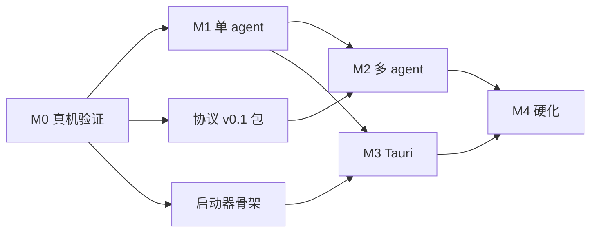

# 开发计划：easyCode 深度集成 + 多 Agent 协作 + 桌面端

- 版本：1.0（基于 `docs/architecture/adr-001-easycode-desktop.md` 与四份调研 + 红队评审）
- 日期：2026-11-12
- 原则：一次成型、不做占位实现、每个里程碑有可验收 demo 与 kill criteria。

---

## 0. 交付定义（Definition of Done）

一个里程碑完成，必须同时满足：

1. 代码合并到 `main`，`pnpm build` 通过；
2. 该里程碑的验收场景有自动化测试（单测/集成/e2e 至少两类）；
3. 有可复现的运行命令与结果记录（`docs/poc/` 或测试报告）；
4. 不新增硬编码提示词常量（ADR-06 判据）；
5. 无 `any`、无 `as` 强转（测试除外），符合 `pong-studio/AGENTS.md`；
6. 桌面相关改动在 Windows 真机验证过（非 WSL）。

---

## 1. 里程碑总览

| 里程碑 | 目标 | 关键交付 | 估算（人日） | 退出标准（kill criteria） |
|---|---|---|---|---|
| M0 | 证明 easyCode 在 Windows 本地能承担真实编码任务 | PoC harness、`@pong/easycode-runtime` 骨架、锁文件、A/B 基线、C-first 启动器 | 5–8 | 任一验收失败 → 停止，重评通道（daemon/ws）或退回 C 方案 |
| M1 | 单 agent 产品化：现有 Agents 页面可切 `runtime=easycode` | system-agent runtime、审批桥、事件/产物投影、license 清理 | 15–20 | 审批/中断/恢复任一不可用 → 回滚 feature flag |
| M2 | 多 Agent 协作（6 种语义消息） | 编排层、黑板、verifier、回放、A/B 报告 | 12–18 | token 或成功率无改善 → 只保留 conclusion 双消息，砍编排 |
| M3 | 桌面端交付 | Tauri 2 薄壳、Rust 监督器、安装包、首启引导 | 10–15 | 安装包不可安装/僵尸进程/首启 >120s → 退回启动器交付 |
| M4 | 硬化与答辩 | Windows 专项、崩溃矩阵、性能、演示脚本、文档 | 8–12 | 崩溃恢复矩阵有 P0 失败 → 修复后才能交付 |

总计：50–73 人日（单人约 10–15 周；两人并行约 6–8 周）。

---

## 2. M0：真机验证（最高优先级，5–8 人日）

> 目的：在写产品代码前，用真实 easyCode 二进制把"能不能用"变成事实。M0 不通过，M1 不允许开始。

### 2.1 工作分解

| ID | 任务 | 产出 | 依赖 | 人日 |
|---|---|---|---|---|
| M0-1 | 全链路 PoC harness（Node 脚本）：spawn app-server → initialize → thread/start → turn/start → 收集通知 → 应答审批 → dynamic tool 回调 → interrupt → resume → 30 分钟长会话 | `scripts/poc/easycode-poc.mjs` + `docs/poc/m0-results.md` | - | 2 |
| M0-2 | 版本锁与 schema 基线：`runtime.lock.json`（easyCode 版本、exe sha256）、`generate-ts` 白名单、schema diff 脚本 | `packages/@pong/easycode-runtime/runtime.lock.json`、`scripts/schema-diff.mjs` | - | 1 |
| M0-3 | `@pong/easycode-runtime` 骨架：协议类型（白名单）、stdio transport、请求-响应关联、通知队列（读循环不阻塞）、进程 supervisor 接口 | `packages/@pong/easycode-runtime/src/{transport,protocol,supervisor,approval}.ts` + 单测 | M0-2 | 2 |
| M0-4 | 故障注入：读循环暂停 30s 后审批仍可回、审批 120s 超时降级、interrupt 竞态、resume 半 patch | `scripts/poc/fault-injection.mjs` + 结果 | M0-1,M0-3 | 1 |
| M0-5 | A/B 基线：单 agent vs "自由文本 handoff" 的 token/时延/成功率 | `docs/poc/m0-ab-baseline.md` | M0-1 | 1 |
| M0-6 | C-first 启动器骨架：Rust 监督器（spawn/健康检查/Job Object/shutdown 顺序）+ `start-pong` 集成 | `packages/desktop-shell/supervisor/` + `scripts/start-desktop.mjs` | - | 1 |
| M0-7 | release 二进制门禁：确认 easyCode fork CI 是否能产出 release；不能则记录显式决策（dev-small 或 C） | `docs/poc/m0-binary-decision.md` | - | 0.5 |

### 2.2 M0 验收标准（全部通过才进 M1）

1. 真实 turn 在 Windows 原生跑通，包含一次命令审批 + 一次文件修改；
2. 审批应答往返 < 2s，超时降级为 `decline` 有审计；
3. 读循环被阻塞 30s 时，服务端不丢审批（stdio 阻塞可恢复），恢复后审批仍送达；
4. `turn/interrupt` 与 `turnAborted` 竞态不误判；`invalid_request` 被当作已结束；
5. `thread/resume` 能从一个中断 turn 恢复，且 workspace 有半改检测；
6. 30 分钟连续会话无内存/进程泄漏、无 SQLite 锁失败；
7. 4 个 agent 并发时 `EASYCODE_HOME` 共享可用（WAL/busy retry）；
8. release 二进制决策已记录（release 或 dev-small，二选一，不许含糊）；
9. runtime.lock 校验通过，schema diff 脚本可运行。

---

## 3. M1：单 agent 产品化（15–20 人日）

### 3.1 后端

| ID | 任务 | 文件/接口 | 依赖 | 人日 |
|---|---|---|---|---|
| M1-1 | `RuntimeAgent` 适配：`prepare()` = `thread/start`/`resume`；`streamTurn()` = 通知 → `StreamChunk`；`close()` | `packages/cli/src/modules/agents/system-agents/easycode/easycode-runtime-agent.ts`（新） | M0-3 | 3 |
| M1-2 | provider 注册：实现 `SystemAgentProvider`，`SystemAgentRegistry.register`；`agent_thread.runtime_kind` 迁移 | `.../system-agents/easycode/easycode-agent.provider.ts`（新）、`runtime_kind` 迁移 | M1-1 | 2 |
| M1-3 | 审批桥：`item/*/requestApproval` → pending → `AgentToolApprovalService`/`agent_thread_grants`；120s 超时；同连接应答；`invalid_request` 竞态处理 | `.../system-agents/easycode/approval-bridge.ts`（新） | M1-1 | 3 |
| M1-4 | dynamic tools：pong 工具（workflow/DB/HTTP/文件）注册为 easyCode `dynamicTools`；`item/tool/call` 执行；副作用走 pong 审批；toolset_hash 校验 | `.../system-agents/easycode/dynamic-tools.ts`（新）+ `@pong/agents` 工具注册 | M1-1 | 3 |
| M1-5 | 事件投影：item/* → `InstanceAiEvent` → SSE；用量、reasoning、plan 映射；去重键 `(threadId,turnId,itemId)` | `.../system-agents/easycode/event-projection.ts`（新） | M1-1 | 2 |
| M1-6 | 产物投影：`fileChange`/diff → `agent_files`/`binary_data`；manifest（sha256、parents） | `.../system-agents/easycode/artifact-bridge.ts`（新） | M1-1 | 2 |
| M1-7 | 生命周期：进程池（同 thread 树复用）、健康检查、崩溃重启、关窗顺序、WorkingSet 回收 | `packages/@pong/easycode-runtime/src/supervisor.ts` | M0-6 | 2 |
| M1-8 | license 清理（ADR-09）：删 `packages/cli/src/license/`、metrics、错误类；82 处 `feat:` gate 改造；删 `buildLicenseHints` | 见 ADR-09 | - | 2 |
| M1-9 | 测试：协议契约 8 项、审批桥、投影、故障注入（复用 M0 脚本） | `packages/@pong/easycode-runtime/**/__tests__`、`packages/cli/src/modules/agents/system-agents/__tests__` | M1-1..8 | 3 |

### 3.2 前端（最小改动，不新建 feature）

| ID | 任务 | 文件 | 人日 |
|---|---|---|---|
| M1-10 | 会话页 runtime 徽标 + "本地内核"标识 | `features/agents/...`（复用现有面板） | 1 |
| M1-11 | 审批收件箱：复用现有审批卡，增加超时倒计时与"未知结果"态 | `features/agents/.../approval` | 1 |
| M1-12 | 产物面板：diff/文件列表引用 rollout 坐标 | `features/agents/...` | 1 |

### 3.3 M1 验收

- 在 `/agents/system` 新建会话，`runtime=easycode` 可选中；
- 一句话任务能完成"读仓库 → 改文件 → 跑测试"，全程审批可见；
- 刷新页面会话恢复；杀死 pong server 后重启，未完成 turn 标记作废不重放；
- 审批 120s 超时自动拒绝并记录；
- license 删除后首启仍正常（与 M0 的离线首启一致）。

---

## 4. M2：多 Agent 协作（12–18 人日）

| ID | 任务 | 文件 | 人日 |
|---|---|---|---|
| M2-1 | 协议 v0.1 包：6 kind + envelope + artifact URI + ULID + 幂等键 + JSON Schema/Zod 双端校验 | `packages/@pong/agent-protocol/`（新） | 3 |
| M2-2 | 编排层：`agent_task`/`agent_message`/`agent_artifact_manifest`/`agent_conclusion` 实体 + 黑板 append-only（`log_seq` 单调） | `packages/cli/src/modules/agents/orchestrator/`（新） | 4 |
| M2-3 | 角色运行时：planner/coder/reviewer/arbiter 作为 system agent 实例；producer 不得自验 | 同上 + `system-agents/easycode` 复用 | 3 |
| M2-4 | 验证器：可执行验收命令优先；不可执行才用 reviewer 结论；仲裁写 `basis[]` | `orchestrator/verifier/` | 2 |
| M2-5 | 回放：按黑板 `log_seq` 重放任务；产物内容寻址可校验 | `orchestrator/replay/` | 2 |
| M2-6 | A/B：单 agent vs 多 agent（token、时延、成功率、返工率），结果写报告 | `docs/poc/m2-ab-report.md` | 2 |
| M2-7 | UI：任务视图（黑板时间线）、质疑/裁决呈现 | `features/agents/...`（复用） | 2 |

### M2 验收

- 一个真实任务（如"给工作流加错误处理并补测试"）由 planner→coder→reviewer 完成；
- 评审能触发 `conclusion_challenged` 并产生修订，仲裁有 `basis`；
- 回放可重现最终产物哈希；
- A/B 报告显示：多 agent 成功率不低于单 agent，且 handoff token 显著下降（目标 ≥50%，以实测为准）。

---

## 5. M3：桌面端交付（10–15 人日）

| ID | 任务 | 文件 | 人日 |
|---|---|---|---|
| M3-1 | Tauri 2 薄壳：窗口、托盘、单实例、深链、更新检查 | `packages/desktop-shell/src-tauri/` | 3 |
| M3-2 | Rust 监督器（复用 M0-6）：spawn pong node sidecar + easycode 池；Job Object；shutdown 顺序；端口 probe-then-handoff | `packages/desktop-shell/supervisor/` | 3 |
| M3-3 | 打包：NSIS 安装器；node.exe + cli dist + editor dist + easycode.exe；`runtime.lock.json` 校验 | `packages/desktop-shell/scripts/build-installer.mjs` | 3 |
| M3-4 | 首启引导：数据目录、模型 provider 配置、demo 自动登录（loopback bootstrap token）、无注册/邀请 | `packages/desktop-shell/src/onboarding/` | 2 |
| M3-5 | 桌面测试：安装/卸载、杀进程、崩溃重启、托盘退出、断网启动、首启时延 | `packages/desktop-shell/tests/` | 3 |

### M3 验收

- 干净 Windows 机器：安装 → 首启 ≤120s → 直接进工作台；
- 关窗后无残留 node/easycode 进程（任务管理器验证）；
- 断网（除模型 API）可启动并使用本地功能；
- 崩溃注入（kill pong）后壳能重启并恢复 UI。

---

## 6. M4：硬化与交付（8–12 人日）

- Windows 长路径、杀软误报、端口占用、WebView2 缺失矩阵；
- 并发 4 agent 压测（内存、SQLite、CPU）；
- 事件日志增长与清理策略（rollout/thread_history 保留）；
- 崩溃恢复矩阵：半 patch、半命令、审批中、迁移中；
- 毕业答辩演示脚本（`docs/demo/graduation-demo.md`）：一条命令起桌面端、演示多 agent 任务、展示审批与产物；
- 文档收尾：README、架构图、故障排查。

---

## 7. 依赖与并行

- 可并行：M0-2/M0-3（协议层）与 M0-6（启动器）互不依赖；M2-1（协议包）可与 M1 并行。
- 必须串行：M0 全部验收 → M1；M1 审批桥 → M1 dynamic tools；M2 编排 → M2 A/B。

---

## 8. 测试策略

| 层 | 范围 | 工具 |
|---|---|---|
| 单元 | 协议编解码、事件映射、审批状态机、产物 manifest | Vitest |
| 契约 | 8 项 app-server 契约（initialize/thread/turn/approval/dynamic tool/interrupt/abort/resume） | Vitest + 真实 easycode.exe（CI 标记） |
| 集成 | system-agent 执行链路（fake easyCode server） | Vitest + fake app-server |
| 故障注入 | 读循环阻塞、审批超时、interrupt 竞态、半 patch resume | Node 脚本 + 真实进程 |
| 桌面 e2e | 安装、首启、关窗清理、崩溃重启 | Playwright/WinAppDriver（M3） |
| Windows 专项 | 长路径、端口占用、杀软、Job Object | 手工矩阵 + 脚本 |

---

## 9. 回退点与 kill criteria

| 检查点 | 条件 | 动作 |
|---|---|---|
| M0 出口 | 全链路/审批/竞态任一失败 | 停止产品化；评估 daemon/ws 通道；仍失败则退回 C 方案（浏览器 + easyCode exec 批处理） |
| M1 审批 | 审批不能稳定送达/应答 | 关闭 feature flag，把 easycode runtime 从 registry 摘除 |
| M1 事件 | 投影丢失或重复率 >0.1% | 回滚到官方 agents runtime |
| M2 骨架 | A/B 无收益 | 只保留 conclusion 双消息与 artifact 规范，砍编排 |
| M3 安装 | 僵尸进程/安装失败/首启 >120s | 发布启动器版（C 方案）作为交付形态 |
| M4 | 崩溃恢复 P0 失败 | 修复后交付，不允许带病答辩 |

---

## 10. 首个 Sprint（S1 = M0，5–8 人日）

执行顺序与任务板（可直接建 team task）：

1. **S1-1** easyCode 全链路 PoC（M0-1）— 负责人：runtime 工程师
2. **S1-2** runtime.lock + schema 基线（M0-2）— 负责人：runtime 工程师
3. **S1-3** `@pong/easycode-runtime` 骨架（M0-3）— 负责人：runtime 工程师
4. **S1-4** 故障注入脚本（M0-4）— 负责人：测试/质量
5. **S1-5** A/B 基线（M0-5）— 负责人：架构/评估
6. **S1-6** C-first 启动器骨架（M0-6）— 负责人：桌面工程师
7. **S1-7** release 二进制决策（M0-7）— 负责人：Lead
8. **S1-8** 周中评审：红队复核 PoC 结果（必须有人在周五前提出反对）

Sprint 出口：M0 九条验收全绿，并形成 `docs/poc/m0-results.md` 与 go/no-go 决策。
