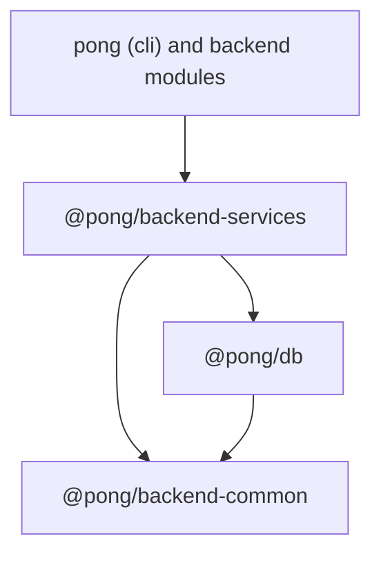

# @pong/backend-services

Backend services and HTTP error classes that many backend modules share.

## Why this package exists

Backend modules live in `packages/cli/src/modules/<name>` today. Most of them
import a small set of services from the rest of `cli`. A module cannot move
into its own workspace package while those imports point at `@/...` paths in
`cli`.

This package is the home for that shared set. It sits above `@pong/db` and
below `pong` (`cli`) in the dependency graph:



`@pong/backend-common` holds the foundation that `@pong/db` also needs (logger,
license state, module registry, locks). `@pong/backend-services` holds business
and infrastructure services that need the persistence layer or that only
`cli` and the modules consume.

## What lives here

- `EventService`: the shared, typed event bus.
- `UrlService`: instance and webhook URLs.
- `CacheService`: application cache access.
- `RedisClientService`: shared Redis connections and support code.
- `Publisher` and `Subscriber`: the scaling-mode pubsub channels. The command
  payload types (`PubSubCommandMap`) live in `@pong/decorators`, next to
  `@OnPubSubEvent`.
- `ProjectScopeService`: project-level scope checks. A module calls
  `hasScopes(user, projectId, scopes)`, not `userHasScopes` from `cli`.
  `userHasScopes` stays in `cli` for the route decorators and for checks on
  shared credentials and workflows.

The next PRs move `ProtectedResourceRegistry`, `RoleService` and the finder
services here, one area at a time.

### Register event payloads

`EventMap` is an open interface. Each event owner augments it with its payload
types. This keeps domain dependencies out of the shared event bus.

```typescript
import type {} from '@pong/backend-services';

declare module '@pong/backend-services' {
	interface EventMap {
		'example-completed': { id: string };
	}
}
```

Include the augmentation file in the owner's TypeScript project. If another
package uses these events, include the augmentation in the owner's exported
types. The CLI registers its existing maps in `src/events/event-map.ts`.
Augmentation needs no runtime registration. All consumers import `EventService`
from `@pong/backend-services` and use the same DI token.

## Compatibility with cli

The package config mirrors `packages/cli`, so a file moved from `cli` compiles,
lints and tests here without edits:

| Concern | Setup | Mirrors |
| --- | --- | --- |
| TypeScript | `common.go` + `backend.go`, `lib` es2023, `strictFunctionTypes`, `strictPropertyInitialization` and `useUnknownInCatchVariables` off | `packages/cli/tsconfig.json` |
| Lint | `oxlint --type-aware`. `eslint.config.mjs` is the policy twin that code-health reads | `packages/cli/oxlint.config.mts`, `eslint.config.mjs` |
| Tests | Vitest with the decorators config, one fork per file, the same `PONG_USER_FOLDER` and `PONG_ENCRYPTION_KEY` setup | `packages/cli/vitest.config.base.ts`, `test/setup-test-folder.ts` |

Two things do not carry over on purpose:

- There is no `@/` path alias. `cli` tests load this package from `dist/`
  and other consumers inline it from `src/`. `tsc` does not rewrite an alias
  in `dist/`, so it resolves in neither. Use relative imports inside the
  package.
- `cli` turns a set of rules down to `warn` for its whole tree. This package
  keeps the shared backend layer as is. Fix such findings when you move a file.

## Rules for adding code

- The code must not import from `pong` (`cli`). If it needs a `cli` seam,
  define a narrow DI port here and bind it in `cli` at bootstrap.
- At least two backend modules must use the code. A service that one module
  uses belongs to that module.
- Keep the file layout of `cli` (`errors/`, `services/`). A move with `git mv`
  keeps the history readable.
- Add shared exports to `src/index.ts`. Use `@pong/backend-services/auth` for
  auth registries and provider proxies. This entry point does not load the
  cache, Redis, or database-backed services. Keep internal file paths private.
- Keep `oxlint.config.mts` and `eslint.config.mjs` in step. A ratchet
  allowlist for a moved TypeORM leak goes into both.
