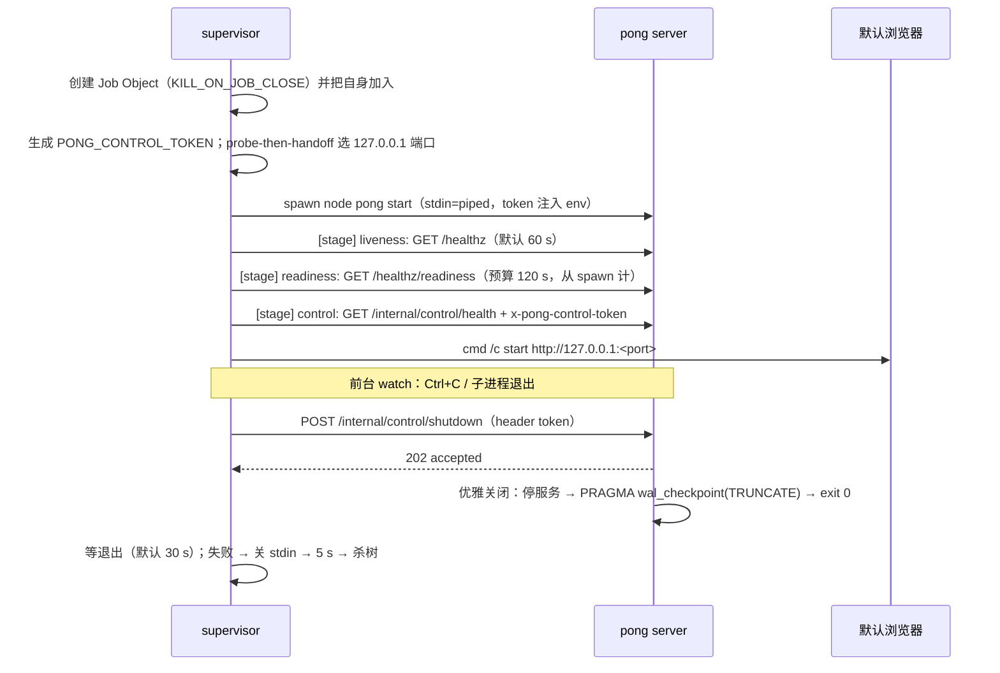

# desktop-shell — M0 C-first 桌面启动器与进程监督器

状态：**M0-6 + task-12**（readiness 门控 + 控制端点关闭）。未接入 Tauri，未修改 pong 业务代码。
目标：先用"浏览器 + 本地 pong + 小启动器"交付，验证进程生命周期；M3 的 Tauri 薄壳
**复用本目录的 Rust 模块**（Job Object、端口、健康检查、控制端点关闭、shutdown 顺序），不做第二套实现。

```
packages/desktop-shell/
├─ supervisor/                 # 独立 Rust crate（零外部依赖，可离线 cargo build）
│  ├─ Cargo.toml
│  └─ src/
│     ├─ main.rs               # 模式分发、阶段化启动、watch 循环、self-test
│     ├─ cli.rs                # 参数解析（--dev/--self-test/--readiness-timeout/...）
│     ├─ port.rs               # probe-then-handoff，绝不硬编码 5678
│     ├─ health.rs             # 最小 HTTP/1.1 客户端 + liveness/readiness 轮询
│     ├─ control.rs            # GET /internal/control/health、POST .../shutdown
│     ├─ token.rs              # 随机 PONG_CONTROL_TOKEN（BCryptGenRandom，无 crate）
│     ├─ job.rs                # Windows Job Object（KILL_ON_JOB_CLOSE）+ Ctrl+C 处理
│     ├─ pong.rs               # 定位 node/pong CLI，spawn `pong start`，注入 token
│     └─ shutdown.rs           # control 202 → 等退出 → stdin 回退 → 杀树
└─ README.md

pong-studio/scripts/start-desktop.mjs   # 开发期 Node 入口（同样契约；无 Job Object，见 L2）
```

## 快速开始

### 1) Rust 监督器（推荐，含 Job Object 保证）

```powershell
cd packages/desktop-shell/supervisor
cargo build --release
.\target\release\pong-desktop-supervisor.exe --dev
```

`--dev` 是默认前台模式：挑端口 → spawn `node <pong> start`（注入随机 `PONG_CONTROL_TOKEN`）→
等 `/healthz` → 等 `/healthz/readiness` → 验证 `/internal/control/health` → 打开浏览器 →
Ctrl+C 经控制端点优雅退出。常用参数：

```powershell
# 冷启动放宽 readiness 预算（默认 120 s，首次启动可达数分钟）
.\target\release\pong-desktop-supervisor.exe --dev --no-browser --readiness-timeout 300

# 指定端口 / Node / pong 入口 / 数据目录
.\target\release\pong-desktop-supervisor.exe --dev --port 5800 --no-browser `
  --node C:\Users\me\.tools\node24\node.exe `
  --pong .\packages\cli\bin\pong `
  --user-folder C:\Users\me\AppData\Local\PongStudio\data

# 集成自测：真实 node24 pong 下验证 202 → exit 0 → WAL=0、无 token 401
.\target\release\pong-desktop-supervisor.exe --self-test --no-browser
```

`--self-test` 只有在**全部断言通过**时才退出 0，输出可直接被 CI 断言：

```
LIVENESS_MS / READINESS_MS / READY_TOTAL_MS / CONTROL_READY
CONTROL_HEALTH_STATUS=ok   CONTROL_HEALTH_PID=<pid>
NO_TOKEN_STATUS=401        # 无 token 必须 401，且不得被当成"已接受关闭"
SHUTDOWN_HTTP=Some(202)    SHUTDOWN_GRACEFUL=true   SHUTDOWN_FORCED=false
SHUTDOWN_EXIT_WAIT_MS=...  EXIT_CODE=Some(0)
WAL_BYTES=0                WAL_PATH=...\.pong\database.sqlite-wal
SELF_TEST=PASS             SELF_TEST_FAILURES=none
```

### 2) Node 开发入口（无需 Rust 工具链）

```powershell
node scripts/start-desktop.mjs                 # 打开浏览器
node scripts/start-desktop.mjs --smoke         # ready → 202 → 断言 exit 0/WAL=0（CI）
node scripts/start-desktop.mjs --no-open --readiness-timeout 300
```

脚本自动选择 Node 24+：`--node` → `PONG_DESKTOP_NODE` →
`<repo>/../.tools/node24/node.exe` → `<repo>/.tools/node24/node.exe` → 当前 `node`（需 ≥24）。

## 启动阶段（阶段日志能看出卡在哪）



**为什么必须等 readiness**：控制端点只在 server 完成就绪后可用。只等 `/healthz` 时会拿到
404 或 `pong is starting up. Please wait`（DB 迁移未完成时中间件的响应），控制调用会被误判。
本机实测：liveness ~4.2–4.5 s，readiness 还要再等 ~3.8–9.9 s（合计 8–14.5 s 才算真正可用）。

## 关闭契约

| 步骤 | 请求/动作 | 期望 | 失败处置 |
|---|---|---|---|
| 1 | `POST /internal/control/shutdown`，header `x-pong-control-token: <token>` | **202** `{"accepted":true}` | 非 202 / 连接失败 → 记为警告，直接进入步骤 3 |
| 2 | 等待进程自行退出（默认 30 s） | exit code **0**，`database.sqlite-wal` 被 truncate 到 **0** | 超时 → 步骤 3 |
| 3 | 关闭子进程 stdin（EOF） | 少数情况下作为后备退出 | 5 s 后 → 步骤 4 |
| 4 | `taskkill /T /F` + `Child::kill` | 进程树消失 | 记 `SHUTDOWN_FORCED=true`；WAL 不保证 |

- pong 的 `exitSuccessFully()` 会先 `PRAGMA wal_checkpoint(TRUNCATE)` 再 `process.exit(0)`，
  所以 **exit code 0 + WAL=0** 是"优雅关闭真的发生"的两个可验证证据。
- 无 token / token 错误 → pong 返回 **401**；token 未注入（端点未启用）→ **404**。
  两者都不能被当作"已接受关闭"（`self-test` 显式断言 401）。
- **只有 202 算接受**：编辑器 SPA catch-all 对未知路径会返回 200 + HTML，状态码 200 不代表任何事。

## 设计要点

| 主题 | 做法 | 理由 |
|---|---|---|
| 端口 | `bind 127.0.0.1:0` 取端口后释放，交给 `PONG_PORT` | 不硬编码 5678；显式 `--port` 被占用时立即失败（退出 1） |
| 端口竞态 | liveness 失败自动换端口重试一次 | probe-then-handoff 的关闭-绑定窗口真实存在 |
| 控制鉴权 | 每次启动随机 32 字节 token（hex），经 env 注入；`PONG_CONTROL_TOKEN` 可覆盖 | pong 端用 `timingSafeEqual` 校验；不进 argv/日志 |
| 就绪判定 | liveness → readiness → control health 三段式，任一失败 fatal 并指出阶段 | 避免把 "starting up" 当 ready |
| 绑定 | 强制 `PONG_LISTEN_ADDRESS=127.0.0.1` | pong 默认监听 `::`（全网卡），桌面场景必须收回 loopback |
| 数据 | 默认 `<repo>/.pong-data`（开发实例） | 打包版改用 `%LOCALAPPDATA%\PongStudio\data` |
| 遥测 | 关闭 diagnostics/version-notifications/templates/personalization/banner | 离线优先基线（与 `start-pong.ps1` 一致） |
| 与 pong 的耦合 | 仅 `/healthz`、`/healthz/readiness`、`/internal/control/*` + 环境变量 | 不改 pong 业务代码 |

## 实测记录（2026-11-13，本机 Windows x64，release）

| 场景 | 结果 |
|---|---|
| `--self-test`（seed 数据目录，OS 缓存已热） | liveness **4526 ms**；readiness 200 于 **14415 ms**（readiness 阶段 9888 ms）；control +58 ms；`CONTROL_HEALTH_STATUS=ok`；`NO_TOKEN_STATUS=401` |
| 同上，关闭 | `POST .../shutdown` → **202**；优雅退出 **249 ms**；exit code **0**；`WAL_BYTES=0`；`SELF_TEST=PASS` |
| `start-desktop.mjs --smoke`（同数据目录） | liveness 4157/4189 ms；readiness 阶段 3804/3913 ms；total **7980/8120 ms**；control 18/19 ms |
| 同上，关闭 | **202**；优雅退出 **114 ms**；exit code **0**；`SMOKE_WAL_BYTES=0`；`SMOKE=PASS` |
| 端口冲突（`--port` 被占用） | 立即失败：`[fatal] port selection failed: ... already in use`，退出码 **1** |
| Job Object 崩溃测试（`taskkill /F /PID <supervisor>`，不带 `/T`） | pong 立即消失，残留 **0**（M0-6 验证；Job 代码未改） |
| 退出后残留 | supervisor/mjs 正常关闭路径均 **0** 残留 |
| 冷启动（首次运行、无文件缓存） | 早前 v0.1 只测 liveness 时 >5 min 未就绪；task-12 未在干净机复测；readiness 默认 120 s 可配更大 |
| release 产物 | `pong-desktop-supervisor.exe` **0.294 MB**（`lto=thin`/`strip`/`panic=abort`，零外部依赖），构建约 2 s |

> 冷启动与本机预热后启动可能差两个数量级。**M1 安装包必须预热/预置类型缓存**，
> 并把 `--readiness-timeout` 暴露给用户（或自动按首次启动放宽）。

### 实现坑（M3 复用前必读）

1. **绝不能给 Job 写 `Drop` 去 `CloseHandle`**：supervisor 自己在 Job 里，关闭最后一个 handle 会触发
   `KILL_ON_JOB_CLOSE`，在 `main` 返回前把进程杀掉——实测到"端口冲突时退出码 0 且丢失 `[fatal]`"。
   正确做法是**一直持有 handle 到进程退出**（本 crate 故意不实现 `Drop`）。
2. **只等 `/healthz` 不够**：控制端点在 readiness 之前不可用（404 或 "starting up"）。三段式等待是硬要求。
3. **只有 202 算关闭被接受**：200 可能来自 SPA catch-all；401/404 必须走回退路径并告警。
4. **`--pong` / `--node` 是候选列表而非强制**：给错路径会回退到默认路径继续启动（需要严格模式再改）。

## 已知限制

| # | 限制 | 影响 | 计划 |
|---|---|---|---|
| L1 | 控制端点要求 readiness 完成后才可用 | 启动早期无法关闭；靠 kill 兜底 | 已用三段式等待规避；M3 保持 |
| L2 | `start-desktop.mjs` 没有 Job Object | 被强杀时 pong 是否残留取决于 console 归属，**不是保证** | 生产/打包只用 supervisor exe |
| L3 | 未签名 exe | SmartScreen/杀软可能拦截 Rust 产物；本次未触发 | M3 打包阶段 Authenticode + 误报报备 |
| L4 | 未接入单实例锁 | 可同时开两个 supervisor（不同端口；同一数据目录会竞争） | M1 加命名 mutex |
| L5 | 未拉起 easyCode | M0 只验证 pong 生命周期；agent 运行时是 M0-7/M1 | 复用 `job.rs` 的继承式 Job 语义 |
| L6 | 未接托盘/窗口/深链 | 浏览器标签页体验；关标签页不等于退出应用 | M3 Tauri 壳 |
| L7 | 依赖系统浏览器/WebView2 | 无 WebView2 时用默认浏览器；M3 才需要 WebView2 | M3 安装器检测 |
| L8 | Rust crate 未接入 pnpm/turbo | `pnpm build` 不编译 supervisor；CI 需单独 `cargo build` | M1 加脚本/CI job |
| L9 | 数据目录默认在仓库内 `.pong-data` | 仅开发期合理 | 打包版改用 `%LOCALAPPDATA%` |
| L10 | Ctrl+C 优雅退出路径无自动化测试 | 与 `--self-test` 共用 `shutdown::run`，逻辑已覆盖，但信号链未端到端测 | M1 加信号注入测试 |
| L11 | WAL=0 断言仅对 sqlite 有效 | 用 postgres 的实例跳过该断言 | 打包版固定 sqlite |
| L12 | pong 启动日志出现重复包警告 | `packages/cli/node_modules/@pong/nodes-langchain` 重复（pnpm 布局），非本骨架引入 | 打包裁剪阶段处理 |

## 排障

| 现象 | 先查 |
|---|---|
| `pong CLI entry not found` | 仓库未构建？`packages/cli/bin/pong` 是否存在；或 `--pong` 指错 |
| `no Node 24+ runtime found` | Node 版本 < 24；设置 `PONG_DESKTOP_NODE` 或 `--node` |
| `[stage] liveness FAILED` | 端口被抢（会自动重试）/ 配置错误 / DB 连接失败；看 pong stderr |
| `[stage] readiness FAILED`（"starting up" 或超时） | DB 迁移/节点加载慢；加大 `--readiness-timeout`；查 `\.pong-data\.pong\pongEventLog.log` |
| `control token rejected (401)` | token 注入被外部 `PONG_CONTROL_TOKEN` 覆盖或 pong 版本不匹配；看 pong 启动日志 |
| `control UNAVAILABLE (404)` | pong 构建未包含控制端点（`dist/controllers/internal-control.controller.js` 是否存在） |
| 退出后仍看到 node | 是否 `--no-job`；`taskkill /PID <pong> /T /F` 清理后重试 |
| 关闭很慢/`forced=true` | pong 内部 graceful shutdown 卡住（默认 30 s 自身强退）；查 pong 日志里 "Shutting down..." |
