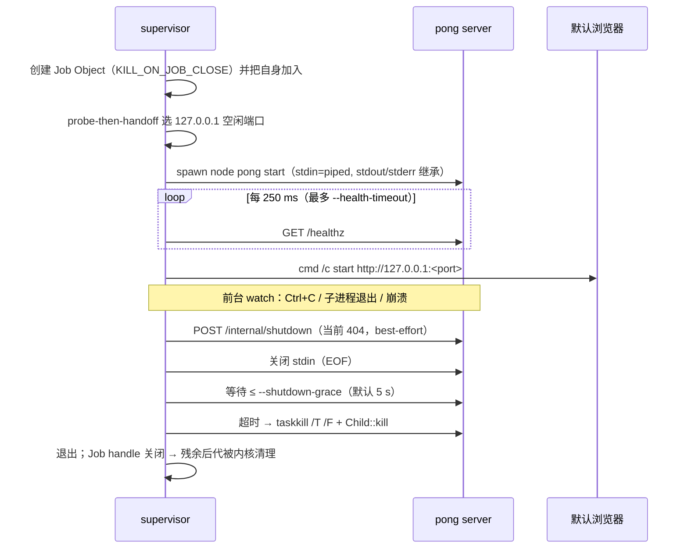

# desktop-shell — M0 C-first 桌面启动器与进程监督器（骨架）

状态：**M0-6 骨架**，未接入 Tauri，未修改 pong 业务代码。
目标：先用"浏览器 + 本地 pong + 小启动器"交付，验证进程生命周期；M3 的 Tauri 薄壳
**复用本目录的 Rust 模块**（Job Object、端口、健康检查、shutdown 顺序），不做第二套实现。

```
packages/desktop-shell/
├─ supervisor/                 # 独立 Rust crate（零外部依赖，可离线 cargo build）
│  ├─ Cargo.toml
│  └─ src/
│     ├─ main.rs               # 模式分发、watch 循环、self-test
│     ├─ cli.rs                # 参数解析（--dev / --self-test / --port / --node ...）
│     ├─ port.rs               # probe-then-handoff，绝不硬编码 5678
│     ├─ health.rs             # 最小 HTTP/1.1 客户端 + /healthz 轮询
│     ├─ job.rs                # Windows Job Object（KILL_ON_JOB_CLOSE）+ Ctrl+C 处理
│     ├─ pong.rs               # 定位 node/pong CLI，spawn `pong start`
│     └─ shutdown.rs           # 控制端点 → 关 stdin → 等 → 杀树
└─ README.md

pong-studio/scripts/start-desktop.mjs   # 开发期 Node 入口（无 Job Object，见限制 L2）
```

## 快速开始

### 1) Rust 监督器（推荐，含 Job Object 保证）

```powershell
cd packages/desktop-shell/supervisor
cargo build --release
.\target\release\pong-desktop-supervisor.exe --dev
```

`--dev` 是默认前台模式：挑端口 → spawn `node <pong> start` → 等 `/healthz` → 打开浏览器 →
Ctrl+C 走优雅退出。常用参数：

```powershell
# 指定端口 + 不打开浏览器 + 指定 Node 24 / pong 入口 / 数据目录
.\target\release\pong-desktop-supervisor.exe --dev --port 5800 --no-browser `
  --node C:\Users\me\.tools\node24\node.exe `
  --pong .\packages\cli\bin\pong `
  --user-folder C:\Users\me\AppData\Local\PongStudio\data

# 自动冒烟：spawn → /healthz → shutdown → 打印机器可读报告 → 退出
.\target\release\pong-desktop-supervisor.exe --self-test --no-browser
```

self-test 会输出 `READY_MS=`、`PORT=`、`PONG_PID=`、`SHUTDOWN_GRACEFUL=`、`EXIT_CODE=` 等行，
可直接被 CI 断言。

### 2) Node 开发入口（无需 Rust 工具链）

```powershell
node scripts/start-desktop.mjs                 # 打开浏览器
node scripts/start-desktop.mjs --smoke         # ready → shutdown → 退出（CI）
node scripts/start-desktop.mjs --port 5800 --print-token
```

脚本自动选择 Node 24+：`--node` → `PONG_DESKTOP_NODE` →
`<repo>/../.tools/node24/node.exe` → `<repo>/.tools/node24/node.exe` → 当前 `node`（需 ≥24）。
`--print-token` 打印的一次性 bootstrap token 预留给 M3 的自动登录端点（M0 不消费）。

## 生命周期与顺序



**为什么 Job Object 不是普通退出路径**：先关 Job 会立即 `TerminateProcess` pong，SQLite WAL
来不及 checkpoint。正常退出必须走"控制端点 → stdin EOF → 等待 → 杀树"；Job 只在 supervisor
崩溃/被强杀时兜底（已实测，见"实测记录"）。

**为什么 Ctrl+C 需要 handler**：Windows 控制台里 Ctrl+C 会同时投递给 pong；监督器捕获后
按上面的顺序收尾，而不是直接 `ExitProcess`。

## 设计要点

| 主题 | 做法 | 理由 |
|---|---|---|
| 端口 | `bind 127.0.0.1:0` 取端口后立即释放，交给 `PONG_PORT` | 不硬编码 5678；显式 `--port` 占用时直接报错而不是静默换端口 |
| 端口竞态 | 启动失败（子进程退出/健康超时）自动换端口重试一次 | probe-then-handoff 的关闭-绑定窗口是真实存在的 |
| 健康检查 | 只依赖 `GET /healthz`；子进程退出立即失败 | 无业务 IPC；配置错误秒级报错而不是等 180 s |
| 绑定 | 强制 `PONG_LISTEN_ADDRESS=127.0.0.1` | pong 默认监听 `::`（全网卡），桌面场景必须收回 loopback |
| 数据 | 默认 `<repo>/.pong-data`（开发实例） | M3 打包改为 `%LOCALAPPDATA%\PongStudio\data`；不污染用户正式数据 |
| 遥测 | 关闭 diagnostics/version-notifications/templates/personalization/banner | 离线优先基线（与 `start-pong.ps1` 一致） |
| 与 pong 的耦合 | 仅 `/healthz` + 环境变量；不改 pong 代码 | ADR-03：集成走 pong 现有边界 |

## 崩溃/孤儿清理验证（手工）

```powershell
# 1) 前台启动，记下输出的 pid
.\target\release\pong-desktop-supervisor.exe --dev --no-browser

# 2) 另开终端强杀 supervisor（模拟任务管理器结束进程）
taskkill /F /PID <supervisor_pid>

# 3) 预期：pong 立即消失（Job Object KILL_ON_JOB_CLOSE）
Get-CimInstance Win32_Process -Filter "name='node.exe'" |
  Where-Object { $_.CommandLine -like '*pong*' } |
  Select-Object ProcessId, CommandLine
```

若第 3 步仍有 pong，检查 `--no-job` 是否被误加、事件日志里是否有 Job 创建失败的 WARN。

## 实测记录（2026-11-13，本机 Windows x64）

| 场景 | 结果 |
|---|---|
| supervisor `--self-test`（release，预热 OS 文件缓存，seed 数据目录） | `/healthz` 200 in **4024 ms**；退出强制杀树 5295 ms；进程退出码 0 |
| supervisor `--self-test`（debug，同条件） | 4044 / 4562 ms |
| `start-desktop.mjs --smoke`（默认数据目录，首次创建） | **3864 ms**；随机端口 56422 |
| 再次 `--smoke` | 3652 ms |
| Job Object 崩溃测试（`taskkill /F /PID <supervisor>`，不带 `/T`） | pong 立即消失，`node.exe` 残留 **0**（修复 Job handle 生命周期后复测） |
| 端口冲突（`--port` 被占用） | 立即失败：`[fatal] port selection failed: ... already in use`，退出码 1 |
| 冷启动（首次运行、无文件缓存） | 观察到 >5 min 未就绪，未测到完成；怀疑 pnpm/langchain 模块图冷读 + 杀软扫描，需在干净机器复测 |
| 退出后残留 | supervisor 路径：0 残留；`start-desktop.mjs` 路径：本次随 console 关闭一并退出，但无保证（见 L2） |

> 冷启动与本机预热后启动差 **两个数量级**。M1 必须在安装包里预热/预置类型缓存，否则首次启动不可接受。
> release 产物 `pong-desktop-supervisor.exe` = **0.27 MB**（`lto=thin`/`strip`/`panic=abort`，零外部依赖），`cargo build --release` 约 2 s。

### 实现坑（M3 复用前必读）

1. **绝不能给 Job 写 `Drop` 去 `CloseHandle`**：supervisor 自己在 Job 里，关闭最后一个 handle 会触发
   `KILL_ON_JOB_CLOSE`，在 `main` 返回前把进程杀掉——已实测到"端口冲突时退出码 0 且丢失 `[fatal]` 输出"。
   正确做法是**一直持有 handle 到进程退出**（本 crate 故意不实现 `Drop`，靠 OS 在退出时关闭句柄）。
2. **不能信任 `/internal/shutdown` 的 200**：pong 的 SPA catch-all 对未知 POST 返回 200 + `index.html`；
   实测 `POST /internal/shutdown` 返回 404（Rust supervisor）或 200（mjs 路径），都**不代表已被接受**。
   M3 端必须以 JSON body/响应头证明接受。
3. **`--pong` / `--node` 是候选列表而非强制**：给错路径时会回退到默认路径继续启动。需要严格模式时再看
   `pong.rs` 的 `first_existing` 逻辑。

## 已知限制

| # | 限制 | 影响 | 计划 |
|---|---|---|---|
| L1 | pong 没有 `/internal/shutdown` 端点，且 **SPA catch-all 对未知 POST 返回 200 + index.html** | 退出走"关 stdin → 等 5 s → 杀树"，无 WAL checkpoint 保证；控制端点不能用状态码判定（必须校验响应体/自定义响应头），否则会把"页面 200"当成"已接受关闭" | M3 前由 pong 侧新增 loopback 控制端点（返回 `{"ok":true}` + 一次性 token） |
| L2 | `start-desktop.mjs` 没有 Job Object | 被强杀时 pong 是否残留取决于 console 归属（本次实测随 console 关闭退出），**不是保证**；开发期可接受 | 生产/打包只用 supervisor exe |
| L3 | 未签名 exe | SmartScreen/杀软可能拦截 Rust 产物（"未知发布者"）；本次未触发 | M3 打包阶段 Authenticode + 微软误报报备 |
| L4 | 未接入单实例锁 | 可同时开两个 supervisor（不同端口，互不冲突；同一数据目录会竞争） | M1 加命名 mutex |
| L5 | 未拉起 easyCode | M0 只验证 pong 生命周期；agent 运行时是 M0-7/M1 | 复用 `job.rs` 的继承式 Job 语义 |
| L6 | 未接托盘/窗口/深链 | 浏览器标签页体验；关标签页不等于退出应用 | M3 Tauri 壳 |
| L7 | 依赖系统已安装 WebView2/浏览器 | 无 WebView2 时用默认浏览器；M3 才需要 WebView2 | M3 安装器检测 |
| L8 | Rust crate 未接入 pnpm/turbo | `pnpm build` 不会编译 supervisor；CI 需单独 `cargo build` | M1 加脚本/CI job（不引入 pnpm 对 Rust 的依赖） |
| L9 | 数据目录默认在仓库内 `.pong-data` | 仅开发期合理 | 打包版改用 `%LOCALAPPDATA%` |
| L10 | pong 启动日志里出现重复包警告 | `packages/cli/node_modules/@pong/nodes-langchain` 与根目录重复（pnpm 布局），非本骨架引入 | 打包裁剪阶段处理 |

## 排障

| 现象 | 先查 |
|---|---|
| `pong CLI entry not found` | 仓库未构建？`packages/cli/bin/pong` 是否存在；或 `--pong` 指错 |
| `no Node 24+ runtime found` | Node 版本 < 24；设置 `PONG_DESKTOP_NODE` 或 `--node` |
| `pong exited during startup` | 端口被抢（会自动重试）/ 配置错误 / DB 迁移失败；看 pong stderr |
| `/healthz` 超时但进程存活 | pong 卡在迁移或外联超时；查 `\.pong-data\.pong\pongEventLog.log` |
| 退出后仍看到 node | 是否 `--no-job`；`taskkill /PID <pong> /T /F` 清理后重试 |
